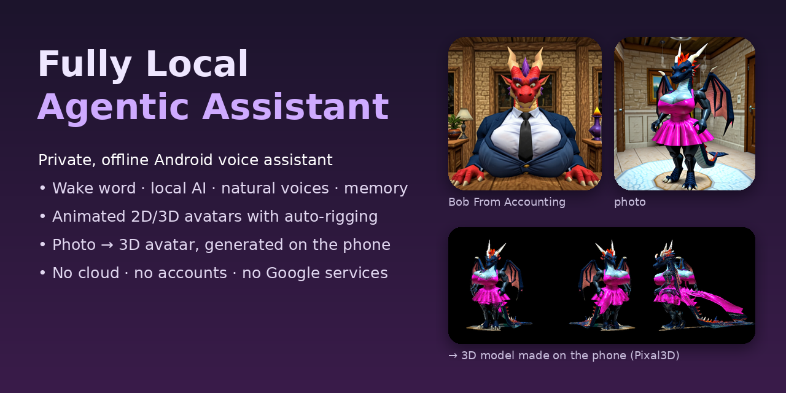
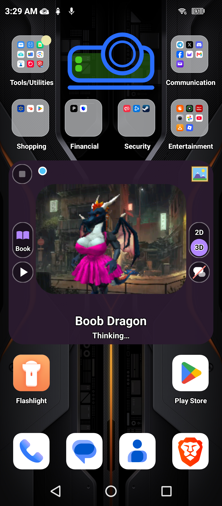
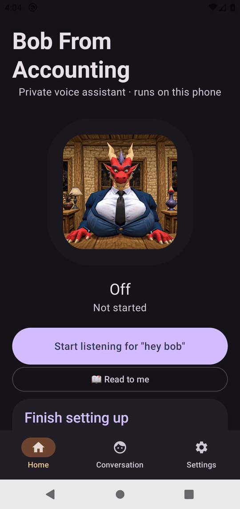
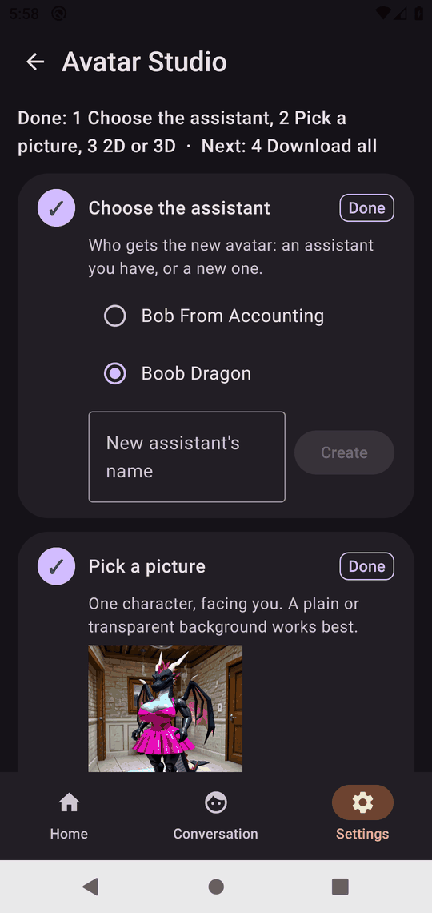
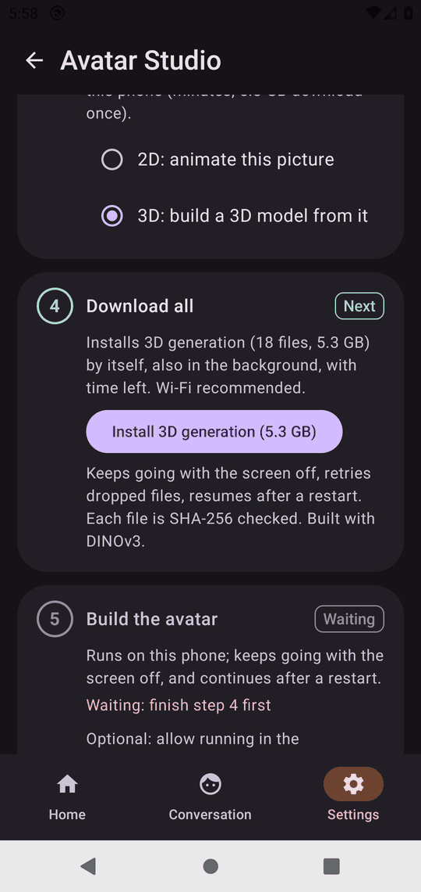
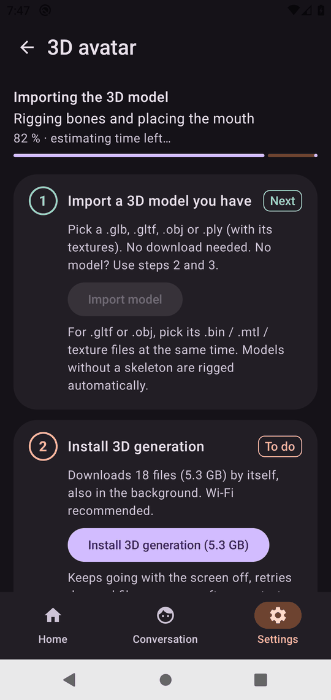
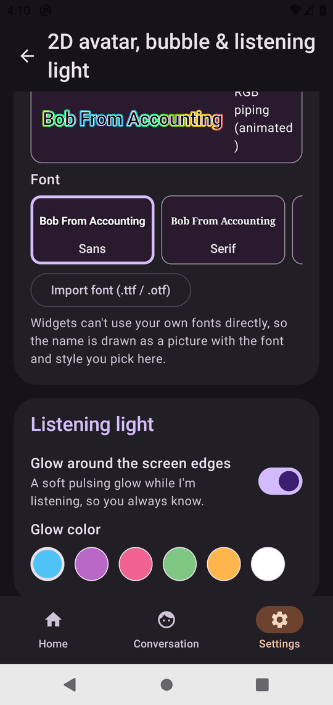
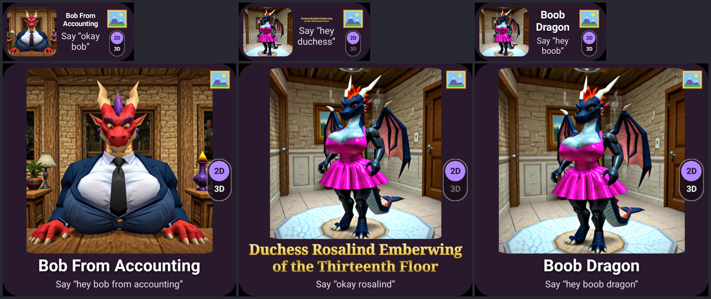
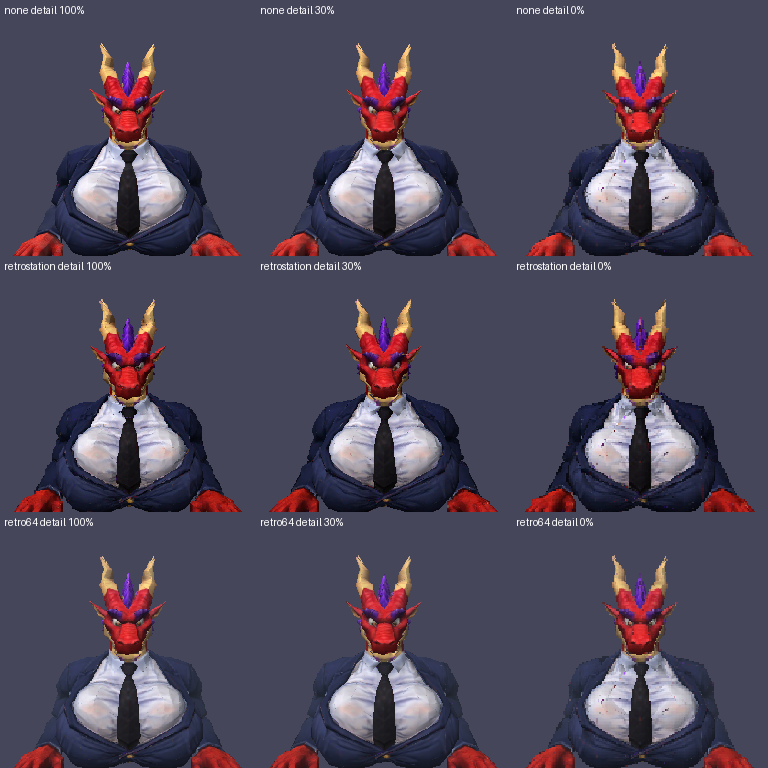
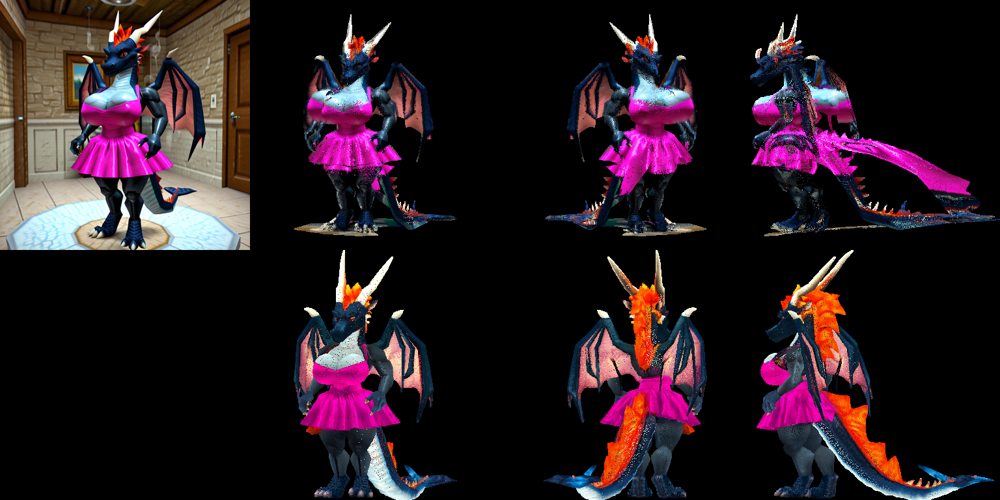

<p align="center"></p>

<p align="right"><a href="https://milkymoomoo.github.io/Fully-Local-Agentic-Assistant/"></a><br><sub><a href="https://milkymoomoo.github.io/Fully-Local-Agentic-Assistant/">Docs with dark mode</a></sub></p>

# Fully Local Agentic Assistant

**A private, offline Android voice assistant with no Google services.** Wake word, local AI chat, natural voices,
long-term memory, editable personalities, an animated 2D/3D avatar widget with auto-rigging for any model (furry and
anthro included), a "Read to me" audiobook mode for EPUB/PDF, and **photo → 3D avatar generation on the phone**.

Everything runs on your phone. No account, no cloud, no API keys, no analytics, no Google Play Services.

> [!WARNING]
> **In development:** on-device, from-scratch image-to-3D-mesh generation (Pixal3D on the phone) is still in
> development and **may not work**. Built-in and downloadable 3D models (via *Settings* / *Avatar Studio* install) work.
> Current release: **0.1.5** (pre-release, Android arm64). See [Verification status](docs/status.md).

<p align="center">
  <a href="https://github.com/Milkymoomoo/Fully-Local-Agentic-Assistant/releases/download/v0.1.5/MilkyMoosAssistant-0.1.5-3b2686c-arm64-v8a.apk">
    <picture>
      <source media="(prefers-color-scheme: dark)" srcset="docs/images/buttons/download-apk-dark.png">
      
    </picture>
  </a>
  <br>
  <sub>Other phones and emulators: <a href="https://github.com/Milkymoomoo/Fully-Local-Agentic-Assistant/releases/download/v0.1.5/MilkyMoosAssistant-0.1.5-3b2686c-universal.apk">universal</a> (all ABIs, bigger) ·
  <a href="https://github.com/Milkymoomoo/Fully-Local-Agentic-Assistant/releases/download/v0.1.5/MilkyMoosAssistant-0.1.5-3b2686c-x86_64.apk">x86_64</a> · <a href="https://github.com/Milkymoomoo/Fully-Local-Agentic-Assistant/releases/tag/v0.1.5">all files and release notes</a> ·
  <a href="https://github.com/Milkymoomoo/Fully-Local-Agentic-Assistant">source code</a><br>
  SHA-256 of every file: <code>SHA256SUMS.txt</code> in the release, and on the <a href="https://milkymoomoo.github.io/Fully-Local-Agentic-Assistant/security.html">security page</a> (how to check: <a href="docs/SECURITY.md">docs/SECURITY.md</a>)</sub>
</p>

<p align="center">
  <a href="https://milkymoomoo.github.io/Fully-Local-Agentic-Assistant/security.html">
    <picture>
      <source media="(prefers-color-scheme: dark)" srcset="docs/images/buttons/verify-virustotal-dark.png">
      
    </picture>
  </a>
</p>

<p align="center">
  <a href="https://milkymoomoo.github.io/Fully-Local-Agentic-Assistant/security.html"></a>
  <a href="https://milkymoomoo.github.io/Fully-Local-Agentic-Assistant/security.html"></a>
  <a href="https://milkymoomoo.github.io/Fully-Local-Agentic-Assistant/security.html"></a>
  <a href="https://milkymoomoo.github.io/Fully-Local-Agentic-Assistant/security.html"></a>
  <a href="https://scorecard.dev/viewer/?uri=github.com/Milkymoomoo/Fully-Local-Agentic-Assistant"></a>
  <a href="https://github.com/Milkymoomoo/Fully-Local-Agentic-Assistant/releases"></a>
  <a href="LICENSE"></a>
</p>

## Contents

- [Feature tour](#feature-tour)
- [Getting started](#getting-started)
- [Photo → 3D: your character as a 3D avatar](#photo--3d-your-character-as-a-3d-avatar)
- [Hardware and sizes](#hardware-and-sizes)
- [Privacy](#privacy)
- [FAQ](#faq)
- [Roadmap](#roadmap)
- [Build it yourself](#build)
- [Credits and licences](#credits-and-licences)
- Full documentation: **[docs/](docs/README.md)** · [docs site with dark mode](https://milkymoomoo.github.io/Fully-Local-Agentic-Assistant/) · for coding agents and porters: **[AGENTS.md](AGENTS.md)**

## Feature tour

<p align="center">
  
  
  
  <br><sub>Real device (left): the home-screen widget in 3D · Emulator renders: Home, and Avatar Studio</sub>
</p>

### 👂 Wake words you type

Say *"hey bob"* (or any phrase you type) and it listens; say *"that's all"* and it stops. Several phrases per assistant, no training.

<details><summary>Technical details</summary>

sherpa-onnx keyword spotter (5.8 MB, bundled) on a 16 kHz stream, threshold `0.35 − 0.2·sensitivity`; sleep phrases matched on the transcript. → [Read more](docs/features/wake-word.md)

</details>

### 📝 Local speech recognition

Understands what you say after the wake word, offline, in English.

<details><summary>Technical details</summary>

Silero VAD + Moonshine Tiny (30.5 MB download), decoded in ≤ 8 s pieces; continuous conversation or a timeout. → [Read more](docs/features/speech-recognition.md)

</details>

### 🧠 Local thinking model

Everyday speech, questions and tasks, answered by a small AI model on the phone. Simple commands work even without one.

<details><summary>Technical details</summary>

llama.cpp GGUF models (Qwen 2.5, Llama 3.2, Dolphin; 0.5B–4B) with a JSON tool grammar (23 tools), KV-prefix reuse, refusal and parrot retries, ~70 rule patterns first. → [Read more](docs/features/thinking-model.md)

</details>

### 📱 Phone actions

Calls, texts, alarms, timers, reminders (kept through a restart), apps, settings panels, music, maps, notes, flashlight, volume.

<details><summary>Technical details</summary>

Android intents (`AlarmClock`, `ACTION_CALL`, `SmsManager`, media keys, …); optional Accessibility service for screen commands. → [Read more](docs/features/phone-actions.md)

</details>

### 🌐 Web and news (off by default)

Ask a question and it reads a few web pages and answers with sources, or reads the headlines.

<details><summary>Technical details</summary>

Brave / DuckDuckGo / SearXNG / Wikipedia in a hidden WebView, 1.5 MB cap per page, RSS feeds; one gate refuses everything while the switch is off. → [Read more](docs/features/web-and-news.md)

</details>

### 🗣️ Natural voices

Dozens of voices, with speed, volume and a masculine ↔ feminine slider. Kokoro (11 named speakers) and LibriTTS (904) let you pick who talks.

<details><summary>Technical details</summary>

Piper (VITS, int8 or full precision) and Kokoro via sherpa-onnx, per-voice speaker choice, sentence-by-sentence streaming, WSOLA + cepstral formant shift. → [Read more](docs/features/voices.md)

</details>

### 🗂️ Long-term memory

Remembers facts and earlier talks, on the phone only, and you can see and delete every entry.

<details><summary>Technical details</summary>

Encrypted SQLite (AES-GCM, Keystore key), rolling summaries, BM25 fact and snippet retrieval into a token budget. → [Read more](docs/features/memory.md)

</details>

### 🧑‍🤝‍🧑 Several assistants

Each with its own name, personality, voice, wake words, avatar, memory and model.

<details><summary>Technical details</summary>

Per-profile SharedPreferences, wake-word routing by priority, JSON export/import. → [Read more](docs/features/assistants-and-personalities.md)

</details>

### 📖 Stories, songs and Read to me

Long stories and songs on request, and audiobooks read aloud from your EPUB, PDF and TXT files.

<details><summary>Technical details</summary>

Streaming long-form generation with a loop guard; streaming book import, cleaning, chapters, a media-session playback service. → [Read more](docs/features/read-to-me.md)

</details>

### ✨ Animated 2D and 3D avatars

Your picture or 3D model talks and moves, in the app, in a floating bubble and on the widget. Retro PS1 and N64 looks.

<details><summary>Technical details</summary>

2D mesh warp with face-detected rig; OpenGL ES 3 GPU skinning with AutoRig3D v6 (two weight sets mixed live), detail levels, PSX/N64 shaders. → [Read more](docs/features/avatar-3d.md)

</details>

### 🏠 Home-screen widget

The active assistant on your home screen, always with their own picture or 3D model (2D if they have none), with talk, book and 2D/3D buttons, name styles and video backgrounds.

<details><summary>Technical details</summary>

`AppWidgetProvider` + pre-rendered idle loops; GIF/MP4/WebM/AVIF backgrounds (dav1d). → [Read more](docs/features/widget.md)

</details>

### 🎨 Avatar Studio

A guided path to a new avatar in Simple settings: **1** choose the assistant (or make a new one), **2** pick a picture, **3** 2D or 3D,
**4** download what it needs, **5** build. Every step says *done*, *next* or *waiting* and why, and it reopens where you left off.
A 3D build always goes to the assistant you picked. It keeps the phone awake until it's finished and notifies you when
it's ready (or why it failed). Every run is kept in a **3D build log** with **Export log** for bug reports.

<details><summary>Technical details</summary>

`ui/AvatarStudio.kt` + `core/StudioFlow.kt`; state saved atomically with a checksum in two slots. Reuses the Advanced
pages' parts (step cards, the installer panel, the 2D picture assignment, the 3D job). → [Read more](docs/features/avatar-studio.md)

</details>

<p align="center">
  
  
  
  <br><sub>Emulator renders · Avatar Studio steps 3–5 · Advanced: <i>3D avatar</i> and <i>2D avatar</i> pages</sub>
</p>

<p align="center"></p>
<p align="center"></p>

## Getting started

1. **Install the APK.** Tap the big button above on your phone (or download `MilkyMoosAssistant-0.1.5-3b2686c-arm64-v8a.apk` from
   [Releases](https://github.com/Milkymoomoo/Fully-Local-Agentic-Assistant/releases/tag/v0.1.5)). Open it and allow installing from this source when Android asks.
   Android 10 to 17 are supported; almost every phone made since 2017 is arm64-v8a.
   *Optional:* check the file's SHA-256 ([how](docs/SECURITY.md)).
2. **First setup.** Open the app. *Finish setting up* on Home walks you through the microphone and notification
   permissions and the one required download (speech recognition, 30.5 MB). Say *"hey bob"* and try *"set a timer for
   five minutes"*.
3. **Add a brain and a voice (recommended).** *Settings › Downloads (one tap)* lists every thinking model and voice with
   its size, licence and whether it fits your phone (★ = best fit). Downloads run in the background with a time left.
4. **Simple vs Advanced.** Settings opens in **Simple**: one page with the assistant you're editing, voice, wake words,
   **Avatar Studio**, the 3D avatar steps, theme and permissions. Switch to **Advanced** at the top for every page
   (listening, voice, 2D avatar, 3D avatar, bubble & widget, models, internet, memory, appearance, privacy).
   Every setting is explained in the [Settings reference](docs/settings-reference.md).
5. **Make it yours.** Rename the assistant, edit its personality, add your own wake words, and give it an avatar in
   **Avatar Studio**. Add the home-screen widget from your launcher's widget list.

## Photo → 3D: your character as a 3D avatar

<p align="center"><br><sub>Desktop run of the phone pipeline (same models and code, x86-64 CPU, not a phone) · left: the picture · top: the app's result · bottom: the full desktop reference</sub></p>

> [!WARNING]
> On-device, from-scratch image-to-3D-mesh generation is **still in development and may not work** on your phone yet.
> Built-in and downloadable 3D models work.

**Give it one picture of your character and the phone builds a 3D model of it, then rigs it so it breathes, moves and
talks on your home screen.** No computer, no cloud, no account.

- **How:** *Settings › Avatar Studio* (or *Advanced › 3D avatar*): pick a picture, choose **3D**, press **Download all**
  once (5.3 GB, Wi-Fi recommended), then **Build**.
- **What you see:** a progress bar and a plain countdown, *"about 9 min left"*, in the app and in the notification. It
  keeps going with the screen off.
- **If it's interrupted** (app closed, battery dead, phone restarted) it carries on from the last finished step and
  makes the same model. Your assistant only switches to the new avatar once it is completely saved.
- **What to expect:** the front looks like your picture; the back is filled in by the AI, smoother and plainer.
  Big wings or thin tails can come out thick or merged. It needs a phone with **8 GB+ RAM**.
- **Honest status:** verified end to end on a desktop CPU with the phone's exact files and code (about 8 minutes).
  On a real phone (0.1.3) both shape stages finished (about 2 h) and then it ran out of Java memory building the surface.
  0.1.5 moves that work to native memory, but it has **not yet been verified** on a phone, and the 512 MB heap release
  gate was **skipped** for 0.1.5.

<details><summary>Technical details</summary>

- **Models:** Tencent **Pixal3D** structure and shape flows (int8) + Microsoft **TRELLIS.2** decoders, Meta **DINOv3-L**
  image features, **MoGe-2** field of view, valeo.ai **NAF** feature upsampling, U²-Net-P cut-out. 18 ONNX files,
  5.29 GB, each SHA-256 checked, from this repository's [`models-3d-v2` release](https://github.com/Milkymoomoo/Fully-Local-Agentic-Assistant/releases/tag/models-3d-v2).
- **Pipeline** (`threed/Pixal3D.kt`): mask → 1024² crop → FOV → DINOv3 + NAF conditioning → structure flow
  (8 Euler steps, RescaleCFG + CFGOverride) → 32³ voxels → sparse shape flow (12 steps) → 5-segment flexible-dual-grid
  decoder → vertex colours projected from the photo → simplify → `.glb` → AutoRig3D.
- **Accuracy vs the 12/20-step reference:** voxel IoU 0.890; shape chamfer 0.359 % of the bounding box, F-score@1 % 0.990.
- **Desktop run:** 7.8 min, 3.27 GB peak RSS (Xeon, 4 threads, ONNX Runtime 1.28).
- **Robustness:** foreground `specialUse` service + partial wake lock; checkpoints after every stage and sampling step
  (temp → fsync → rename, two slots, SHA-256); resume from `onResume` and boot; fixed seeds in the job record, so a
  resumed run is bit-identical (tested for every kill point); max 3 attempts; atomic import before assignment.
- **Workflow import:** a ComfyUI `.json` is fitted to the phone (steps, cfg, scheduler, seeds, crop, triangles) with
  per-value overrides; the table shows *workflow value → used → why*.
- **Time left:** weighted stages × smoothed per-step times, learned per device.
- **Install offline:** copy the release folder over USB and use *Install offline from a folder*.

→ [Photo → 3D in full](docs/features/photo-to-3d.md) · [AutoRig3D](docs/features/autorig3d.md)

</details>

## Hardware and sizes

| | Minimum | Recommended |
|---|---|---|
| **Android** | 10 (API 29) | 12 or newer |
| **CPU** | arm64-v8a (x86_64 build for emulators and Chromebooks) | 8 cores |
| **RAM** | 3 GB (rules only or the 0.4 GB model) | 8 GB+ for the 3B models and **photo → 3D** |
| **Storage** | about 200 MB (app + speech) | 2–4 GB with a model and a voice; **+5.6 GB** for photo → 3D |
| **Graphics** | any (2D avatar) | OpenGL ES 3.0 for the 3D avatar |

| Download | Size |
|---|---|
| App, arm64-v8a | ~45 MB |
| App, universal (all ABIs) | ~86 MB |
| Speech recognition (required) | 30.5 MB |
| Thinking model (optional) | 0.4–4.9 GB, the app suggests one for your RAM |
| Voice (optional) | see [Voices](docs/features/voices.md) (Kokoro: 103 MB) |
| Photo → 3D (optional) | 5.29 GB, 18 files |

## Privacy

* Audio, transcripts, memory, books and models never leave the phone.
* The only network use is (1) a model download you start yourself, from the official Hugging Face / GitHub pages or
  this repository's releases, each **SHA-256 verified**, (2) the optional web answers switch, off by default, whose
  requests go through one gate (`Net`) that refuses unless you turned it on, and (3) the ▶ sample of a voice you
  haven't installed yet, fetched once when you press it, and only while that internet switch is on.
* No Google Play Services, Firebase, analytics or crash reporting. Profiles export without secrets.
* Want a hard guarantee? Block the app in NetGuard or RethinkDNS and only allow it when you download a model.
* Details: [Privacy, permissions and storage](docs/features/privacy-permissions-storage.md) · [Security & verification](docs/SECURITY.md)

## FAQ

<details><summary><b>Is it really offline?</b></summary>

Yes, after the downloads. Wake word, speech recognition, the thinking model, voices, memory and photo → 3D all run on
the phone. Turn on airplane mode and it keeps working (web answers and news excepted, which are off by default).

</details>

<details><summary><b>Which file do I download?</b></summary>

The big button (arm64-v8a) fits almost every phone. Use *universal* if you're unsure and don't mind a bigger file, and
*x86_64* for an emulator or a Chromebook with an Intel/AMD chip.

</details>

<details><summary><b>Why does Android or an antivirus warn me?</b></summary>

Android warns about every app installed from outside the Play Store. Some engines flag apps that use the microphone,
Accessibility or SMS by their permissions alone. Check the SHA-256 and the [security page](https://milkymoomoo.github.io/Fully-Local-Agentic-Assistant/security.html), which
links every VirusTotal result.

</details>

<details><summary><b>Do I need a model download to use it?</b></summary>

Only speech recognition (30.5 MB) is required. Without a thinking model it still does timers, alarms, reminders, calls,
texts, apps, music and more through ~70 built-in rules.

</details>

<details><summary><b>How long does photo → 3D take on a phone?</b></summary>

Not measured to the end yet. On a 4-core desktop CPU it takes about 8 minutes; phones may be slower. The app shows a
countdown that learns your phone's speed, and it continues after interruptions.

</details>

<details><summary><b>Can I use my own 3D model?</b></summary>

Yes: `.glb`, `.gltf`, `.obj` or `.ply` with its texture, on the 3D avatar page, step 1. It is rigged automatically
(AutoRig3D), or uses its own skeleton if it has one.

</details>

<details><summary><b>Will there be a Windows version?</b></summary>

It's planned: see the roadmap. There is no Windows download yet.

</details>

## Roadmap

1. **Windows desktop widget** (next): the same assistant as a resizable, pin-on-top window and a tray icon, with Avatar
   Studio in the tray menu. **CPU first**, so it runs on any PC.
2. **GPU backends** for faster replies and photo → 3D, in this order: **CUDA** (NVIDIA), **ROCm** (AMD),
   **DirectML** (any DirectX 12 GPU on Windows), **Vulkan**, **OpenVINO** (Intel), with an *Auto* choice.
3. A **one-click setup** on the desktop like the phone's: one button installs what your PC can run.
4. On the phone: a finished, timed photo → 3D run on real devices, and the texture stage once it fits in phone memory.

The guide for anyone (or any coding agent) porting it is [AGENTS.md](AGENTS.md).

## Build

Requirements: JDK 17, Android SDK 37, NDK 29.0.14206865, CMake 3.31.6, Python 3 (all picked up by Gradle once installed with `sdkmanager`).

```sh
git clone https://github.com/Milkymoomoo/Fully-Local-Agentic-Assistant.git
cd Fully-Local-Agentic-Assistant
scripts/fetch_models.sh            # wake-word model + U²-Net-P into app/src/main/assets/models
./gradlew :app:testDebugUnitTest   # 220+ unit tests
./gradlew assembleDebug            # or assembleRelease
```

Release builds are split per ABI and minified with R8. To sign them, create `keystore/release.jks` and
`keystore/keystore.properties` (`storeFile`, `storePassword`, `keyAlias`, `keyPassword`); both are git-ignored, and without
them the build uses the debug key. `scripts/release.sh` is the maintainer's release script (clean worktree build,
signing-certificate check, `SHA256SUMS.txt`); adjust its paths for your machine.

**Re-making the 3D models:** `tools/pixal3d_port/` has the export scripts (PyTorch → ONNX), the int8 quantisation, the
optimisation passes, the end-to-end check against the reference pipeline and `make_bundle.py`.
`tools/publish/make_release_manifest.py` writes the app's download manifest from a bundle.

## Project layout

| Path | What |
|---|---|
| `app/` | the Android app (Kotlin, Jetpack Compose; native code in `app/src/main/cpp`) |
| `shared/` | model catalogue and logic shared with the downloader |
| `downloader/` | optional separate downloader app |
| `third_party/` | llama.cpp, dav1d, ONNX Runtime headers |
| `tools/` | Pixal3D port, voice samples, proof tooling, publishing scripts |
| `art/` | source art for the default assistants |

## Credits and licences

The app's code and art are licensed under the [Apache License 2.0](LICENSE). The release APKs also contain eSpeak NG
(GPL-3.0, through sherpa-onnx), so an APK as a whole is distributed under the GNU GPL v3. Models and libraries keep their
own licences: see [THIRD_PARTY_NOTICES.md](THIRD_PARTY_NOTICES.md). Some voices and thinking models you can download are
for non-commercial use only; the app shows each licence before download.

| Part | By | Licence |
|---|---|---|
| Wake word, speech, voices runtime | [sherpa-onnx](https://github.com/k2-fsa/sherpa-onnx) (k2-fsa) | Apache-2.0 |
| Speech recognition | Moonshine (Useful Sensors), Silero VAD | MIT |
| Voices | Piper (rhasspy / OHF), Kokoro (hexgrad), eSpeak NG | MIT / Apache-2.0 / GPL-3.0; per-voice dataset licences |
| Thinking models runtime | [llama.cpp](https://github.com/ggml-org/llama.cpp) | MIT |
| Thinking models | Qwen, Llama 3.2, Dolphin, Gemma | per model, shown before download |
| Photo → 3D | Tencent Pixal3D, Microsoft TRELLIS.2, MoGe-2, valeo.ai NAF | MIT / MIT / MIT / Apache-2.0 |
| Image features | **Built with DINOv3** (Meta) | [DINOv3 License](licenses/DINOv3-LICENSE.md), accepted in the app |
| Cut-out | U²-Net-P | Apache-2.0 |
| Video backgrounds | dav1d (VideoLAN) | BSD-2-Clause |
| ML runtime | ONNX Runtime (Microsoft) | MIT |
| Docs site | marked | MIT |

The default assistants, **Bob From Accounting** and **Boob Dragon**, are original characters made for this project.
