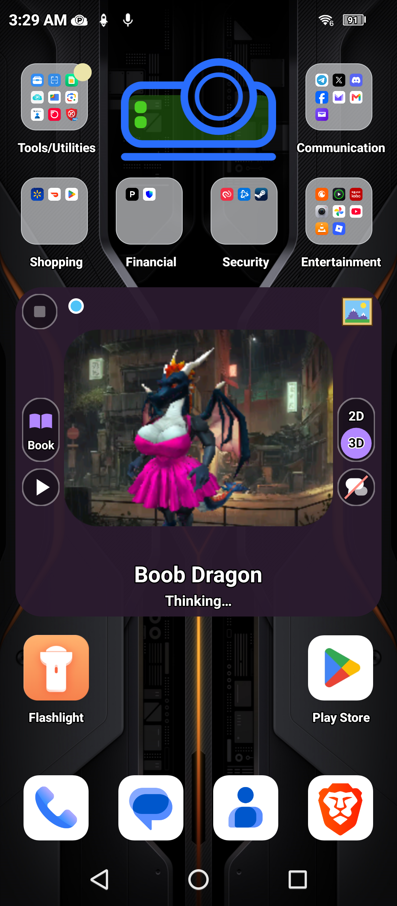

# Milky Moo's Assistant: documentation

> *A private voice assistant that runs entirely on your Android phone. These pages explain every feature, setting and permission, first in plain words and then in technical detail.*

<!-- nav -->

<a href="features/app-basics.md">App basics →</a>

<!-- /nav -->

 Real device · the home-screen widget with a 3D avatar

## How to read these pages

- **The plain explanation is always on top.** You don't need to know anything technical to use it.
- **Technical details sit just below each part** in a fold-out box. Click **▸ Technical details** to open it. It covers how the feature works inside: models, algorithms, file formats, settings keys, measured numbers and limits.
- **Every picture says where it came from:**

  | Label | Meaning |
  |---|---|
  | **Real device** | A screenshot from an actual phone |
  | **Emulator render** | The real app running in the Android emulator on a computer (software graphics, so slower than a phone) |
  | **JVM render** | The app's own renderer run in a desktop test |
  | **Diagram** | A drawing that explains how parts connect |
  | **Desktop run** | Output produced on a desktop computer |

- **Every measured number says where it was measured.** Numbers from an emulator or desktop are never presented as phone numbers. The [verification status](status.md) page lists what has and hasn't been checked on a real phone.

## Pages

### Using it

| Page | What it covers |
|---|---|
| [App basics](features/app-basics.md) | Home, Conversation and Settings tabs, setup checklist, Simple vs Advanced |
| [Wake word](features/wake-word.md) | Waking it hands-free, sensitivity, several wake phrases |
| [Speech recognition](features/speech-recognition.md) | Turning your voice into text, listening time, sleep words |
| [Thinking model](features/thinking-model.md) | The on-phone "brain", choosing a model, what it can and can't do |
| [Phone actions](features/phone-actions.md) | Calls, texts, alarms, timers, reminders, apps, settings, music, maps, notes |
| [Web and news](features/web-and-news.md) | Optional web answers with sources, and spoken news |
| [Voices](features/voices.md) | Choosing and tuning the voice, chimes |
| [Memory](features/memory.md) | What it remembers, where, and how to delete it |
| [Assistants and personalities](features/assistants-and-personalities.md) | Several assistants with their own names, voices and wake words |
| [Stories, songs and poems](features/stories.md) | Long creative answers spoken as they are written |
| [Read to me](features/read-to-me.md) | Audiobooks from your EPUB, PDF and TXT files |

### Looks

| Page | What it covers |
|---|---|
| [Avatar Studio](features/avatar-studio.md) | A new 2D or 3D avatar step by step, picking up where you left off |
| [2D avatar](features/avatar-2d.md) | A picture that talks and moves, the bubble, backgrounds, name styles |
| [3D avatar](features/avatar-3d.md) | 3D models, retro looks, detail levels |
| [AutoRig3D](features/autorig3d.md) | How a still 3D model is made to move |
| [Widget](features/widget.md) | The home-screen widget and its buttons |
| [Photo → 3D](features/photo-to-3d.md) | Making a 3D avatar from one photo, on the phone |

### Reference

| Page | What it covers |
|---|---|
| [Models and downloads](features/models-and-downloads.md) | What to download, sizes, offline import |
| [Privacy, permissions and storage](features/privacy-permissions-storage.md) | What goes online, every permission, where files live, licences |
| [Settings reference](settings-reference.md) | Every setting, its default and its effect |
| [Architecture](architecture.md) | How the parts fit together, with diagrams |
| [Verification status](status.md) | What is tested where, honestly |
| [Troubleshooting](troubleshooting.md) | Common problems and fixes |
| [Glossary](glossary.md) | Plain meanings of the technical words |
| [Security & verification](SECURITY.md) | Checking the APK's fingerprint, the automatic scans, reporting a problem |
| [AGENTS.md](../AGENTS.md) | For coding agents and porters: every feature, where it lives, the rules a port must keep |

Technical details: the system in one paragraph

The app is a native Android app (Kotlin, Jetpack Compose; minSdk 29, target 37; arm64-v8a and x86_64) with no server and no Google Play services.

- **Listening:** a foreground `microphone` service runs a sherpa-onnx keyword spotter continuously (~6 MB). On a wake word it loads Silero VAD + Moonshine Tiny for speech recognition, and a Piper or Kokoro VITS voice plus a llama.cpp GGUF model in parallel.
- **Thinking:** `Brain` routes each utterance through sleep detection, confirmations, standing directives, long-form generation, ~70 rule patterns, and finally the LLM with a 23-tool JSON grammar.
- **Memory:** long-term memory is an AES-GCM-encrypted SQLite store with BM25 retrieval into a token budget.
- **Avatars:**
  - 2D: a 20×20 mesh warp.
  - 3D: OpenGL ES 3 with GPU skinning, two weight sets mixed live, and PS1/N64-style shader variants.
  - Pixal3D (Tencent) + TRELLIS.2 (Microsoft), exported to ONNX, can generate a 3D model from a photo on the phone, in a foreground service with per-step checkpoints that resume after a kill or reboot.
- **Network:** only for user-started downloads (HTTPS allow-list + SHA-256), optional web answers (off by default), and voice samples.

<!-- nav -->

<a href="features/app-basics.md">App basics →</a>

<!-- /nav -->
