# Architecture

> *How the parts fit together: one always-on listener, engines that load on demand, and everything on the phone.*

<!-- nav -->

<a href="settings-reference.md">← Settings reference</a> &nbsp;·&nbsp; <a href="README.md">Docs home</a> &nbsp;·&nbsp; <a href="status.md">Verification status →</a>

<!-- /nav -->

<picture><source media="(prefers-color-scheme: dark)" srcset="images/diagrams/architecture-dark.png">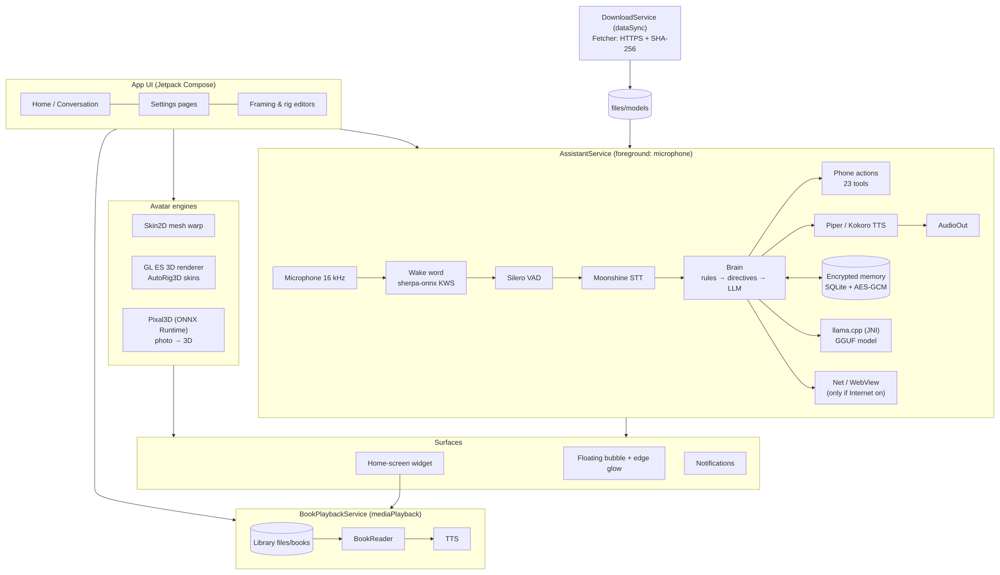</picture> Diagram · the whole app

Mermaid source (GitHub draws this live)

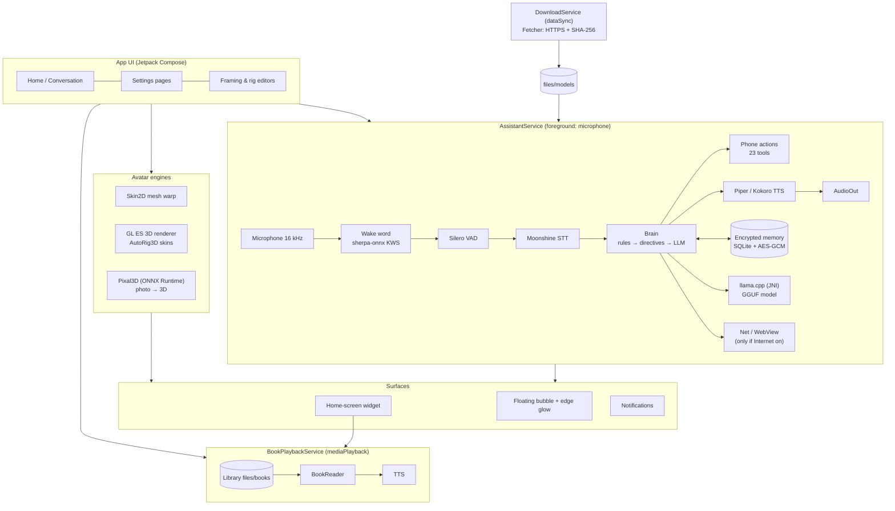

## The big picture

The app is a normal Android app with no server behind it. It has three long-running pieces, each of which shows a notification while it runs:

| Piece | What it does | When it runs |
|---|---|---|
| **Assistant service** | Listens for the wake word, understands you, thinks, acts and speaks | While listening is switched on |
| **Book service** | Reads books aloud with the screen off | While a book is playing, plus 5 minutes after a pause |
| **Download service** | Fetches models in the background | Only during downloads |

Everything else (settings pages, widget, bubble, 3D renderer, photo → 3D) is ordinary app code that runs when you use it.

Technical details

- **Modules:**
  - `:app`: Android UI, services and native glue.
  - `:shared`: pure-Kotlin core (parsers, catalog, policies, memory assembler, rig maths), unit-tested on the JVM.
  - `:downloader`: the optional companion app.
- **Native code:** `app/src/main/cpp`.
  - `llm_core.cpp` / `llm_jni.cpp`: llama.cpp (GGUF, KV-prefix reuse, streaming).
  - `ort_jni.c`: a generic ONNX Runtime runner bound to sherpa-onnx's `libonnxruntime.so`, used by Pixal3D.
  - `av1_jni.c`: dav1d, for AVIF / AV1 backgrounds.
- **Speech:** sherpa-onnx 1.13.8 AAR (KWS, Silero VAD, Moonshine, Piper / Kokoro VITS) on ONNX Runtime CPU.
- **Graphics:**
  - 2D avatar: `Canvas` mesh warp (`Skin2D`).
  - 3D avatar: OpenGL ES 3 with GPU skinning and two weight sets (see [3D avatar](features/avatar-3d.md)).
  - The widget gets software-rendered or pre-rendered frames.
- **Threads:** the microphone has its own thread. Model loads use separate loader threads (speech recognition first, then the voice and the thinking model in parallel). Speaking is a producer/consumer queue: one sentence is synthesized while the previous one plays.
- **No IPC with other apps** except Android intents (alarms, calls, maps) and the optional Accessibility service.

## Voice pipeline

<picture><source media="(prefers-color-scheme: dark)" srcset="images/diagrams/voice_pipeline-dark.png">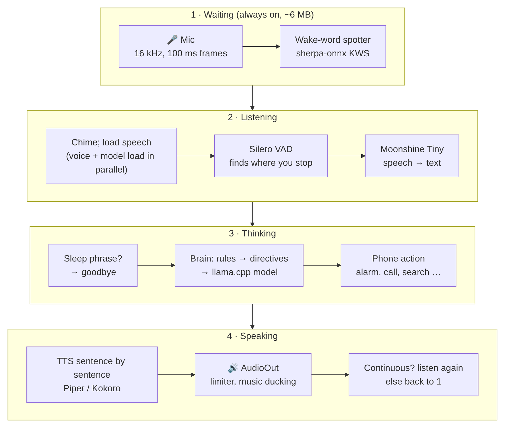</picture> Diagram · from the microphone to a spoken reply

Mermaid source (GitHub draws this live)

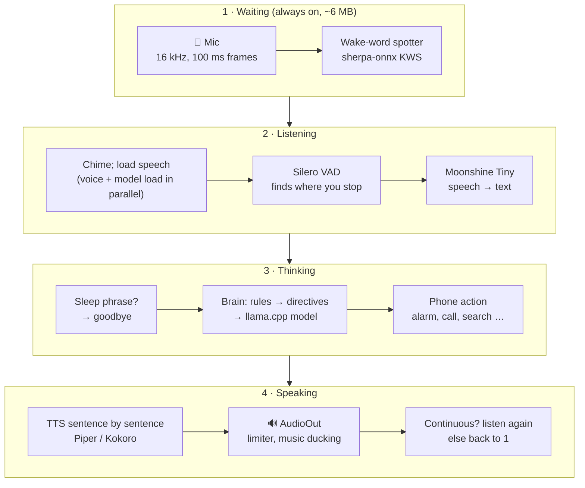

More in [Wake word](features/wake-word.md), [Speech recognition](features/speech-recognition.md), [Thinking model](features/thinking-model.md) and [Voices](features/voices.md).

## 3D auto-rig

<picture><source media="(prefers-color-scheme: dark)" srcset="images/diagrams/rig-dark.png">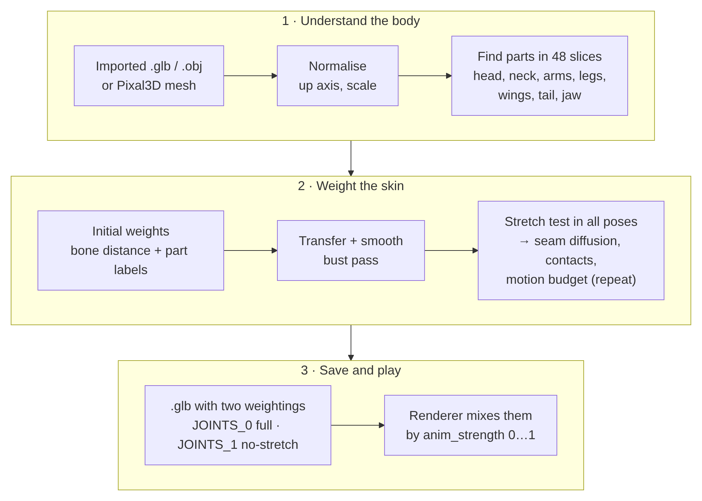</picture> Diagram · AutoRig3D v6, from a mesh to an animated avatar

Mermaid source (GitHub draws this live)

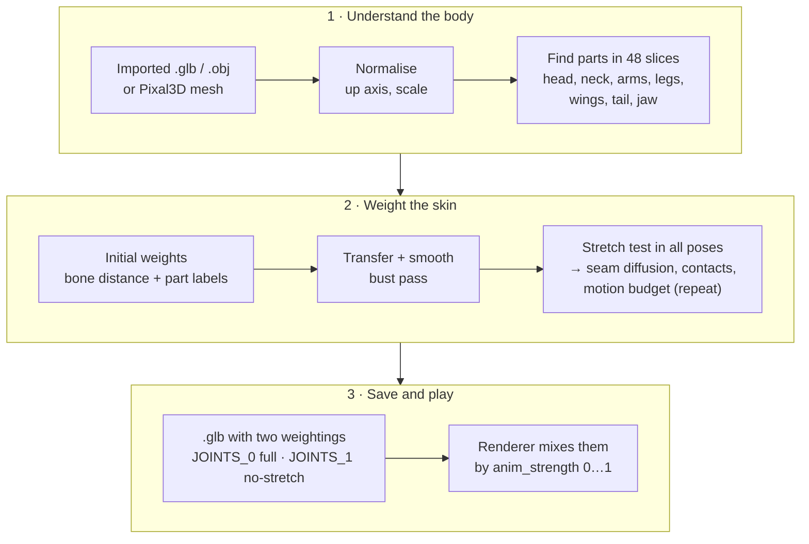

More in [AutoRig3D](features/autorig3d.md).

## Book playback

<picture><source media="(prefers-color-scheme: dark)" srcset="images/diagrams/book_playback-dark.png">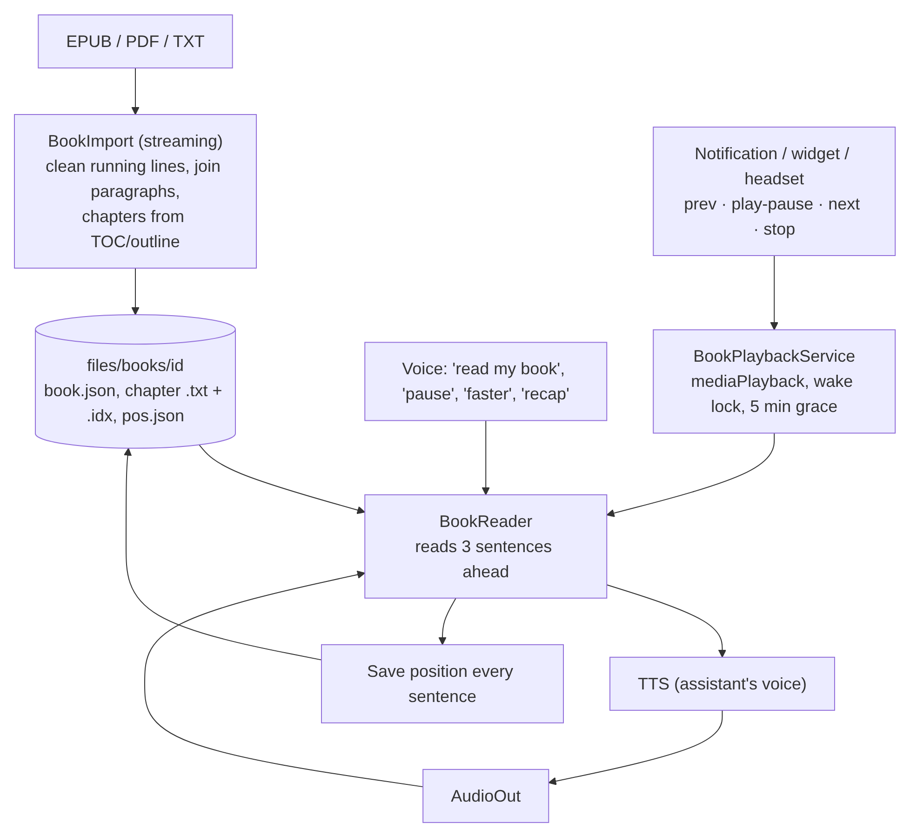</picture> Diagram · import, library and playback

Mermaid source (GitHub draws this live)

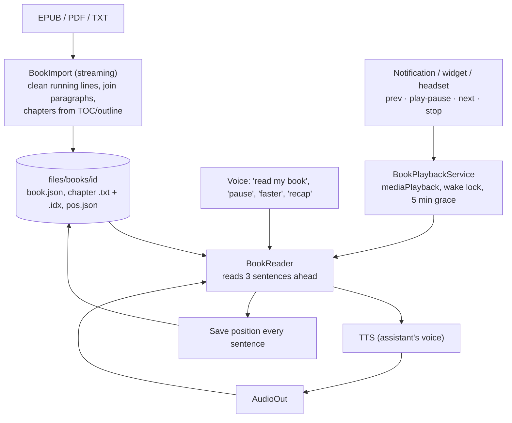

More in [Read to me](features/read-to-me.md).

## Long stories and songs

<picture><source media="(prefers-color-scheme: dark)" srcset="images/diagrams/longform-dark.png">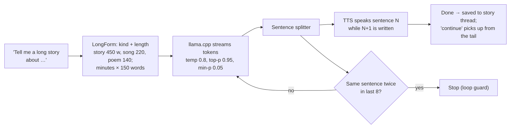</picture> Diagram · writing and speaking at the same time

Mermaid source (GitHub draws this live)

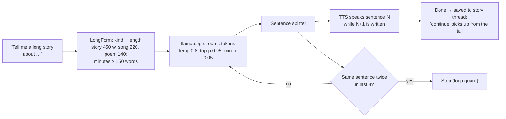

More in [Stories, songs and poems](features/stories.md).

## Photo → 3D installer

<picture><source media="(prefers-color-scheme: dark)" srcset="images/diagrams/installer_flow-dark.png">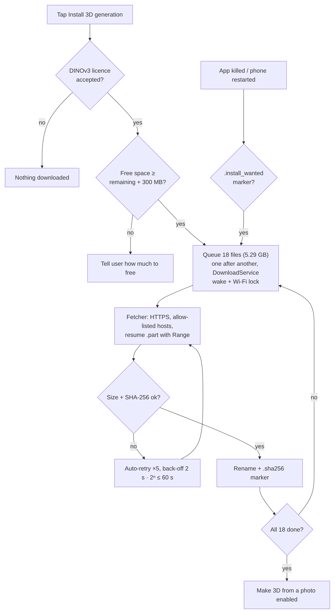</picture> Diagram · the one-button installer

Mermaid source (GitHub draws this live)

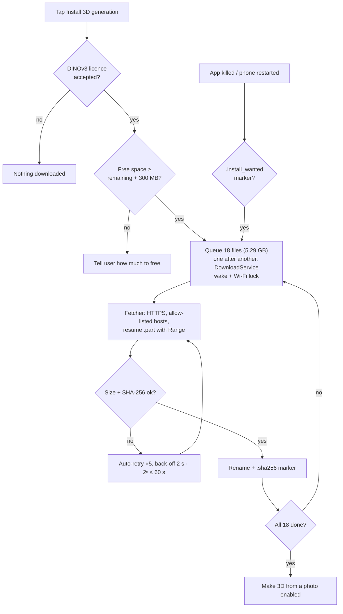

## Photo → 3D pipeline

<picture><source media="(prefers-color-scheme: dark)" srcset="images/diagrams/pixal3d_pipeline-dark.png">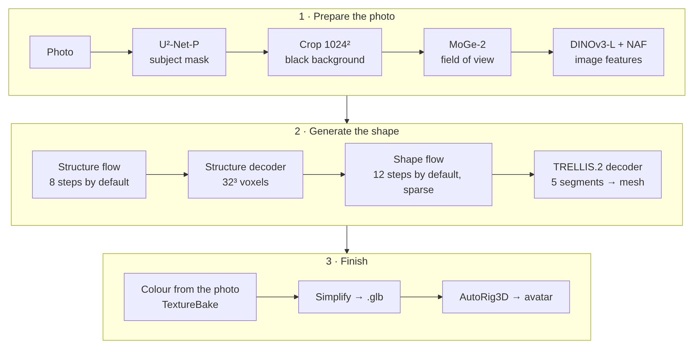</picture> Diagram · the on-phone Pixal3D pipeline

Mermaid source (GitHub draws this live)

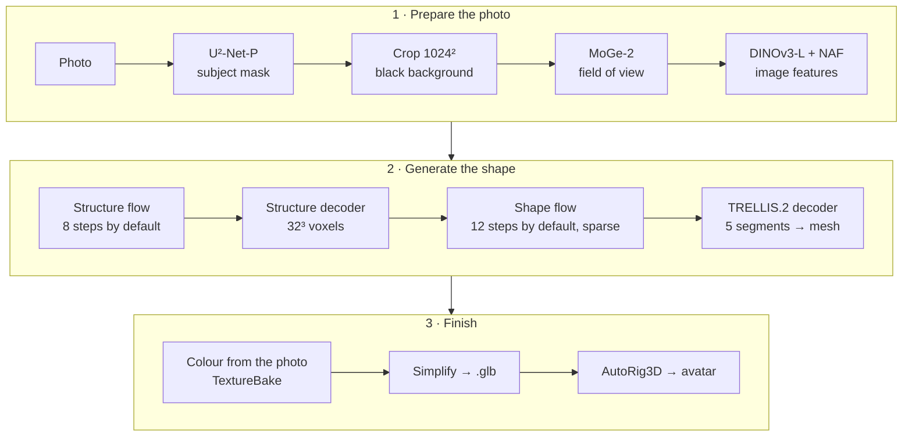

More in [Photo → 3D](features/photo-to-3d.md).

## Long jobs: checkpoints, resume and time left

<picture><source media="(prefers-color-scheme: dark)" srcset="images/diagrams/resume_flow-dark.png">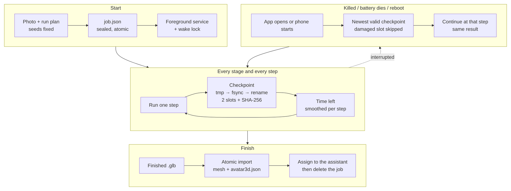</picture> Diagram · how a photo → 3D run survives a kill, a dead battery or a reboot

A photo → 3D run takes minutes, so it is built to be interrupted. Everything it finishes is saved right away in a way that can't be half-written, and the next start continues from there.

Technical details

- **`core/Checkpoints.kt`:** `AtomicFiles.write` (temp → fsync → rename), `seal`/`unseal` (`MMCK` | length | payload | SHA-256), and `CheckpointStore` (two slots per key; `load` returns the newest valid one).
- **`threed/Pixal3DCheckpoint.kt`:** what is saved per stage (cond, ss per step, vox, shape per step, glb).
- **`threed/Pixal3DJob.kt` + `Pixal3DService.kt`:** the job record with fixed seeds, the foreground service with a wake lock, resume from `MainActivity.onResume` and `BootReceiver`, at most 3 attempts, assignment only after the atomic import.
- **`core/Eta.kt`:** `Pixal3DEta` (weighted stages, smoothed per-step times saved per device) and `TransferEta` (downloads: smoothed speed, queue position).
- **`core/StudioFlow.kt`:** Avatar Studio's saved state and its step rules (no Android code, so a desktop port can reuse it).
- **Tests:** `CheckpointsTest` (kill during a write, truncated and corrupt slots), `ResumeTest` (kill after every step → identical result; truncated newest checkpoint), `EtaTest`, `StudioFlowTest`, `Run3DPlanTest` (plan JSON and fixed seeds).

Mermaid source (GitHub draws this live)

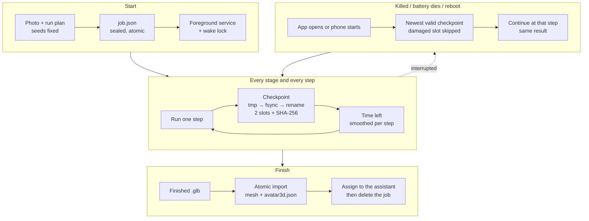

<!-- nav -->

<a href="settings-reference.md">← Settings reference</a> &nbsp;·&nbsp; <a href="README.md">Docs home</a> &nbsp;·&nbsp; <a href="status.md">Verification status →</a>

<!-- /nav -->
