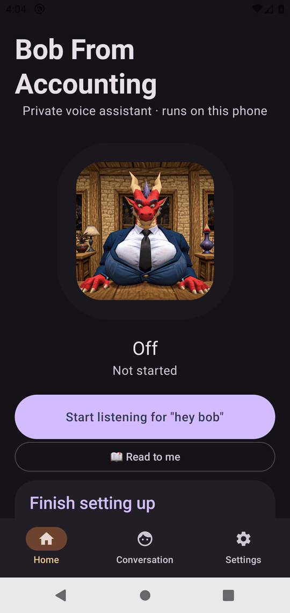
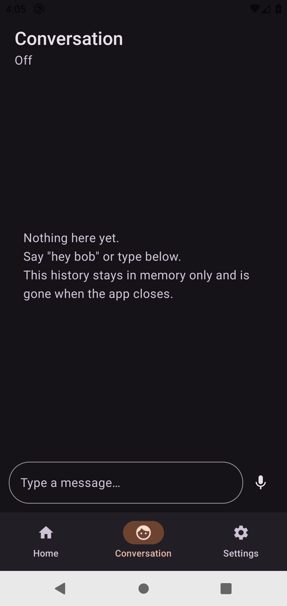
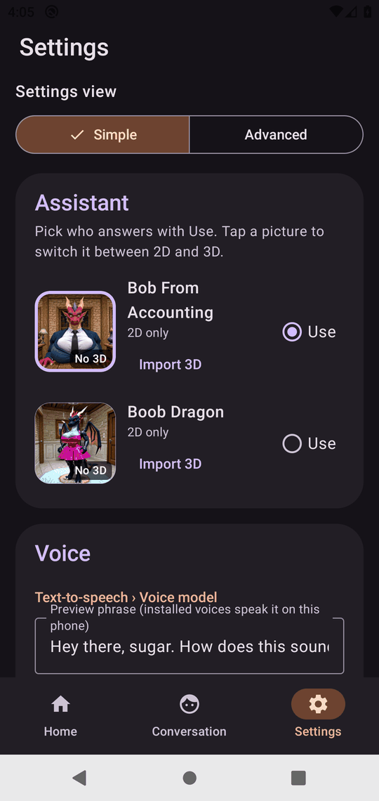
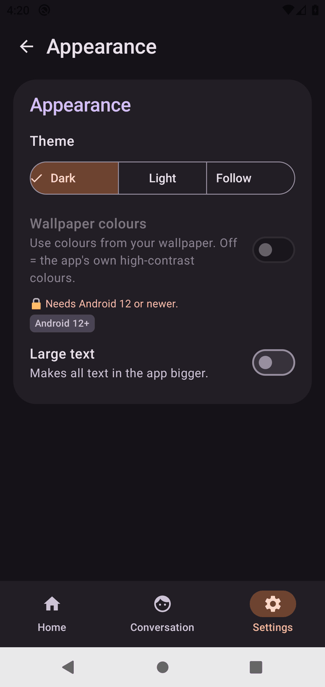
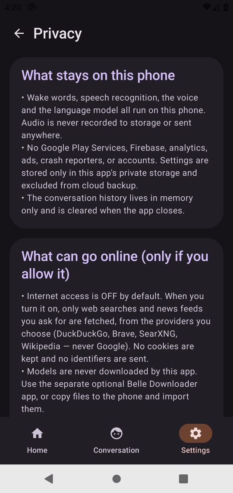
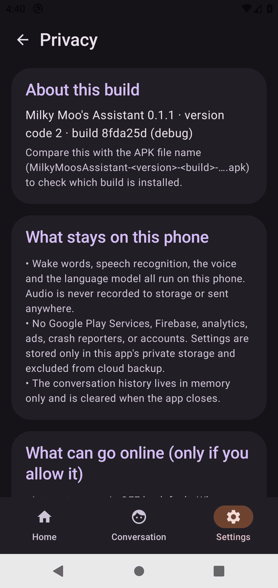

# App basics

> *The three tabs, the setup checklist, Simple vs Advanced settings, and how it looks.*

<!-- nav -->

<a href="../README.md">← Docs home</a> &nbsp;·&nbsp; <a href="../README.md">Docs home</a> &nbsp;·&nbsp; <a href="wake-word.md">Wake word →</a>

<!-- /nav -->

 &nbsp;  &nbsp;  Emulator renders · Home, Conversation and Settings (Simple view)

## At a glance

| Tab | What's on it |
|---|---|
| **Home** | The assistant's avatar, its status, the big *Start listening* button, *Talk now*, *Read to me*, a setup checklist and example phrases |
| **Conversation** | What you said and what it answered, with a box to type instead of talking |
| **Settings** | *Simple* (the few things most people change) or *Advanced* (every page) |

## Home

- **Start listening for "hey bob"** turns on background listening. While it is on, the button becomes **Talk now** (start a conversation without the wake word) and **Turn off listening**. During a conversation an **End conversation** button appears.
- **Status** below the avatar: *Off*, *Getting ready…*, *Ready*, *Waking up…*, *Listening…*, *Thinking…*, *Speaking* or *Going to sleep*, with a coloured dot.
- **📖 Read to me** opens your books, or shows *Reading: chapter …* with *Pause the book* while a book plays.
- **Finish setting up** lists only what is still missing, each with a **Fix** button:
  - the microphone permission
  - speech recognition (30 MB)
  - a voice (about 20 MB)
  - a thinking model
  - *Display over other apps*
- **What you can say:** tap an example (*"set a timer for 10 minutes"*, *"what's the latest news"*…) to run it as if you had said it.
- **Memory use** shows what is loaded right now. **Internet** shows whether web access is on, with a *Change* link.
- **Add widget** offers to pin the home-screen widget (shown once).

Technical details

- **Code:** `ui/HomeAndChat.kt`.
- **Buttons:**
  - *Start listening* calls `MainActivity.startAssistant()`, which requests the core permissions and then starts `AssistantService`.
  - *Talk now* starts a session without KWS.
  - *Turn off listening* stops the service and sets `service_wanted = false`.
- **Example chips** call `AssistantRuntime.handleText(act, phrase)`, the same path as typed text.
- **Checklist:** built on every recomposition from `RECORD_AUDIO`, `ModelFiles.hasStt`, `installedVoices`, `installedLlms` and `Settings.canDrawOverlays`.
- **Memory use** is `AssistantRuntime.loadState()`.
- **Widget pin:** `AppWidgetManager.requestPinAppWidget`; the hint hides via `widget_hint_done`.

## Conversation

The Conversation tab shows the current chat. You can **type** instead of speaking: the answer is spoken and shown. Answers from the web list their **Sources** with numbered links. **End** ends the conversation, and **Clear** empties the list.

This on-screen history is **kept in memory only** and disappears when the app closes. Long-term memory is separate (see [Memory](memory.md)).

Technical details

- **History:** `AssistantRuntime.transcript`, in RAM only. `clearTranscript()` empties it.
- **Typed text** goes through `handleText`, so it takes the same `Brain.handle` path as speech, minus speech recognition.
- **Web sources** are attached to the turn (`core/Web.kt` → `ActionRouter`) as title, domain and URL.

## Settings: Simple and Advanced

**Simple** (the default) puts the most-used settings on one page:

- which assistant you are editing
- voice and voice volume
- wake words, and *Keep listening after I answer*
- **Avatar Studio** (a new 2D or 3D avatar, step by step; it resumes where you left off) and *Show my 3D avatar*
- **3D avatar**: the same numbered steps as the Advanced 3D page (import, install, make from a photo)
- theme
- the system prompt
- a short permissions list, including **Allow restricted settings** (Android 13+, needed before the Accessibility service can be switched on for an app installed from a file)

**Advanced** shows every page, grouped as Read to me, Assistants, Listening, Voice, Avatar (*2D avatar*, *3D avatar*, *Bubble & widget*), Background, Chimes, Models, Internet, Permissions and Appearance & privacy. Every setting is listed in the [Settings reference](../settings-reference.md).

 &nbsp;  Emulator renders · Appearance and Privacy pages

Technical details

- **Switching views:** the *Settings view* choice is stored in `belle_global › simple_settings`.
- **Code:** pages are declared in `ui/SettingsScreen.kt` as `Page(id, icon, title, group)`. The ids are `books`, `assistants`, `wake`, `conversation`, `sleep`, `voice`, `avatar`, `avatar3d`, `bubble`, `background`, `chimes`, `getmodels`, `model`, `memory`, `speech`, `internet`, `news`, `setup`, `look` and `privacy`.
- **Simple view:** `SettingsKit.SimpleSettings`. The hidden page `studio` (Avatar Studio) is opened from it; hidden pages are left out of the Advanced list.
- **Step cards:** `ui/AvatarPages.kt` (`StepCard`, `StepState` DONE / NEXT / TODO / BLOCKED / OPTIONAL, `StepsSummary`).
- **Permission rows:** `PermRow` re-checks its state on every resume.

## Which version is installed?

The bottom of the Settings list, and **Settings › Privacy › About this build**, show the version and build, for example *Milky Moo's Assistant 0.1.1 · version code 2 · build 8fda25d*. APK files are named the same way: `MilkyMoosAssistant-0.1.1-8fda25d-arm64-v8a.apk`.

 Emulator render (debug build) · Privacy › About this build

Technical details

- **Shown values:** `BuildConfig.VERSION_NAME`, `VERSION_CODE`, and `GIT_SHA`, the short commit read with `git rev-parse --short=7 HEAD` at build time (`dev` when building outside git).
- **Releases:** `scripts/release.sh` bumps `versionCode` (+1) and the patch number of `versionName`, commits the bump, builds that commit, and names the APKs `MilkyMoosAssistant-<versionName>-<sha7>-<abi>.apk`.

## Appearance

The **theme** can be *System*, *Light* or *Dark* (default). Android 12+ can take **wallpaper colours**, and **Large text** makes everything bigger.

Technical details

- **Keys:** `theme`, `wallpaper_colors`, `large_text`.
- **Colours:** Material 3 with a fixed, contrast-checked palette, or `dynamicColorScheme` when wallpaper colours are on.

## The in-app Privacy page

This page explains what stays on the phone and what can go online: model downloads only when you tap them, web answers only when you turn the internet on, voice samples only when you press ▶, and cookies only until you clear browsing data.

[Privacy, permissions & storage](privacy-permissions-storage.md) has the full description.

<!-- nav -->

<a href="../README.md">← Docs home</a> &nbsp;·&nbsp; <a href="../README.md">Docs home</a> &nbsp;·&nbsp; <a href="wake-word.md">Wake word →</a>

<!-- /nav -->
