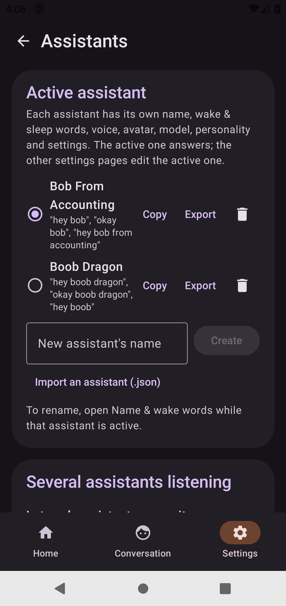

# Assistants, personalities and standing instructions

> *Several characters on one phone, each with its own name, voice, look, memory and personality, and instructions they never forget.*

<!-- nav -->

<a href="memory.md">← Long-term memory</a> &nbsp;·&nbsp; <a href="../README.md">Docs home</a> &nbsp;·&nbsp; <a href="stories.md">Stories, songs and poems (long-form) →</a>

<!-- /nav -->

 Emulator render · Settings › Assistants

## At a glance

| | |
|---|---|
| **Assistants** | As many as you like. Two come ready-made: **Bob From Accounting** and **Boob Dragon** |
| **Each has its own** | Name, wake words, voice, avatar (2D and 3D), background, name style, thinking model, memory, personality |
| **Personality editor** | Four short sections you can rewrite in plain words |
| **Standing instructions** | Say *"from now on, …"* and it sticks, for up to 10 rules |

## Several assistants

The **Assistants** page lists every assistant:

- **Use** makes one the active assistant. The app, bubble, widget and wake words follow it.
- **Copy** duplicates an assistant with all its settings.
- **Export** saves its settings to a `.json` file, and **Import an assistant** loads one.
- **Delete** removes it, after asking.
- **Create** makes a new one from a name.

To rename an assistant, make it active and edit its name on *Name, personality & wake words*. With *"Let each assistant answer its own wake words"* on, you can call any of them by name (see [Wake word](wake-word.md#several-assistants-one-phone)).

Technical details

- **Code:** `ProfileStore.kt`.
- **Per-profile settings:** each profile is a private `SharedPreferences` file. `Prefs` always reads the profile that is *currently answering*: the session profile when a wake word picked a non-active assistant, otherwise the active one.
- **App-wide settings** live in `belle_global`: `ids` (the profile list), `active`, `priority`, `multi_wake`, `last_llm` and `simple_settings`.
- **First run:** the original single-assistant settings become profile `default` (Bob). *Boob Dragon* is added with her picture (keeping its painted background), the Amy voice and her own wake words. Both get their bundled 3D models (`assets/default_avatars/*.glb`, about 4 MB each: 70k triangles, 1024 px textures), imported and rigged.
- **Export format:** `{"belle_profile":1,"settings":{…every pref key…}}`. String sets are written as `{"set":[…]}`. There are no secrets: the app has no API keys or accounts.
  - **Not included:** picture, model, font or sound *files* (only their pref values) and the memory.
- **Import:** creates a new 8-character id.

## Personality (the prompt editor)

Each assistant's personality is four short texts you can edit:

| Section | What it is for | Default (summarised) |
|---|---|---|
| **Who you are** | The character | A warm companion. Dragons get a dragon flavour |
| **How you respond** | Tone and length | Short, natural, spoken style; match the user's energy; no lists or emoji |
| **How you address the user** | Names and pet names | Use your name when known, sweet pet names now and then, your pronouns |
| **Extra instructions** | Anything else | (empty) |

A section you haven't touched follows the assistant's name, so renaming Bob updates it automatically. An edited section is kept exactly as typed, and an emptied one means "nothing here". Each section has its own *Reset to default*, and there is *Reset all to default*. Changes apply from the next reply.

*Reset conversation* clears a stuck or confused chat (long-term memory is kept).

Technical details

- **Code:** `core/PersonaPrompt.kt` and `ui/PromptEditor.kt`.
- **Limits:** `MAX_SECTION = 1200` characters each and `MAX_TOTAL = 2400` characters for all four (about 700 tokens).
- **Rendered as:** `Who you are (<name>'s personality): …`, `How you respond: …`, `How you address the user: …`, `Extra instructions from the user (follow them): …`.
- **Prefs:** `p_personality`, `p_style`, `p_address`, `p_extra`. If a key is absent, the section follows the name.
- **Full system prompt** (`Tools.fullSystemPrompt`), in this fixed order. The persona goes last so it weighs most.
  1. Tool list and calling rules
  2. `BASELINE_CLAUSE`: how to treat the user
  3. `ADULT_CLAUSE`: an uncensored, consenting-adult, private conversation, always on
  4. `ROLEPLAY_CLAUSE`: only when the loaded model is a roleplay fine-tune
  5. The four persona sections
- **Preview:** the editor shows the whole prompt, including the fixed parts.
- **Reset conversation:** cancels any reply in progress and resets the short-term context.

## Standing instructions (directive tracker)

Tell the assistant how to behave *from now on*, in your own words, during any conversation:

- *"From now on call me captain."*
- *"Always answer in rhymes."*
- *"Keep the story set in Paris."*
- *"Stop swearing."*

These are **pinned**: they go with every request, word for word, and are never summarised away or dropped when the conversation gets long. Change them the same way: *"stop calling me captain, call me admiral instead"*, *"forget that last rule"*, or *"go back to normal"* to clear them all. Up to 10 are kept, and the oldest drops off first.

Technical details

- **Code:** `core/Directives.kt`.
- **Parsing:** `parseAll(utterance)` splits the sentence into **clauses** (at punctuation, or "and / but / then" before an instruction verb) and classifies each one:
  - `clearAll`: *"forget all my instructions"*, *"go back to your normal self"*
  - `stopCalling`: *"stop calling me X"* (removes the name rule)
  - `forgetRule`: *"forget that last rule / the part about X"*
  - `callMe`: *"call me / my name is / address me as X"*
  - `standing`: *"from now on / always / never / don't / until I say stop / for the rest of the story …"*, with at least 3 words
  - `notDirective` filter: questions, *"never mind"*, *"keep going"*, *"stop"*
- **Limits:** `MAX = 10`, `MAX_CHARS = 220` each. Text is kept in your words with the first letter capitalised.
- **Storage:** notes in the memory thread `DIRECTIVES`, rewritten on every change.
- **Use:** `Directives.render()` is placed right before *"User now says:"*, outside the memory budget (see [Memory](memory.md)). When a turn overflows the context, everything except the system prompt and the directives is dropped first.

## Limits and honest notes

- Personality text is guidance for a small model. It is followed loosely, more so by bigger models.
- Directive detection is pattern-based and English-only. Unusual phrasings may not be picked up. If one is missed, rephrase it with *"from now on …"*.
- An exported assistant does not carry its picture, 3D model or memory. Copy those separately if you move phones.

<!-- nav -->

<a href="memory.md">← Long-term memory</a> &nbsp;·&nbsp; <a href="../README.md">Docs home</a> &nbsp;·&nbsp; <a href="stories.md">Stories, songs and poems (long-form) →</a>

<!-- /nav -->
