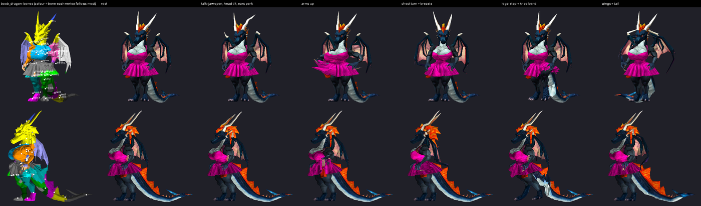
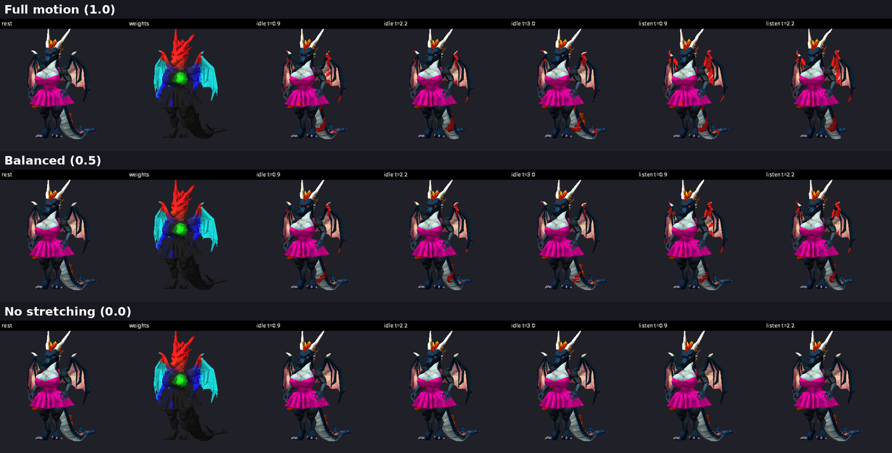
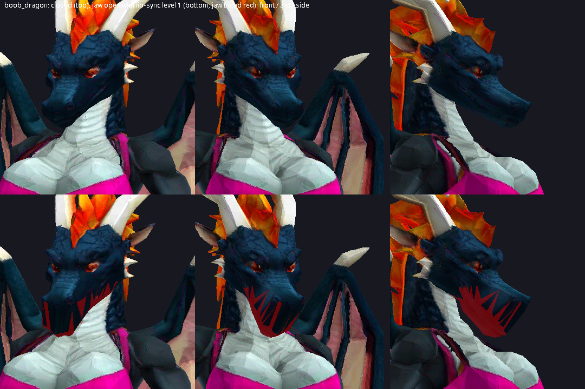

# AutoRig3D (automatic skeleton)

> *Gives any 3D character a skeleton by itself, including tails, wings, muzzles and dresses, so it can breathe, gesture and talk without tearing.*

<!-- nav -->

<a href="avatar-3d.md">← 3D avatar</a> &nbsp;·&nbsp; <a href="../README.md">Docs home</a> &nbsp;·&nbsp; <a href="widget.md">Home-screen widget →</a>

<!-- /nav -->

 JVM render (software rasteriser, from the unit tests) · Boob Dragon: bone map, rest, talk (jaw and ears), arms up, chest, leg step, wings and tail

## At a glance

| | |
|---|---|
| **What it does** | Finds the head, neck, jaw, arms, legs, chest, ears, wings and tail of a model that has no skeleton, and decides how much each bit of skin follows each bone |
| **When** | Automatically on import, and once again after an app update that improves the rig (current: **version 6**) |
| **Your controls** | *Rig:* Smooth skin / N64-style parts · *Animation strength:* Full motion / Balanced / No stretching |
| **Keeps** | A skeleton that came with the file (and its animations) is used as is |

## How it works for you

You don't need to do anything. Import a character (a person, a dragon, someone in a dress) and the assistant works out its body: where the neck is, which part is the jaw, where the arms and legs bend, whether there are wings or a tail. Then it **tests its own work**. It plays every idle, listening, thinking and talking pose, looks for places where the skin would stretch or tear (a hand resting on a hip, a wing touching the tail, a chin on the chest), and smooths them out.

Technical details: finding the body

All of this is in `mesh/AutoRig3D.kt` (`rig(mesh, style)`, `VERSION = 6`). It uses the glTF convention: +Y up, facing +Z.

1. **Centre line:** the median of the vertices, not the bounding box (a tail or wing would drag the box).
2. **Width profile:** 48 height slices, using the central 80 % of points per slice. A **core width** per slice is the connected run around the middle line, which ignores horns, wings and arms separated by a gap.
3. **Head and neck:** the head is the widest core slice at 70–95 % height. The neck is the narrowest core slice below it (down to 40 %). Busts use plain silhouette width instead.
4. **Shoulders:** the widest slice just below the neck.
5. **Arms:**
   - The hand is the mean of the 2 % of lower vertices farthest from the shoulder. The elbow is at the midpoint, bent slightly outward and back.
   - Arm reach is grown **over the surface** inside the arm's tube, so a skirt or hips under a hanging hand never follow the arm.
6. **Legs:** two separate clusters in the low slices. The hips sit at least half-way from feet to neck (a skirt hides the real hips).
   - **Digitigrade** legs are detected from the side profile: the hock is the most backward point, the knee the most forward. They get thigh → shin → metatarsus → foot.
7. **Wings:** a lot of geometry well behind the back, above the pelvis, reaching out sideways.
8. **Tail:** geometry behind and below the waist near the middle line, given a **5-bone chain**.
9. **Mouth and jaw** (muzzle-aware):
   - The face is examined from the side. A **snout** shows up as a long front part much thinner than the head. The mouth line then runs along it, 40 % up from its underside, to a hinge behind where the muzzle starts.
   - A flat (human) face gets a level mouth line under the nose, with the hinge at mid-head.
   - The jaw is the part of the jaw box **connected over the surface** to the mouth, so a bust under a lowered head never opens with the mouth.
   - If no vertex ends up on the jaw, lip-sync falls back to a small head nod.
10. **Ears or horns:** tall parts rising from each upper side of the head, clearly off the middle line.
11. **Chest and breasts:** a bust in front of the waist goes with the chest **as one piece**, never with the arms. It is weighted symmetrically: both sides get the mirrored centre and the larger size. A breast bone sits behind each breast, with bounce capped at `BOUNCE_MAX = 0.03` rad.

**Bones:** root, spine, chest (+ breasts), neck, head, jaw, arms (upper/lower/hand), legs (thigh/shin/[metatarsus]/foot), wings, tail ×5, ears.

Technical details: weights and the no-tear passes

1. **Initial weights:**
   - `skinned`: every vertex blends its **two nearest bones**.
   - `rigid`: one bone each, giving N64-style rigid segments.
   - Arms only claim their own side outside the torso. Legs only below the hips. Wings only behind. The tail only behind and low.
2. **Weight transfer and smoothing:**
   - Vertices are **welded by position**, so UV-seam halves bend together.
   - Separate shells (clothing, armour, hair, accessories) copy the weights of the nearest body point underneath.
   - Two passes of neighbour averaging blend bone borders. The jaw, wings, tail and ears keep their hard edges.
3. **Bust pass:** the whole breast, and anything over it (dress, top, fused or separate), inside a smooth ellipsoid follows the chest. Arm, head and wing influence there is moved to the chest, fading out.
4. **Stretch test:** every edge is skinned through all `checkFrames` poses (idle, listen, think, talk with gestures at full loudness, several cycles; multi-threaded).
   - `stretch = 1 + |Δlength| / max(rest, STRETCH_FLOOR·height)`, with `STRETCH_FLOOR = 0.005`, so sub-millimetre slivers don't count.
   - The limit is **1.10** (10 %).
5. **Joint seams** (v6, geodesic heat diffusion): around edges that still stretch at a parent/child seam (head/neck, shoulder, tail root, wing root), weights diffuse **over the surface**. Patches are a grid cell ∩ a connected piece of surface, so nothing blends "through the air".
   - Patch width grows up to `SEAM_RHO = 0.08` of height, or `BODY_RHO = 0.12` for whole-body bands.
6. **Contacts** (v6, "the part that moves drags the skin it touches"): where two non-neighbouring parts of a fused mesh touch, the side that moves less follows the side that moves more. The fade runs along the surface up to `FOLLOW_REACH = 0.3` of height, for `CONTACT_ROUNDS = 5`.
7. **Priority parts:** bust/chest 3, head/neck/ears 2, arms 1, rest 0. A lower-priority part follows a higher one at a contact. Leaders are never changed.
8. **Motion budget:**
   - The contact pass alone would freeze parts (a wing lying on the tail could not flap). So each part ([`Pose3D.groups`], left/right together) gets back the least blend toward full-motion weights that restores at least **`MOTION_KEEP = 0.95`** of its RMS motion (found by bisection), spread smoothly.
   - Where fused parts still tear, `limitMotion` scales the worst group's procedural motion by 0.8 repeatedly (floor **`MOTION_MIN = 0.1`**, limit 1.12) and saves it as `Skeleton.motion` in the `.glb`.
   - The jaw is never toned down.
9. **Head split:** `HEAD_SPLIT = 0.5`, meaning half of a nod or turn happens at the neck joint.

## Animation strength

Where parts of a model touch (a wing on a tail, a hand on a hip), moving them fully can stretch the surface between them. You choose the trade-off:

| Mode | What you get |
|---|---|
| **Full motion** (default) | Every part moves fully. Touching parts may stretch a little |
| **Balanced** | About half the motion where parts touch, much less stretching |
| **No stretching** | No stretching anywhere. Parts that touch others barely move |

 JVM render · the same idle and listening poses at the three strengths. Red marks edges stretched beyond the limit

Technical details

- **Two weightings:** the rig stores the **full-motion weighting** as the primary `JOINTS_0`/`WEIGHTS_0` and the **no-stretch weighting** (motion budget 0, `lastSafe`) as glTF `JOINTS_1`/`WEIGHTS_1` in the same `.glb`.
- **Mixing:** the vertex shader mixes the two by `anim_strength` (1 = full, 0.5 = balanced, 0 = no stretching), so the change is instant, with no re-rig.
- **Blend schedule** (`blend(i, t)`): t 0..1 goes safe → full (seams blended); 1..2 would go full → the pre-v5 base weighting.
- **Old models:** a model without `JOINTS_1` uses the single weighting.
- **Pref:** `anim_strength` (1.0).

## Rig style

- **Smooth skin** (default): bends like skin.
- **N64-style parts:** each piece moves rigidly, like 1990s console characters. It pairs well with the [Retro64 look](avatar-3d.md#retro-looks-shaders).

Technical details

- **Pref:** `rig_style3d` (`skinned` / `rigid`).
- **Switching** re-runs the import pipeline on the stored mesh, in a background thread.
- The choice is hidden for models that came with their own skeleton (`rig: "file"`).

 JVM render · muzzle-aware jaw: closed (top) and fully open at lip-sync level 1 (bottom, jaw tinted red); front, ¾ and side views

## Limits and honest notes

- The rig is a heuristic for upright, front-facing characters (people, anthros, dragons). Four-legged animals, lying poses or very abstract shapes may rig oddly. Use *No stretching*, or import a model with its own skeleton.
- The rig is checked against the app's own procedural poses, not arbitrary animations.
- **Verified:** with unit and image tests (`RigSheetTest`, `JawTest`, `BreastNoTearTest`, `DefaultAvatarsTest`) on the bundled Bob and Boob Dragon and an imported dragoness. On a real phone the rigged 3D avatar was seen on the widget. Motion quality on a phone was judged visually only.

<!-- nav -->

<a href="avatar-3d.md">← 3D avatar</a> &nbsp;·&nbsp; <a href="../README.md">Docs home</a> &nbsp;·&nbsp; <a href="widget.md">Home-screen widget →</a>

<!-- /nav -->
