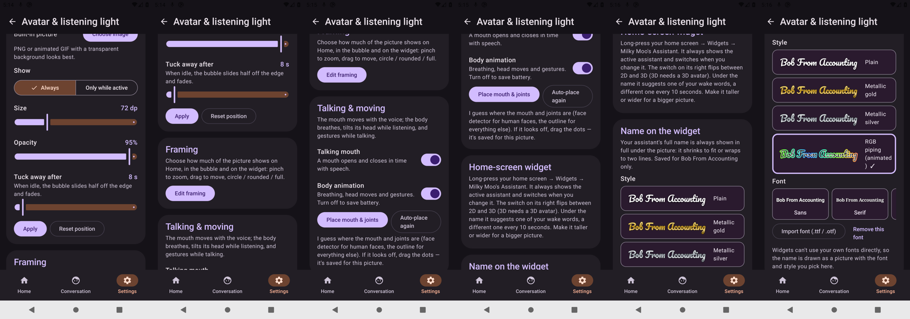

# 2D avatar, bubble and backgrounds

> *A picture that breathes, sways, blinks its listening light and moves its mouth when it talks: in the app, floating over other apps, and on the home screen.*

<!-- nav -->

<a href="avatar-studio.md">← Avatar Studio</a> &nbsp;·&nbsp; <a href="../README.md">Docs home</a> &nbsp;·&nbsp; <a href="avatar-3d.md">3D avatar →</a>

<!-- /nav -->

 Emulator render · Settings › 2D avatar, bubble &amp; listening light

## At a glance

| | |
|---|---|
| **Pictures** | Any PNG, JPG, WebP, animated GIF or AVIF. Transparency is kept |
| **Animation** | Breathing, swaying, arm and head movement, wings, tail and legs, plus a talking mouth driven by the actual voice |
| **Where it appears** | Home screen of the app, a floating bubble over other apps, the home-screen widget |
| **Backgrounds** | Keep the picture's own, or use your own image, GIF or short video loop |

## Where the settings are

- **Simple settings:** **[Avatar Studio](avatar-studio.md)** walks you through a new avatar step by step.
- **Advanced › 2D avatar:** numbered steps, each marked *done*, *next* or *waiting*: **1 Picture**, **2 Mouth & joints**, **3 Animation** (optional). Below them: **Framing** and **Background**.
- **Advanced › Bubble & widget:** the floating bubble, the listening light and the home-screen widget's options.

## Your avatar picture

Choose any picture of your character. The assistant finds the head, neck, shoulders and mouth by itself, and turns the picture into a soft "puppet" that moves gently when idle and more when it talks. If the automatic guess is off, **Place mouth & joints** lets you drag the dots yourself. **Auto-place again** starts over.

| Switch | Default | What it does |
|---|---|---|
| Talking mouth | On | The mouth opens with the voice |
| Body animation | On | Breathing, swaying, gestures |
| Animated GIF | Play | *Play the GIF (mouth only)*, or *Use a still frame (full body animation)* |

Technical details

- **Rig model** (`core/Skin2D.kt`): `Rig2D` holds normalised joints (head top, neck, hips, shoulders, elbows, wrists, plus optional **wings, tail and legs** as root→tip pairs) and a mouth box.
- **Deformation:** linear-blend skinning (LBS) over a **20 × 20 grid mesh** (Live2D-style "mesh with bones").
  - Bones: spine (hips→neck), head (neck→top), upper and lower arms, and the extras.
  - The jaw opens by pushing the region under the mouth line down.
  - Opaque pictures get a pinned border weight, so the background doesn't swing with the body.
- **Animation:** `PoseDriver` drives the pose from the state (0 idle, 1 listening, 2 thinking, 3 speaking) and the speech energy.
- **Auto-rig** (`avatar/RigStore.autoRig`):
  1. Android's built-in **`android.media.FaceDetector`** (part of the OS, no Google services) finds the eye midpoint and eye distance on human-like faces.
  2. Otherwise an **alpha-silhouette heuristic** is used: the neck is the narrowest row between head and shoulders, and the mouth sits just above it.
  3. The bundled *Boob Dragon* picture has a hand-placed rig.
- **Rig editor:** `RigEditorActivity` lets you drag joint dots and the mouth box (move by its middle, resize by a corner). Saved per picture per assistant (`rig_<key>`).
- **Lip sync** (`avatar/LipSync.kt`): Piper via sherpa-onnx does not expose phoneme timings, so the mouth follows the **RMS envelope of 20 ms frames** of the audio actually playing (after voice shift). It is normalised to the clip's loud level, with fast attack and slower release.
- **GIFs:** a playing GIF already moves, so only the mouth is overlaid. A still frame enables the full-body rig.
- **Prefs:** `avatar_file`, `avatar_animate`, `avatar_mouth`, `avatar_gif_mode`.

## The listening light

A ring around the avatar shows what the assistant is doing. It glows and pulses while **listening**, spins while **thinking**, and bounces while **speaking**. An optional soft **glow around the screen edges** while listening (on by default, colour selectable) means you always know when it hears you, whatever app is open.

Technical details

- **Ring:** `avatar/AvatarView.kt` draws the state ring (`Ui` state from `AssistantRuntime`).
- **Edge glow:** `AvatarOverlay.EdgeGlowView` is a full-screen overlay window that never receives touches.
- **Prefs:** `edge_glow` (true), `glow_color` (default `0xFF4FC3F7`, light blue).

## The floating bubble

The bubble is a small avatar that floats over other apps (it needs *"Display over other apps"*).

- **Tap** to talk. Tap again to end the conversation.
- **Long-press** for a menu: Talk, End conversation, Settings, hide.
- **Drag** it anywhere. It docks to the nearest side.
- After the *tuck away* time, it slides half off the edge and fades.

| Setting | Default | Range |
|---|---|---|
| Show avatar bubble | On | |
| Show | Always | Always / Only while active |
| Size | 72 dp | 40 – 160 dp |
| Opacity | 95 % | 20 – 100 % |
| Tuck away after | 8 s | Never – 120 s |
| Reset position | | right edge, 400 px from the top |

Technical details

- **Code:** `avatar/AvatarOverlay.kt`.
- **Window:** a `TYPE_APPLICATION_OVERLAY` window exactly the size of the avatar and **not focusable**, so touches elsewhere go to the app underneath.
- **Behaviour:** `dock()` snaps to the nearest side, and `tuck()` half-hides and fades it after idle.
- **Prefs:** `avatar_on`, `avatar_mode` (`always` / `active`), `avatar_size` (72), `avatar_opacity` (0.95), `avatar_autohide` (8), `avatar_x` / `avatar_y` (−1 / 400).

## Framing

**Edit framing** sets how much of the picture shows: pinch to zoom, drag to move, and choose a circle, rounded or full frame. You can frame the app's Home circle, the bubble and the widget **separately**, or use one framing for all.

Technical details

- **Model** (`core/Framing.kt`):
  - **2D:** `zoom` (1 = whole picture fits) and the centre point `(cx, cy)`.
  - **3D:** camera distance (× model size), height (−1..1 of model height) and orbit angle (degrees).
- **Editor:** `avatar/FramingEditorActivity.kt`.
- **Prefs:** `framing_same` (true) and `framing_<avatarKey>_<surface>` with surfaces `home`, `bubble`, `widget`. Saved per assistant and per picture.

## Backgrounds

By default the avatar keeps its picture's own background. Choose **My background** to put the character in front of any image, animated GIF or short video, looping. If your picture has no transparency, the app **cuts the character out** automatically with a small on-device model. A video's sound can play too (*Background sound*, with its own volume).

Technical details

- **Formats** (`avatar/Backgrounds.kt`): JPG, PNG, BMP, WebP, GIF (animated), **AVIF** (still, and animated on Android 12+), **MP4** and **WebM** (VP8/VP9/**AV1**).
- **Decode once into small frames:** every file is decoded once into at most **96 frames**, each ≤ **320 px** (`RGB_565`).
  - Animated images are sampled for at most about 4 s at 12 fps.
  - Videos are sampled at ≤ 8 fps over the first **12 s** (`VIDEO_WINDOW_MS`), in one sequential `MediaExtractor` + `MediaCodec` pass (hardware decoder first). YUV goes straight to small RGB, crop- and stride-aware.
  - Every surface, including the widget (which can't play video), then just picks a frame.
- **AV1 on old phones:** **dav1d** is bundled (8-bit, about 0.6 MB per ABI) for phones without an AV1 decoder (common on Android 10/11). Still AVIF on API 29/30 is parsed by the app's own HEIF/ISO-BMFF reader (`Avif.kt`).
- **Crash guard (safe mode):** a marker file is written while decoding. If the app died inside a decoder (native crash or out of memory), the file is put on a *bad list* at next start and every assistant using it falls back to the picture's own background. A bad file can never black-screen the app twice.
- **Cutout** (`avatar/Cutout.kt`):
  1. Pictures whose border is at least ⅕ transparent are used as they are.
  2. Otherwise **U²-Net-P** matting (4.6 MB, Apache-2.0, bundled) produces a foreground mask that is bilinearly upsampled. The code also uses a larger ISNet model if a file `isnet-general-use.onnx` is present, but this version offers no download for it.
  3. If it cannot separate the character, the picture is kept whole.
- **Prefs:** `bg_mode` (`own` / `custom`), `bg_file`, `bg_sound` (false), `bg_volume` (0.5). Files live in `files/backgrounds/`.

## Name art

The assistant's name is shown as stylised lettering on Home and the widget. Pick a style (*plain*, *metallic gold*, *metallic silver*, *animated RGB piping*) and a font (*Sans, Serif, Monospace, Casual, Script, Condensed, Heavy*), or **import your own `.ttf` / `.otf` font**.

Technical details

- **Code:** `ui/NameArt.kt`, which renders to a bitmap.
- **Metallic styles:** a 5-stop linear gradient with a dark outline.
- **RGB style:** animated hue piping.
- **Prefs:** `name_style` (`plain`), `name_font` (`sans`). Imported fonts are copied into app storage.

## Limits and honest notes

- The 2D puppet is an approximation. Pictures with unusual poses may need *Place mouth & joints*.
- Very long or high-resolution videos are trimmed to a 12-second, low-resolution loop by design, to keep memory small.
- The floating bubble's behaviour depends on the phone maker's overlay rules. It was exercised on the emulator. Docking and tucking on a real phone were not separately verified for this release.

<!-- nav -->

<a href="avatar-studio.md">← Avatar Studio</a> &nbsp;·&nbsp; <a href="../README.md">Docs home</a> &nbsp;·&nbsp; <a href="avatar-3d.md">3D avatar →</a>

<!-- /nav -->
