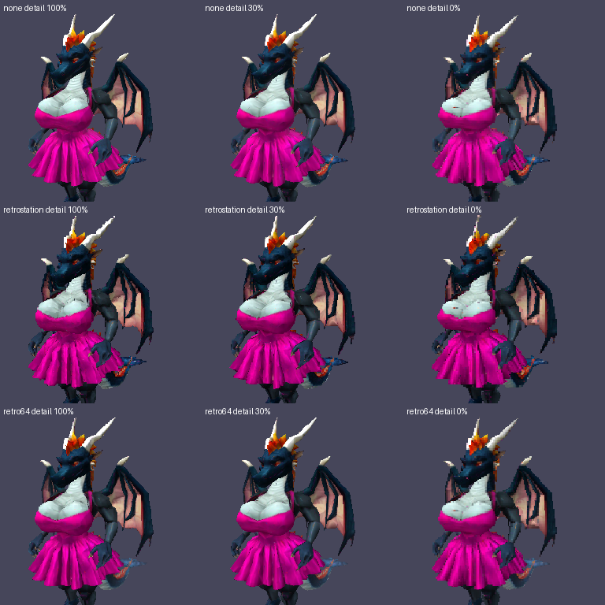
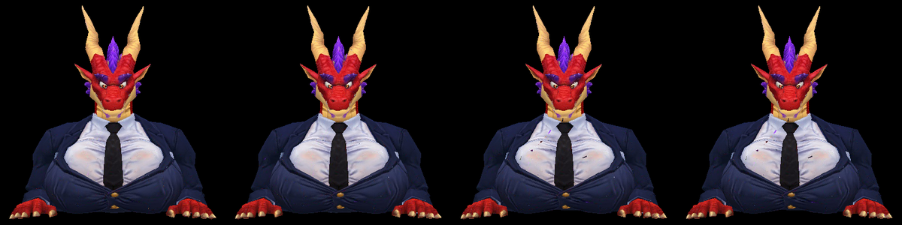
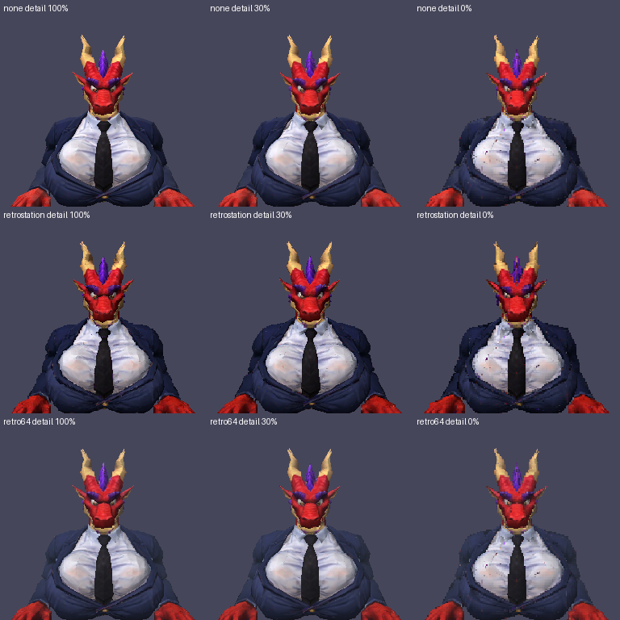

# 3D avatar

> *Your assistant as a real 3D character, rendered live on the phone, with detail you can dial down and retro console looks.*

<!-- nav -->

<a href="avatar-2d.md">← 2D avatar, bubble and backgrounds</a> &nbsp;·&nbsp; <a href="../README.md">Docs home</a> &nbsp;·&nbsp; <a href="autorig3d.md">AutoRig3D (automatic skeleton) →</a>

<!-- /nav -->

 Emulator render (GLES 3.0, software GPU) · rows: None / Retrostation / Retro64 · columns: detail 100 % / 30 % / 0 %

## At a glance

| | |
|---|---|
| **What it does** | Shows the assistant as an animated 3D model on Home, in the bubble and on the widget. It breathes, sways, gestures, and opens its jaw as it talks |
| **Where it comes from** | Bundled for Bob and Boob Dragon (on the first launch the 3D page shows *Preparing the built-in 3D avatars* while they are rigged in the background; the app stays usable); **import** your own `.glb`, `.gltf`, `.obj` or `.ply`; or make one from a photo with [Photo → 3D](photo-to-3d.md) |
| **Rigging** | Automatic (see [AutoRig3D](autorig3d.md)), or the model's own skeleton and animations if it has them |
| **Looks** | Normal, **Retrostation** (PS1 style) or **Retro64** (N64 style) |
| **Switch 2D ⇄ 3D** | *Show 3D on Home and the bubble*, a tap on the picture in Simple settings, or the widget's 2D/3D pill |

## Where the settings are

- **Simple settings:** **[Avatar Studio](avatar-studio.md)** (picture → 3D, step by step) and **Show my 3D avatar**.
- **Advanced › 3D avatar:** numbered steps, each marked *done*, *next* or *waiting* with the reason: **1 Import a 3D model you already have**, **2 Install 3D generation** (with time left), **3 Make one from a photo** (with the *Workflow & run settings* expander). Below them: **Show & frame**, **Rig & animation**, **Look** and **Detail**.

## How it works for you

Turn on **Show 3D**, and the 3D model replaces the flat picture wherever the avatar appears. It moves the same way as the 2D one: calm when idle, attentive when listening, thoughtful while thinking, and lively with a moving jaw when speaking. Your chosen background still shows behind it.

The **Detail** slider trades looks for battery: lower detail draws fewer triangles, uses smaller textures and a smaller picture, and animates less often. *Automatic for this phone* picks a level from your phone's memory and graphics chip. You can also give Home, the bubble and the widget **their own** detail level.

Technical details

- **Renderer** (`avatar/Avatar3DRenderer.kt`): **OpenGL ES 3.0, off-screen.**
  - One GL context on one background thread renders frames into a bitmap for Home, the bubble and the widget. Widgets cannot host GL views, so they get bitmaps.
  - `renderBlocking(req, timeoutMs)` returns `null` if 3D isn't possible, and the 2D picture is used instead.
- **Skinning:** GPU linear-blend skinning, with up to 4 joints and 4 weights per vertex.
  - **Rig v6:** a second weighting (`JOINTS_1` / `WEIGHTS_1`) is mixed in by the [animation strength](autorig3d.md#animation-strength).
- **Pose** (`Pose3D.evaluate`): the file's own animation (looped) if present, plus procedural motion on top: breathing, sway, nods, ears, wings and tail, arm gestures, and the jaw from the [lip-sync](avatar-2d.md) level. The states are 0 idle, 1 listening, 2 thinking, 3 speaking.
- **Back-face culling** is decided per model (`Orientation.kt`). Closed, consistently wound meshes (generated ones) are culled, so an inner clothing shell never pokes through at reduced detail.
- **Files per assistant:**
  - `avatar.glb`: standard glTF 2.0, with the progressive-mesh tables and the rig in `extras`/`skins`, so it opens in any viewer
  - `avatar3d.json`: info
  - `preview.png`: the widget's fallback still

## Detail levels

| Setting | Default | Effect |
|---|---|---|
| Automatic for this phone | On | Picks detail by RAM and graphics level |
| Detail | (auto) | Lowest · Low · Medium · High · Ultra |
| Home / Bubble / Widget: own setting | Off | A separate detail level for that surface |

Technical details

`core/Avatar3DSettings.kt`, class `Detail3D(level ∈ [0,1], surface)`. The "real work" is cut in four ways at once:

| Lever | Formula |
|---|---|
| **Triangles** (progressive-mesh prefix) | log scale: `exp(ln lo + (ln total − ln lo)·level)`, where `lo = max(1500, clean floor)` |
| **Texture base mip** | level ≥ 0.8 → 0 (full, ≤ 2048 px) · ≥ 0.55 → 1 (1024) · ≥ 0.3 → 2 (512) · else 3 (256). Never coarser than the model's **safe level** |
| **Render scale** | `0.35 + 0.65·level` of the view's pixels, at most 0.75 on the widget |
| **Frame-rate cap** | Home: idle `6+9·l`, active `12+18·l` fps · Bubble: idle `4+6·l`, active `8+16·l` · Widget: idle **2**, active `4+8·l` |

- **Automatic level** (`Detail3D.auto(ramGb, gles32, surface)`):

  | Tier | Condition | Home | Bubble | Widget |
  |---|---|---|---|---|
  | 0 | under 7 GB | 0.45 | 0.30 | 0.15 |
  | 1 | 7 GB or more | 0.65 | 0.45 | 0.25 |
  | 2 | 11 GB or more and GLES 3.2 | 0.85 | 0.60 | 0.35 |

- **Labels:** Lowest < 0.15 ≤ Low < 0.35 ≤ Medium < 0.6 ≤ High < 0.85 ≤ Ultra.
- **Prefs:** `detail3d` (−1 = auto) and `detail3d_<surface>` (−1 = follow the main level).
- **Measured** on the api29 emulator (x86_64, **software GPU, SwiftShader**, not a phone), Bob v4, one frame including read-back:

  | Detail | Triangles | Render size | Mip | ms/frame (None) | Retrostation | Retro64 |
  |---|---|---|---|---|---|---|
  | 100 % | 69,984 | 512 px | 0 | 108 | 86 | 129 |
  | 30 % | 24,020 | 279 px | 1 | 43 | 51 | 66 |
  | 0 % | 15,188 | 179 px | 1 | 52 | 32 | 41 |

  These numbers show the *relative* savings only. A phone GPU renders the same frames many times faster. Phone frame times were not recorded for this release.

 JVM render · Bob at four progressive-mesh levels: the silhouette and texture hold while triangles drop

Technical details: progressive mesh and texture mips

- **Progressive mesh** (`mesh/ProgressiveMesh.kt`, Hoppe-style):
  - Built **once** at import from **quadric-error half-edge collapses**, and stored inside the `.glb`.
  - Half-edge collapses never create vertices: a collapsed vertex merges into an existing neighbour. Every surviving vertex therefore keeps its own position, UV, colour **and skinning weights**, which is how the rig survives any detail level.
  - Vertices and triangles are stored in collapse order (`pmParent`, `pmTriDeath`), so any level is a **prefix plus an index remap**. `glDrawRangeElements` then touches only vertices `[0, n)`: fewer triangles drawn *and* fewer vertices skinned.
  - Collapses run on the **welded** surface. A UV seam's copies ("wedges") move together within the same texture chart.
  - A collapse is refused if it would drag a triangle across the atlas, fold a triangle in 3D or UV space, flip outside the normal cone, or pull an open border inward.
  - `CLEAN_ERROR` sets the lowest level the slider may reach.
- **Chart-aware mipmaps** (`mesh/TextureMips.kt`):
  - Generated models use atlases of many small charts with black gutters. A plain box filter (`glGenerateMipmap`) smears those gutters into the edges.
  - Instead, the texels actually covered by triangles are found by rasterising in UV space, the gutters are filled before each down-sample, and each level's **mean RGB error** over the used texels is measured.
  - `safeLevel(errors, limit = 6)` (`SAFE_ERROR`) is the coarsest level allowed.

## Retro looks (shaders)

| Look | What you see | Options |
|---|---|---|
| **None** | Smooth, lit, modern | |
| **Retrostation** | 1990s PlayStation: wobbly vertices, warping textures, 15-bit colour with dithering, low resolution | Intensity · *No depth buffer* (draws back to front like the PS1) |
| **Retro64** | Nintendo 64: soft 3-point texture filter, low resolution, distance fog | Intensity · Fog (on) |

 Emulator render · the three looks

Technical details

**Retrostation** (`uMode 1`):
- **Vertex snapping:** clip-space XY is snapped to a grid of `res / (2 + 4·intensity)`, the famous jitter.
- **Affine texture mapping:** UV × w is interpolated and divided back per fragment.
- **Colour:** quantised from 255 down to **31 steps** (5 bits per channel) with **Bayer ordered dithering**.
- **Resolution:** internal resolution capped at about `320 − 96·intensity` px.
- **No depth buffer** (`psx_no_depth`): triangles are sorted back to front on the CPU each frame, like the PS1's ordering tables.

**Retro64** (`uMode 2`):
- The **N64 3-point texture filter** is blended in by intensity.
- **Fog:** linear distance fog (`n64_fog`, default on) towards `rgb(0.55, 0.60, 0.68)`.
- **Resolution:** internal resolution capped at about 320 px.

**Both:** the whole atlas is capped at about 512 → 256 px with intensity, like a console's texture memory. `shader3d` (`none` / `retrostation` / `retro64`, exactly one at a time) and `shader3d_intensity` (0.8).

## Importing your own 3D model

Press **Import 3D model** (or **Replace 3D model**) on the *3D avatar* page and pick the file (and its texture and `.bin`/`.mtl` files, if separate). The app reads it, builds the detail levels, rigs it automatically (or keeps the model's own skeleton and animations), finds the mouth, saves it and makes a preview. **Rig** lets you choose *Smooth skin* or *N64-style parts*. **Edit framing** sets the camera distance, height and angle per surface. **Remove** goes back to 2D.

Technical details

- **Readers** (`mesh/Import3D.kt`, `mesh/Mesh3D.kt`):
  - **.glb**: all triangle primitives merged, node transforms applied, skins and animations kept
  - **.gltf**: embedded, or with its `.bin` and images picked alongside
  - **.obj**: with `.mtl` and texture
  - **.ply**: ASCII or binary little-endian, with optional normals, vertex colours and UVs
- **Pipeline** (`Avatar3DFiles.import`):
  1. read
  2. progressive mesh
  3. auto-rig (unless the file has its own skeleton)
  4. jaw / mouth
  5. save `avatar.glb`
  6. render `preview.png`
- **Rig style** (`rig_style3d`): `skinned` (two nearest bones blended) or `rigid` (each vertex follows one bone, N64-style segments). Changing it re-imports from the stored mesh.
- **Upgrades:** models saved by older versions are upgraded quietly in the background (`upgradeDetailLevelsInBackground`).
- **Other prefs:** `show3d` (true), `framing_*` (3D: distance, height, orbit angle).

## Limits and honest notes

- 3D needs OpenGL ES 3.0. Phones without it, and any render failure, fall back to the 2D picture.
- Very dense models (hundreds of thousands of triangles) import slowly and use more memory. 70k triangles with 1024 px textures (the bundled avatars) is the tested size.
- **Verified on a real phone:** the 3D avatar on the home-screen widget ([real-device screenshot](widget.md)). Home and bubble 3D were exercised on the emulator. Real-phone frame rates and battery cost were **not measured**.

<!-- nav -->

<a href="avatar-2d.md">← 2D avatar, bubble and backgrounds</a> &nbsp;·&nbsp; <a href="../README.md">Docs home</a> &nbsp;·&nbsp; <a href="autorig3d.md">AutoRig3D (automatic skeleton) →</a>

<!-- /nav -->
