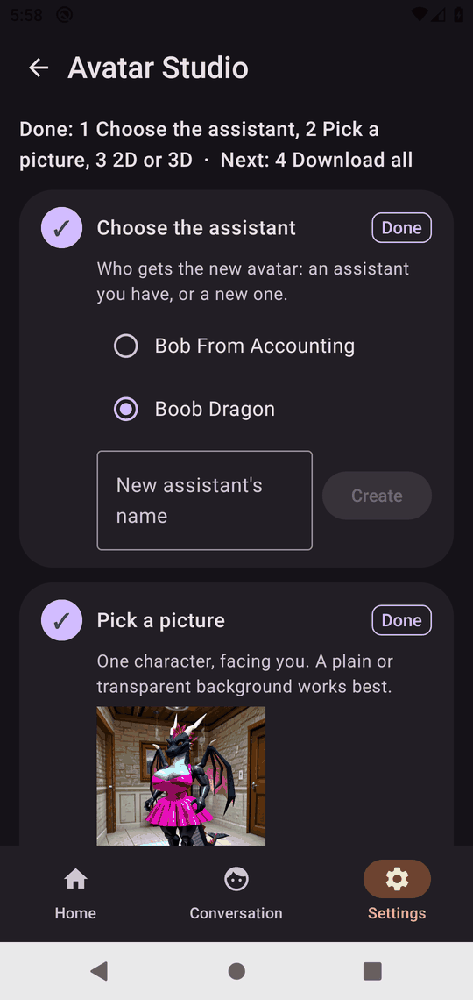
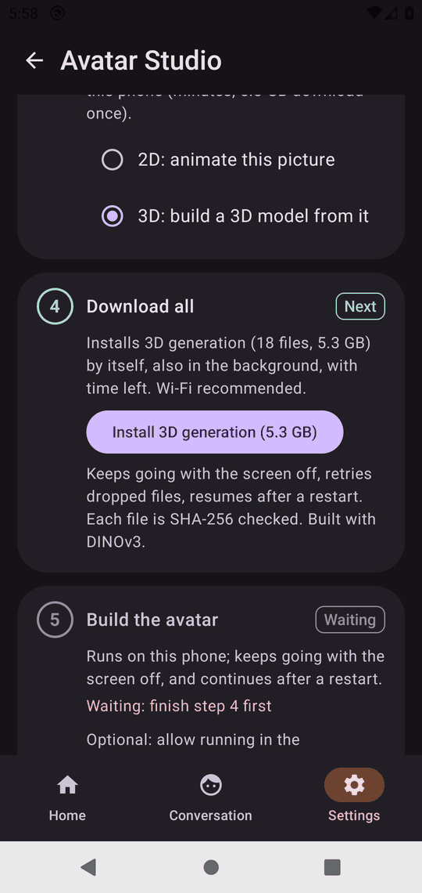

# Avatar Studio

> *A guided path to a new avatar: choose the assistant, pick a picture, choose 2D or 3D, download what it needs, and build. It remembers where you were.*

<!-- nav -->

<a href="read-to-me.md">← Read to me (audiobooks)</a> &nbsp;·&nbsp; <a href="../README.md">Docs home</a> &nbsp;·&nbsp; <a href="avatar-2d.md">2D avatar, bubble and backgrounds →</a>

<!-- /nav -->

 &nbsp;  Emulator render (0.1.3) · Settings (Simple) › Avatar Studio

## At a glance

| | |
|---|---|
| **Where** | *Settings* in **Simple** view › *Avatar* › **Avatar Studio** |
| **Steps** | 1 Choose the assistant · 2 Pick a picture · 3 2D or 3D · 4 Download all · 5 Build the avatar |
| **2D** | Ready in seconds; nothing to download |
| **3D** | Builds a 3D model from the picture **on the phone**. One-time download of 5.3 GB; then minutes per model, with a live *time left* |
| **Safe to interrupt** | Close the app, lose power, restart: it continues from where it stopped |
| **Advanced** | The same parts live on separate pages: [2D avatar](avatar-2d.md), [3D avatar](avatar-3d.md), [Photo → 3D](photo-to-3d.md) |

## How it works for you

Each step is a card with a number and a status:

- **✓ Done:** finished; you can still change it.
- **Next:** what to do now.
- **Waiting:** it says what it is waiting for, for example *"pick a picture first"* or *"downloading now"*.

1. **Choose the assistant.** Tap one you have, or type a name and press **Create** for a new one. The avatar goes to this assistant only.
2. **Pick a picture.** One character facing you; a plain or transparent background works best. It is kept aside until the build, so nothing changes on the assistant yet.
3. **2D or 3D.**
   - **2D** animates the picture itself (mouth, breathing, sway).
   - **3D** builds a 3D model from it on this phone, rigs it automatically, and lets it move in 3D.
4. **Download all.** 2D needs nothing. For 3D it installs *3D generation* (18 files, 5.3 GB) by itself, also in the background, with a progress bar and *time left* per file. Wi-Fi is recommended.
5. **Build the avatar.**
   - **2D:** **Use this picture** gives it to the assistant right away. **Check mouth & joints** (optional) opens the rig editor.
   - **3D:** **Build the 3D avatar** starts it, always for the assistant from step 1. That choice is stored with the job, so the model can't land on another assistant. The status (stage, *Step N of M*, time left, bar) scrolls to the top with a full-width **Stop** under it. A notification shows *"Making a 3D model · about N min left"*. You can leave the app. The phone doesn't go to sleep during the build, and the screen stays on while this page is open. The first build asks **once** to run without battery limits.
   - When it's done, a notification says *"<name>'s 3D avatar is ready"*; if it failed, it gives the reason. **Make <name> active** makes that assistant the active one and switches the widget to 3D. **Make another** starts the Studio over.
   - Below step 5, the **3D build log** shows past runs, an unfinished run with **Resume**, any finished model that wasn't attached (**Attach last generated model to…**), and **Export log: share…** / **Save…**. See [Photo → 3D › Build log and history](photo-to-3d.md#build-log-and-history).

**If something interrupts it** (the app is closed, the battery dies, the phone restarts), the build continues from the last finished step the next time the app opens or the phone starts. The Studio also reopens at the step you were on. The Simple settings row says *"Continue where you left off: step 4 of 5 (Download all)"*.

The avatar is only switched over **after the new one is completely saved**, so an interrupted build never leaves the assistant with half an avatar.

Technical details

- **Code:** `ui/AvatarStudio.kt` (screen), `core/StudioFlow.kt` (state and step rules, no Android code). It reuses the Advanced building blocks rather than copies: `StepCard` / `StepsSummary` (`ui/AvatarPages.kt`), `Install3DPanel`, `assign2DPicture` (also used by the 2D avatar page), `Pixal3DJob.run` and `Pixal3DService`.
- **State:** `StudioState(profileId, picture, kind, buildStarted, finished, step, startedAt)` saved as sealed JSON (magic | length | payload | SHA-256) with **temp file → fsync → rename**, alternating between two slots `files/avatar_studio/studio.{0,1}.ck`. Loading takes the newest slot that passes its checksum; a damaged save falls back to the one before.
- **Step rules** (`StudioFlow.steps`): a step is *Done* only when what it produced still exists on the phone (the profile, the picture file, installed models, an avatar written after `startedAt`). It is *Next* only when every earlier step is done; otherwise it is *Waiting* with a reason. Tested in `StudioFlowTest`.
- **2D build:** `assign2DPicture` writes the picture atomically under a unique name, sets that assistant's `avatar_file`, deletes the old picture if no other assistant uses it, turns `show3d` off for that assistant, and refreshes the bubble and widget.
- **3D build:** `Pixal3DJob.run(profileId, bitmap)` under `Pixal3DService` (foreground `specialUse`, partial wake lock), with per-step checkpoints and resume (see [Photo → 3D](photo-to-3d.md#how-it-works-for-you)). After the atomic import it sets `show3d` for that assistant.
- **Battery optimisation:** if the app isn't exempt, the 3D step offers `ACTION_REQUEST_IGNORE_BATTERY_OPTIMIZATIONS` (falls back to the settings list). Declining is fine: the foreground service and wake lock still run.
- **Desktop port:** the Windows equivalent is a tray item that opens the same five steps; see [AGENTS.md](../../AGENTS.md#avatar-studio).

## Limits and honest notes

- The 3D build has been verified end to end on a desktop CPU with the phone's files and code, and the resume logic by unit tests (kill after every step, truncated checkpoints). A full build **on a real phone** has not been timed yet.
- Only one 3D build runs at a time. Starting the Studio for another assistant while one builds shows the running build.
- The Studio picks pictures; it does not import 3D files you already have. Use *Import a 3D model you already have* on the [3D avatar](avatar-3d.md) page for that.

<!-- nav -->

<a href="read-to-me.md">← Read to me (audiobooks)</a> &nbsp;·&nbsp; <a href="../README.md">Docs home</a> &nbsp;·&nbsp; <a href="avatar-2d.md">2D avatar, bubble and backgrounds →</a>

<!-- /nav -->
