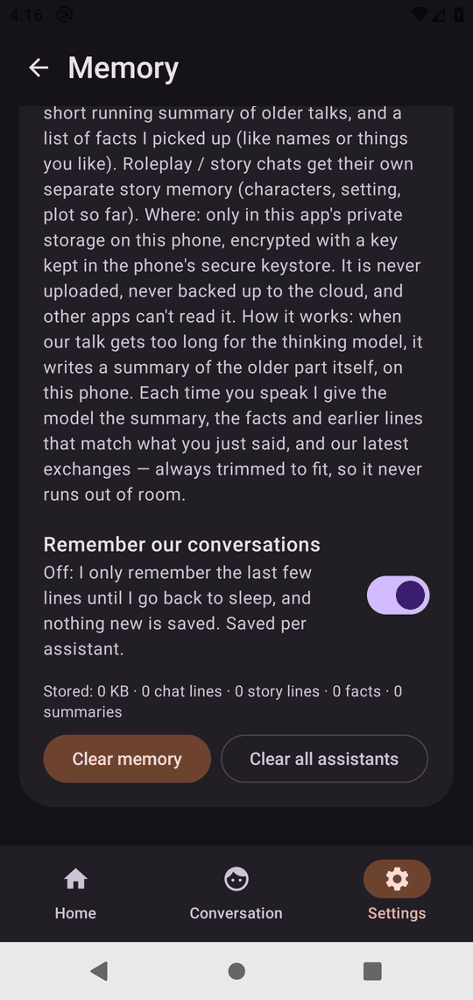

# Long-term memory

> *Remembers your conversations and the facts you mention, privately and encrypted, and only on your phone.*

<!-- nav -->

<a href="voices.md">← Voices and sounds</a> &nbsp;·&nbsp; <a href="../README.md">Docs home</a> &nbsp;·&nbsp; <a href="assistants-and-personalities.md">Assistants, personalities and standing instructions →</a>

<!-- /nav -->

 Emulator render · Settings › Memory

## At a glance

| | |
|---|---|
| **What it does** | Lets the assistant recall earlier talks, your name, likes and plans, and the plot of a story you're telling together |
| **Where it is kept** | One encrypted database per assistant, in the app's private storage |
| **Default** | On (*Remember our conversations*) |
| **You control** | Viewing every remembered line, fact and summary; deleting single entries; clearing one assistant or all |

## How it works for you

A small model can only "see" a few pages of text at once, so the assistant cannot simply re-read your whole history. Instead it keeps three kinds of memory:

1. **Recent lines:** the last few things you said and it answered, word for word.
2. **A running summary:** when the conversation gets long, the assistant writes a short summary of the older part itself (on the phone, during a quiet moment) and keeps that instead.
3. **Facts:** short notes it picked up while summarising, such as *"User's dog is called Biscuit"*.

Each time you speak, it gathers the summary, the facts and the older lines that match your words, plus the latest exchanges, trimmed to fit, and hands them to the model with your sentence.

Stories and roleplay have their **own separate memory** (characters, setting, plot so far), so a story never gets mixed up with everyday chat.

Technical details

- **Code:** `core/Memory.kt` (`Memory`, `Bm25`, `MemoryAssembler`, `MemorySummarizer`, `ModelText`) and `memory/SqlMemoryStore.kt`.
- **Threads:** `CHAT` and `STORY` per profile, plus the reserved `DIRECTIVES` thread (pinned instructions, see [Assistants & personalities](assistants-and-personalities.md)) and `LONGFORM` (the story being told right now).
- **Token estimate:** `tokens(s) ≈ chars / 3`. This is conservative, since English averages 3.5–4.5 characters per token.
- **Budget:** `budget(ctx, system, maxReply) = ctx − system prompt − reply − margin`, capped at `MAX_MEMORY_TOKENS = 600` (`LONG_MEMORY_TOKENS = 400` for stories).

**Assembly** (`MemoryAssembler.build`), in order, each part with a cap:

| # | Part | Cap |
|---|---|---|
| 0 | **Pinned directives** + *"User now says: …"* | always whole, outside the budget (your words are cut to ≤ ¼ of the budget) |
| 1 | Rolling **summary** (*"What you remember about this user…"* / *"Story so far…"*) | ≤ 30 % of what's left |
| 2 | **Facts**: up to 8, ranked by **Okapi BM25** against your words, 60 tokens each | ≤ 15 % |
| 3 | **Old snippets**: up to 4 older turns ranked by BM25 | ≤ 15 % |
| 4 | **Recent conversation**: newest first, from the last 12 turns, until the budget is full | rest |

All of this goes in the *user* turn, not the system prompt, so the long system prompt stays cached in the model's KV cache.

## When summaries are written

Summaries are written by the same thinking model, **in the background after 20 seconds of quiet**. If you start talking again, the summary job steps aside immediately and tries later. Even with no model loaded, memory keeps rolling with a simpler summary made from the first sentences.

Technical details

`MemorySummarizer(keepRecent = 4, maxLoose = 10, minFold = 4)`:

- **Trigger:** at least 4 foldable turns exist beyond the newest 4, and either more than 10 turns are unsummarised or they would use more than half the memory budget.
- **Prompt:**
  - Current summary and new lines. Each turn is cut to 300 characters, or 1,500 characters of reply for stories.
  - The whole input is limited to the last 2,400 characters (4,000 for stories).
  - Output is capped at 200 tokens (340 for stories). `/no_think` is added for Qwen3.
- **Output:** a summary and a list of facts, both parsed. New facts are de-duplicated, case-insensitively.
- **Fallback:** if the model failed and the turns are not piling up (≤ 30), it waits for the next quiet moment. Otherwise it builds an **extractive summary**: the previous summary plus the first sentence of each turn, trimmed to 900 characters.
- **Scheduling:** `SUMMARIZE_IDLE_MS = 20 000`. The job runs through `LlamaEngine.background {}`, so a reply preempts it.

## Privacy and deleting

Your memory never leaves the phone. It is encrypted with a key locked inside the phone's secure keystore, it is excluded from cloud backups, and other apps cannot read it.

The Memory page lists everything: the summary, every fact and every line (newest first). Each has a delete button. **Clear memory** erases one assistant's memory, and **Clear all assistants** erases every assistant's. Both permanently destroy the data and its key.

Technical details

- **Storage:** one SQLite file per profile at `no_backup/memory/<alias>.db` in app-private **no-backup** storage. The manifest also sets `allowBackup="false"` with data-extraction rules. It is excluded from Android Auto Backup and device transfer.
- **Tables:**
  - `turns(id, thread, u BLOB, r BLOB, ts, summarized)`
  - `notes(id, thread, t BLOB, ts)`
  - `summaries(thread PK, t BLOB, ts)`
- **Encryption:** every text column is encrypted with **AES-256-GCM** (a fresh random IV per value) under a key generated in the **Android Keystore**. The key is hardware-backed where the phone supports it, and it is never exported. The page shows *"encrypted"*, or a warning if the keystore was unavailable.
- **Secure wipe** (`clear()`):
  1. `PRAGMA secure_delete` zeroes freed pages, then the rows are deleted.
  2. `VACUUM`, then the files are deleted.
  3. The Keystore key is destroyed, so any leftover ciphertext is unreadable.
- `clearAll()` also wipes stores of deleted profiles.
- **Switch:** `memory_on` (default **true**). With it off, only the last 4 exchanges are kept in RAM for context.
- **Short-term context** is reset when a new session starts more than 5 minutes after the last turn. Long-term memory is unaffected.

## Limits and honest notes

- Summaries are written by a small model and can miss or garble details. You can delete wrong facts on the Memory page.
- Retrieval is keyword-based (BM25), not meaning-based. *"my pet"* will not find a fact stored as *"dog named Biscuit"*.
- There is no separate memory-size setting: the old unused `mem_budget_mb` was removed in 0.1.2. Model memory follows the model you pick (see the [settings reference](../settings-reference.md)).

<!-- nav -->

<a href="voices.md">← Voices and sounds</a> &nbsp;·&nbsp; <a href="../README.md">Docs home</a> &nbsp;·&nbsp; <a href="assistants-and-personalities.md">Assistants, personalities and standing instructions →</a>

<!-- /nav -->
