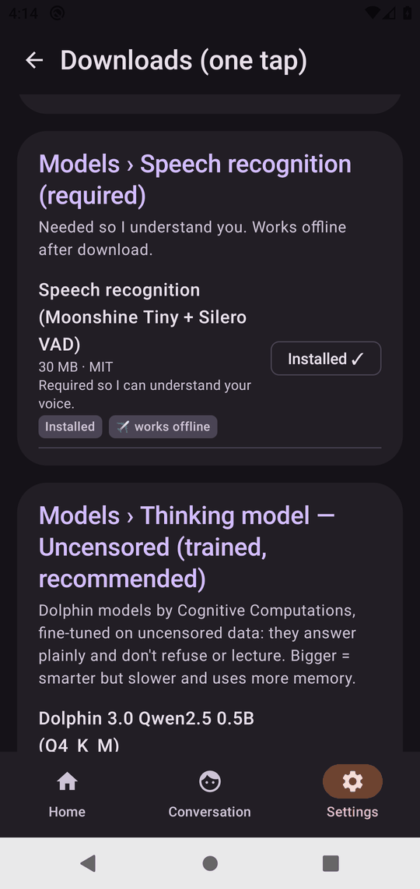

# Models and downloads

> *What the assistant needs, how big it is, where it comes from, and how to get it with one tap or with no internet at all.*

<!-- nav -->

<a href="photo-to-3d.md">← Photo → 3D (Pixal3D on the phone)</a> &nbsp;·&nbsp; <a href="../README.md">Docs home</a> &nbsp;·&nbsp; <a href="privacy-permissions-storage.md">Privacy, permissions and storage →</a>

<!-- /nav -->

 Emulator render · Settings › Downloads (one tap)

## At a glance

| Part | Needed? | Size | Comes with the app? |
|---|---|---|---|
| Wake-word listener | Yes | 5.8 MB | **Yes**, inside the APK |
| Background cut-out (U²-Net-P) | for custom backgrounds | 4.4 MB | **Yes** |
| Default 3D avatars (Bob, Boob Dragon) | | ~4 MB each | **Yes** |
| Speech recognition (Moonshine + VAD) | **Yes**, to understand you | 30.5 MB | Download or import |
| A voice | **Yes**, to talk | ~21 MB (int8) to ~131 MB (full precision HQ); Kokoro 103 MB | Download or import |
| A thinking model | For anything beyond the built-in commands | 0.4–4.9 GB | Download or import |
| Photo → 3D models | Optional | 5.29 GB | [Separate installer](photo-to-3d.md) |

## Three ways to get models

1. **Downloads (one tap):** a list grouped by kind, with sizes, licences, ★ for the best fit for your phone, and ▶ to hear voices. The speech, model and voice pages also have a **One-tap download** button that leads here. The list builds only the rows on screen; for a moment after it opens it says *Checking what's installed…* while that is looked up in the background.
   - Downloads continue in the background, with the screen off, under a progress notification.
   - A dropped download retries by itself a few times before it shows as failed.
   - If the app is closed or the phone restarts, unfinished downloads you started continue the next time Android allows it.
   - **Pause** (full width, under the progress bar while a file downloads) stops one; *Resume* continues it from where it stopped.
   - Each download shows its **time left** (*"about 6 min left"*), and the notification shows the speed. Files waiting in line include the time of the ones ahead of them.
2. **Import a file you already have:** *Import a file* at the top of *Downloads (one tap)* (or *Import files* on the speech page, *Import .gguf file* on the model page, *Import voice file* on the voice page). This works fully offline: copy files over USB first.
3. **Belle Downloader (optional companion app):** a separate small app that downloads models and hands them to the assistant, for people who want the assistant itself never to touch the network for models. An *Open Downloader* button appears only when it is installed.

Technical details

- **Catalog:** `shared/core/ModelCatalog.kt` (exact byte sizes, SHA-256 and licences). The download list is built by `models/Downloads.kt` in these groups:
  - Speech recognition (required)
  - Thinking model: Uncensored, Abliterated, Standard
  - Roleplay / story
  - Voice: High-quality, Standard int8, Full precision, Kokoro
- **Sources:** speech packs and voices come from the **sherpa-onnx GitHub releases**; GGUF models from **Hugging Face**.
- **Fetching** (`models/Fetcher.kt`):
  - HTTPS only. Each redirect hop is checked against the allow-list (start at `github.com` / `huggingface.co`; then `*.githubusercontent.com`, `*.huggingface.co`, `*.hf.co`).
  - **Range resume** on `.part` files, then a size check and a **SHA-256** check before the rename.
- **Background:** `DownloadService` is a foreground service of type `dataSync` with a progress notification.
  - It holds a partial **wake lock** and a **Wi-Fi lock** while anything downloads.
  - It is **sticky**: if Android kills the process, the restarted service resumes the downloads.
  - One-tap downloads use a pool of two; the 3D set downloads one file at a time.
- **Time left** (`core/Eta.kt › TransferEta`): bytes left ÷ smoothed speed (one sample a second over all running downloads, α 0.2), plus the bytes of everything ahead in the queue. The last speed is saved in prefs `downloads_eta › bytes_per_sec` every 10 s, so a resumed queue starts with an estimate. Tested in `EtaTest`.
- **Automatic retries:** `Downloads.AUTO_RETRIES = 4` per download, with back-off `min(2 s · 2^n, 60 s)`. Each retry resumes the `.part` file. Pause/cancel stops it at once.
- **Resume after kill or reboot:** started downloads are kept in prefs `downloads_wanted` until they finish or you pause them. `DownloadService.resumeAll()` runs on app resume, on a sticky restart, and from `BootReceiver` (Android ≤ 14). On Android 15+ it posts a *Tap to finish your downloads* notification instead, because BOOT_COMPLETED may not start a `dataSync` service there.
- **Imports** (`models/ModelImport.kt`) decide what a file is:
  - `.gguf` → thinking model (SHA-256 verified if it is a known catalog model)
  - Moonshine `.tar.bz2` → speech (only the model files are kept, flattened)
  - `silero_vad.onnx` → VAD
  - any other sherpa-onnx `.tar.bz2` → a voice (must contain an `.onnx`)
- **Downloader app:** the `:downloader` Gradle module (`app.belle.downloader`). It downloads (resumable, SHA-256 checked for LLMs), then sends the file to the assistant or saves it to *Downloads* for import.
- **Storage:** see [Privacy, permissions & storage](privacy-permissions-storage.md#storage-layout).

## What loads when (memory)

Only the wake-word listener (about 6 MB) stays loaded all the time. When you wake the assistant:

1. Speech recognition loads first (what you say meanwhile is buffered).
2. The voice and the thinking model load **in parallel while you speak**.
3. After the *unload after idle* time (60 s by default), everything except the listener is unloaded again.

Technical details

- **`AssistantRuntime`, load on demand** (`on_demand`, default true): STT first, then TTS and LLM on separate loaders, then `brain.warm()` (system prompt into the KV cache).
- **Unloading:** `unload_after` (60 s; slider 10–600 s) posts an unload runnable after the last activity.
- **Load on demand off:** everything is loaded at service start and stays loaded.
- **Measured** (api29 software emulator, a worst case): STT ready **26 s**, TTS load **77 s**. On real phones these take a few seconds. Phone load times were not recorded for this release.
- **Approximate memory while loaded:**

  | Part | Memory |
  |---|---|
  | Voice | 170–340 MB (see [Voices](voices.md)) |
  | Thinking model | about its file size plus the KV cache (4096 tokens) |
  | Speech recognition | tens of MB |

## Limits and honest notes

- The first-run downloads need a connection, or files copied to the phone.
- Hugging Face or GitHub may change or rate-limit files. Every download is checksum-verified, so a changed file fails cleanly instead of installing.
- Resuming after a restart depends on Android allowing it. On Android 15+ it needs one tap on the notification, and some phone brands also stop background work aggressively.

<!-- nav -->

<a href="photo-to-3d.md">← Photo → 3D (Pixal3D on the phone)</a> &nbsp;·&nbsp; <a href="../README.md">Docs home</a> &nbsp;·&nbsp; <a href="privacy-permissions-storage.md">Privacy, permissions and storage →</a>

<!-- /nav -->
