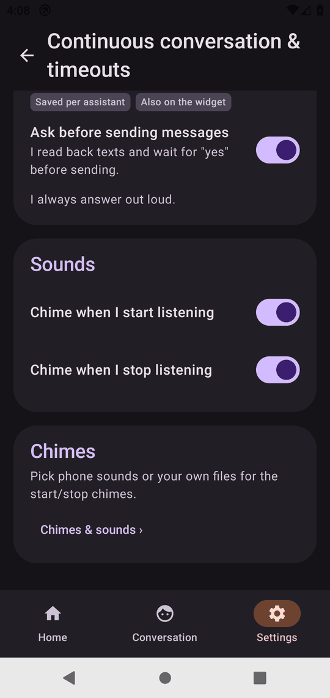

# Phone actions

> *Calls, texts, alarms, timers, reminders, apps, music, maps and screen control, all by voice.*

<!-- nav -->

<a href="thinking-model.md">← The thinking model (chat)</a> &nbsp;·&nbsp; <a href="../README.md">Docs home</a> &nbsp;·&nbsp; <a href="web-and-news.md">Internet answers and news →</a>

<!-- /nav -->

 Emulator render · Settings › Continuous conversation &amp; timeouts

## At a glance

| | |
|---|---|
| **What it does** | Turns requests into real actions on the phone |
| **How** | The fast rules or the thinking model choose one action. The app then uses Android's normal ways to do it |
| **Safety** | Text messages ask first (on by default). Screen control needs Accessibility, which you turn on yourself |

## What you can ask for

| Action | Example | What happens | Needs |
|---|---|---|---|
| Call | "call Sam" | Finds Sam in contacts and calls. Without call permission it opens the dialler | Contacts, Phone (optional) |
| Text | "text Sam I'm on my way" | Reads it back and asks *"Send it?"*, then sends | Contacts, SMS (optional) |
| Open app | "open the calculator" | Fuzzy-matches installed app names | none |
| Alarm | "wake me up at 6:45" | Sets it in your clock app, silently | none |
| Timer | "timer for 20 minutes" | Starts a clock-app timer | none |
| Reminder | "remind me at 5 to call mum" | The assistant's own notification at that time, kept through a restart | Notifications |
| Calendar | "add dentist tomorrow at 3" | Opens a pre-filled new event in your calendar app | none |
| Notes | "note: buy milk" / "read my notes" | Saves to or reads from a private notes file | none |
| Flashlight | "torch on" | Toggles the camera flash | none |
| Volume | "volume to 40 percent", "mute" | Media, ring, alarm, notification or call volume | none |
| Settings | "open Bluetooth settings" | Opens one of 15 settings screens | none |
| Media | "pause", "next song" | Sends media keys to whatever is playing | none |
| Navigate | "directions to the station by walking" | Opens your maps app | none |
| Info | "what's my battery" | Says the time, date, battery, storage or network | none |
| Camera | "open the selfie camera" | Photo, video or selfie | none |
| Web search | "search the web for pancakes" | Opens the query in your browser | none |
| Screen | "scroll down", "tap Send", "read the screen" | Operates any app's screen | Accessibility |

## Doing things from the background

Since Android 10, apps cannot open other apps from the background. If the assistant is not on screen and does not have **"Display over other apps"**, it shows a **notification you tap** to finish the action, and it says so. Grant that permission in *Permissions & background listening* to make actions instant.

Technical details

- **Code:** `actions/AndroidPhoneActions.kt`, which implements the `PhoneActions` interface. The router is `core/ActionRouter.kt`.
- **Background starts:** `start(intent)` first tries `startActivity`. If that is blocked (API 29+ without `SYSTEM_ALERT_WINDOW`), the intent goes into a heads-up notification's `PendingIntent`, and the spoken reply adds *"Tap the notification…"*.
- **Contacts:** `findContact()` searches `ContactsContract` by display name.
- **Call:** `ACTION_CALL` if `CALL_PHONE` is granted, otherwise `ACTION_DIAL`.
- **SMS:**
  - With `SEND_SMS`: `SmsManager.sendMultipartTextMessage` (long texts are split).
  - Without it: `ACTION_SENDTO smsto:` opens your messaging app with the text filled in.
  - Confirmation is controlled by `confirm_sms` (default **true**), through `Brain.pending` and yes/no matching.
- **Alarm/timer:** `AlarmClock.ACTION_SET_ALARM` / `ACTION_SET_TIMER` with `EXTRA_SKIP_UI`. If no clock app answers, `scheduleOwn()` posts the app's own alarm notification through `AlarmManager` and `ReminderReceiver` (`SCHEDULE_EXACT_ALARM` / `USE_EXACT_ALARM`).
- **Reminder:** always uses the app's own exact alarm. When it fires, `ReminderReceiver` posts a high-priority notification (channel *Reminders*) and also **speaks** *"Reminder: …"*.
- **Surviving a restart:** `service/Reminders.kt`.
  - Every reminder (and the app's own alarm/timer fallback) is saved in `files/reminders.json` (`ReminderStore`: id, due time, text, alarm flag) before it is handed to `AlarmManager`. The id is also the `PendingIntent` request code.
  - When it fires, `ReminderReceiver` removes it from the file.
  - Android forgets all `AlarmManager` alarms on reboot, app update and force stop. So `BootReceiver` (`BOOT_COMPLETED`, `MY_PACKAGE_REPLACED`) and every app start (`MainActivity.onResume`) call `Reminders.rescheduleAll()`. Re-arming uses the same request codes, so doing it again only replaces the same alarms.
  - `ReminderStore.plan(now)`: future reminders keep their time. Ones that came due while the phone was off fire 5 s apart right away; if more than a minute late they say *"… (was due 9:00 AM)"*. Ones more than 7 days overdue are dropped.
  - Tests: `ReminderStoreTest` (6 cases: survives a new store on the same file, fired ones aren't re-armed, late/staggered plan, Doze delay isn't "late", 7-day drop, idempotent re-arm, corrupt file).
- **Calendar:** `Intent.ACTION_INSERT` on `CalendarContract.Events`, so nothing is written without you saving it.
- **Notes:** `files/notes.txt`, one line per note: `yyyy-MM-dd HH:mm<TAB>text`. This file is separate from long-term memory.
- **Open app:** `AppMatcher.score` does fuzzy matching (token overlap and prefix) over launcher apps.
- **Media:** `AudioManager.dispatchMediaKeyEvent` with `KEYCODE_MEDIA_PLAY / PAUSE / PLAY_PAUSE / NEXT / PREVIOUS / STOP`.
- **Navigate:** `google.navigation:q=…&mode=d|w|b|r`. "map" mode uses `geo:0,0?q=`.
- **Web search:** opens `https://duckduckgo.com/?q=…` in your browser. The app itself does not fetch anything for this.
- **Settings panels:** wifi, bluetooth, internet, mobile_data, volume, nfc, location, battery, display, sound, airplane, apps, accessibility, assistant, main.

## Screen control (optional)

Turn on the assistant's Accessibility service and it can operate other apps for you:

- **Navigate:** go back, go home, show recent apps, pull down notifications or quick settings
- **Interact:** tap a button by its text, long-press, type text, scroll up or down
- **Other:** read the screen aloud, lock the phone, take a screenshot

It only acts when you ask. It does not watch the screen otherwise.

Technical details

- **Code:** `actions/BelleAccessibilityService.kt`.
- **The 13 operations:**
  - **Global actions** (`performGlobalAction`): back, home, recents, notifications, quick_settings, lock, screenshot
  - **Gestures:** scroll_down, scroll_up
  - **Node actions:** tap, long_press, type (finds the best node by visible text or content description, then `ACTION_CLICK` / `ACTION_LONG_CLICK` / `ACTION_SET_TEXT`)
  - **read_screen:** collects the visible text nodes and speaks them
- **Without the service:** the action replies with how to enable it (Settings › Accessibility › Installed apps).
- **Also used by the web feature's** optional *"Also read the browser tab"* mode (see [Internet](web-and-news.md)).

## Limits and honest notes

- Exactly one action per request. *"Set an alarm and text Sam"* does only one of them.
- Contact matching uses names. Similar names may pick the wrong person, which is why texts are confirmed.
- **Reminders survive a restart.** They are saved on the phone and set again after a reboot, an app update or a force stop. One that came due while the phone was off goes off right after the phone starts and says the time it was for. The logic is unit tested; the reboot itself was checked on the emulator (see [Status](../status.md)).
- **What was tested:** the emulator event log (`proof/api29/events.log`) shows these actions completing by voice: open app, open settings, set alarm, set timer, volume, flashlight and device info. Calls, texts, reminders firing, calendar, navigation and screen control are covered by unit tests of the parsing and routing only. They were **not verified end to end on a real phone** for this release.

<!-- nav -->

<a href="thinking-model.md">← The thinking model (chat)</a> &nbsp;·&nbsp; <a href="../README.md">Docs home</a> &nbsp;·&nbsp; <a href="web-and-news.md">Internet answers and news →</a>

<!-- /nav -->
