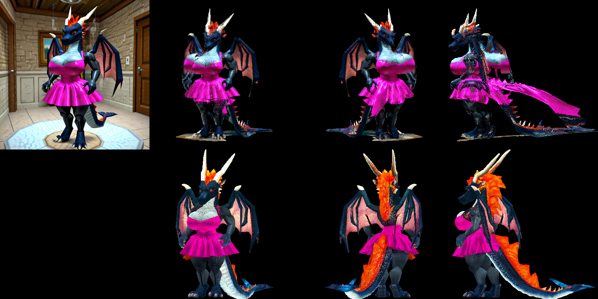
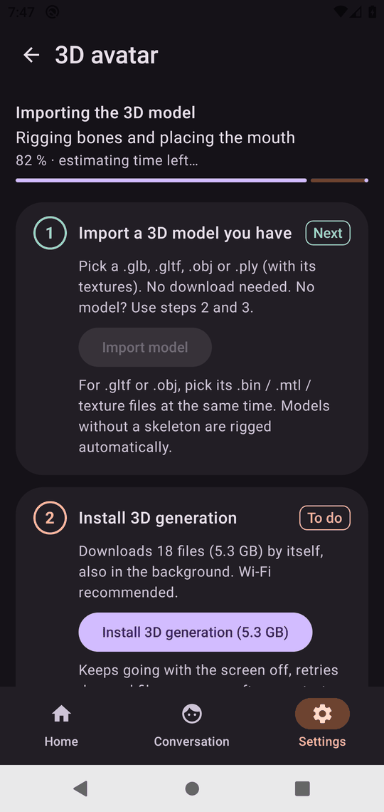
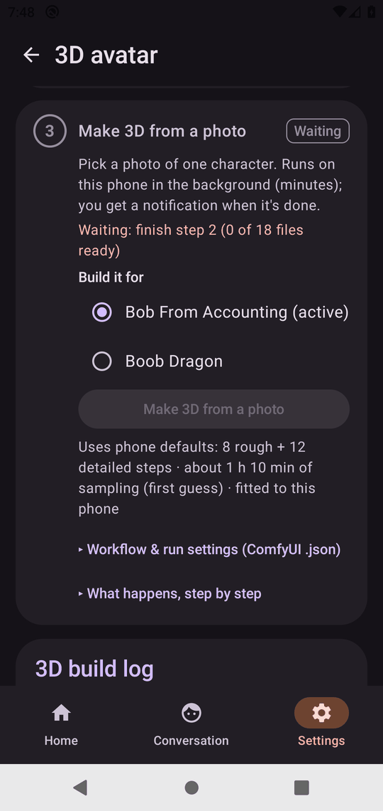
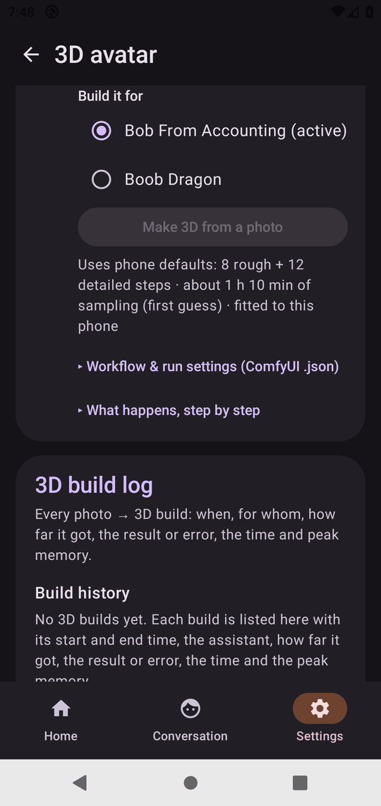
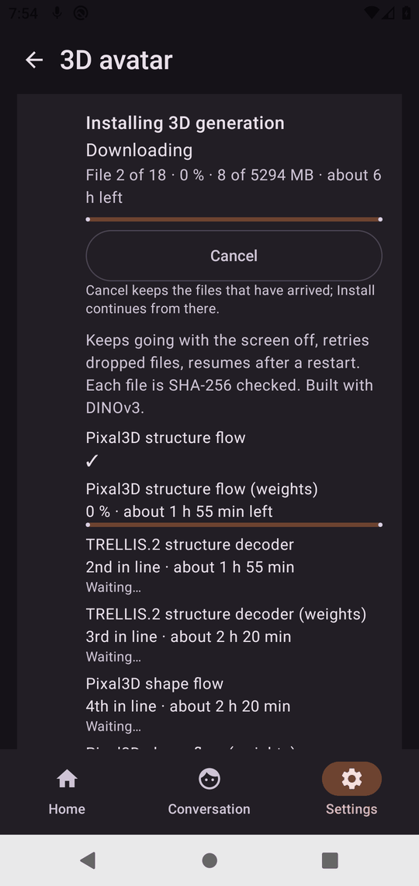
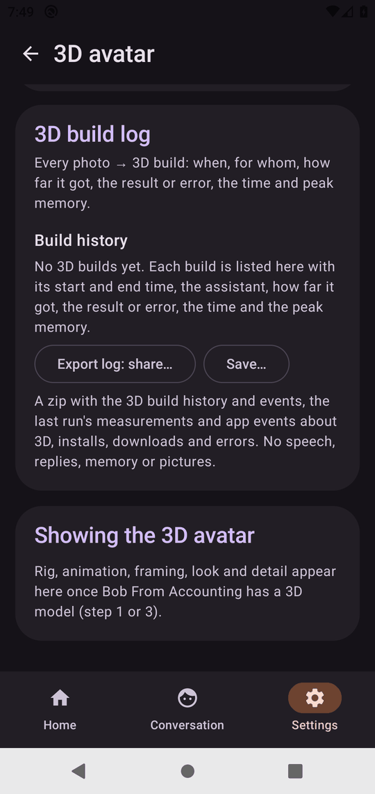
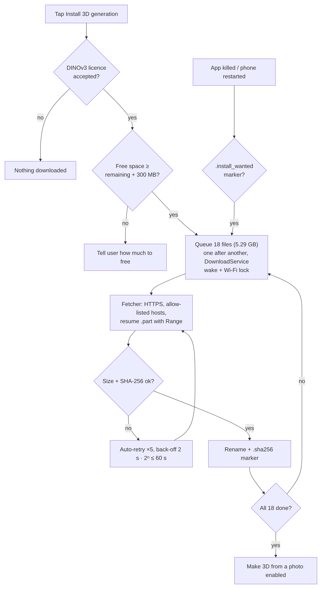
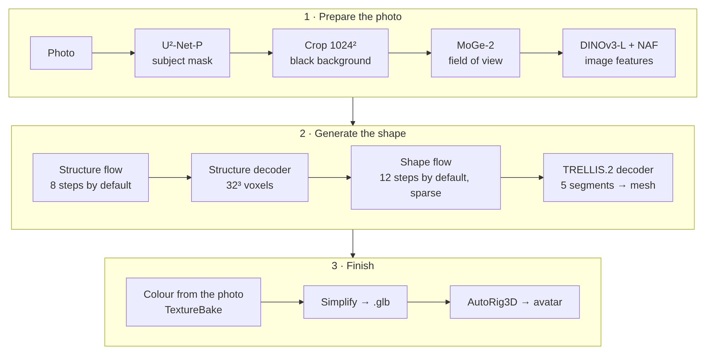

# Photo → 3D (Pixal3D on the phone)

> *Turn one picture of your character into a 3D avatar, generated entirely on the phone with no cloud service.*

<!-- nav -->

<a href="widget.md">← Home-screen widget</a> &nbsp;·&nbsp; <a href="../README.md">Docs home</a> &nbsp;·&nbsp; <a href="models-and-downloads.md">Models and downloads →</a>

<!-- /nav -->

 Desktop run of the <b>phone pipeline</b> (same models and code path, x86-64 CPU, not a phone) · left: input picture · top: the app's result, three views · bottom: the full ComfyUI reference for comparison

## At a glance

| | |
|---|---|
| **What it does** | Makes a coloured 3D model from one picture, then rigs it and uses it as the 3D avatar |
| **Install** | One button, **Install 3D generation**: 18 files, **5.29 GB**, from this project's GitHub release |
| **Needs** | About 5.6 GB of free storage, and a phone with **8 GB+ RAM** (peak about 3.3 GB) |
| **Time** | About **8 minutes** on a 4-core desktop CPU. **A phone is about 10× slower.** One user report (OUKITEL WP100 TITAN, imported official workflow with 12 rough + 20 detailed steps) measured about 43 min for the 12 rough steps (3.5 min each on average, up to 5.5 min) and about 3 min per detailed step, so a full build takes **around 2 hours**. With the phone defaults (8 + 12 steps) it takes less. The app shows a live *time left* |
| **Licence step** | You must accept the **DINOv3 License** before the download starts |
| **Optional** | You don't need this to use 3D. [Importing a model](avatar-3d.md#importing-your-own-3d-model) works without it |

 &nbsp;  &nbsp;  Emulator render (0.1.4 release, build cce9ae3) · Settings › 3D avatar. The first picture shows the first-run import of the built-in avatars.

 Emulator render (0.1.4 release) · a running job: the status block scrolls to the top and its full-width Cancel (Stop for a build) sits under the bar. A photo → 3D build looks the same but needs a 12 GB phone, so it couldn't run on the emulator.

## How it works for you

The easiest way is **[Avatar Studio](avatar-studio.md)** in Simple settings: it walks you through choosing the assistant, the picture, 2D or 3D, the download and the build. The same steps are on *Settings › 3D avatar* in Advanced, as numbered cards that each say **done**, **next** or **waiting** (and why):

- **1 · Import a 3D model you already have:** just the model and its texture, with no downloads.
- **2 · Install 3D generation:** one button, with time left.
- **3 · Make one from a photo:** pick a picture and it builds.

1. Press **Install 3D generation**.
2. Read the DINOv3 licence summary (**Read the full licence** opens it) and press **I agree — install**, or **Not now**.
3. All 18 files then download **by themselves, one after another**, each with its own progress bar and **time left** (for example *"about 14 min left"*; files further back say *"3rd in line · about 22 min"*).
   - They keep going with the screen off or while you use other apps.
   - A dropped file is retried automatically (up to 5 times, waiting a little longer each time). Only after that does it show a **Retry** button. **Retry all** retries every failed file.
   - If the app is closed or the phone restarts, the install **continues where it stopped** the next time Android allows it. On Android 15 and later, after a restart, a notification asks for one tap.
   - **Cancel (keeps what has arrived)** stops it and nothing resumes on its own; pressing Install again continues from the saved parts.
4. **Choose who it's for.** Step 3 has a **Build it for** list of your assistants. It starts on the one you're editing; in Avatar Studio it's the assistant from step 1. The choice is saved with the job, so the finished model goes to that assistant even if you switch assistants, the app is closed, or the phone restarts mid-build. If that assistant is deleted before the build ends, the model is kept and offered under **Attach last generated model to…** (below).
5. **Make 3D from a photo (on this phone)** is always visible. Until everything is installed it is greyed out and says why, with a counter such as *"Finish step 2 first (7 of 18 files ready)"*. When it is enabled, press it and pick a picture.
6. It runs **in the background with a notification** (*"Making a 3D model · about 2 h 10 min left"*, a progress bar and **Stop**). You can switch apps or turn the screen off.
   - **The status moves to the top of the page** as soon as the build starts: who it's for, the stage (*Rough shape*, *Detailed shape*, *Building the surface*, …), the step (*Step 5 of 12*), the percentage, the time left and the bar. A full-width **Stop** button is under it. Stop ends the build, and its saved steps are discarded.
   - **Rough shape** has as many steps as the plan's *structure* steps and **Detailed shape** as many as its *shape* steps. The phone defaults are **8 rough + 12 detailed**. An imported official ComfyUI workflow keeps its own steps (**12 + 20**), which is why some phones show *Rough shape 5/12* and then *Detailed shape 2/20*. The counts shown are the ones the pipeline reports for the steps it is actually running. Between the two stages, *Building the surface*, *Painting it from the photo* and *Making it phone-sized* have no steps. The line under the Make button says which applies.
   - **If the app is killed, the battery dies or the phone restarts**, it continues from the last finished step the next time the app opens or the phone starts, instead of starting over. A resumed run makes **the same model** (its random seeds are saved with the job).
   - It tries at most 3 times; after that it stops and says what went wrong. Every try that fails is logged with its real reason (including Android's own reason when the app was killed, such as *low memory*), never silently.
   - **If it runs out of memory** it doesn't try again by itself, because the same version would run out again at the same place. The history line says *ran out of memory at <stage>* and the notification says *"Your progress is kept: update the app, then Resume."* After an app update the try count starts again at 0 and **Resume** continues from the saved checkpoint. A build saved by 0.1.3 (for example one that finished the detailed shape and stopped at *Building the surface*) is resumed straight at the surface without redoing any steps.
   - **The phone doesn't sleep while it builds:** the app holds a wake lock for the whole build and lets go when it finishes, fails or is cancelled. The screen also stays on while the build page is open. The first time you start a build, the app asks **once** to let it run in the background without battery limits. Say yes for long builds.
7. **When it's done you get a notification:** *"Milly's 3D avatar is ready"* (tap it to see the model). If it fails, the notification says *"…couldn't be made"* and gives the reason. On the 3D page, **Make Milly active** makes that assistant the active one and switches the widget to her 3D model (the line under the button says so).
8. The result is imported like any model: detail levels, [automatic rig](autorig3d.md), mouth, preview. It is turned on for Home, the bubble and the widget.

**Time left.** Before anything has been timed on your phone, it's a deliberately long guess: the desktop's measured speed × 10. After one or two steps it uses **this build's own measured step times**. Later stages are scaled by the same factor, using their measured cost relative to a rough step. It leans long: if it's wrong, the build finishes early rather than late. The number **only counts down**. It goes up only when the build is clearly slower than shown (more than 15 % and 3 min), never by a minute or two. It is rounded up: whole minutes under 10 min, 5-minute steps up to 2 h (*"about 1 h 55 min left"*) and 10-minute steps beyond. Step times are saved for this phone after **every** step, so even a build that was cut off makes the next estimate right from the start.

### Build log and history

The 3D page (Advanced) and Avatar Studio step 5 both show a **3D build log**. It lists:

- **Attach last generated model to…:** shown if a finished model wasn't given to any assistant. This happens when the assistant was deleted during the build, or the model was made by version 0.1.0, which could lose track of it. Pick an assistant and press **Attach**.
- **Unfinished build:** the last run that didn't finish, with who it was for and how far it got, plus **Resume** (continues from its checkpoint) and **Discard**.
- **Build history:** one line per run (newest first). Each line has the start and end time, the assistant, how far it got, and the result (*done*, *failed: reason*, *cancelled*, *interrupted*). It also shows how long the run took and the peak memory, for example *"21 Nov 14:02 → 14:21 · for Milly · done (19 min) · peak 3.2 GB"*. A run cut off by a force stop or a dead battery shows as *interrupted at <stage>* until it is resumed.
- **Export log: share…** and **Save…**: share or save a zip containing a readable `build-log.txt`, the history as `history.json` and the last run's `last_run.json`. Use these when reporting a problem. The same buttons are under *Settings › Privacy › Diagnostics*.

 Emulator render (0.1.4 release, before any build) · Settings › 3D avatar › 3D build log

**What the export contains.** It includes the app version, phone model, Android version, RAM, the build history and the build's own event lines. It also includes app events about 3D, downloads, models, the widget, the avatar, the service, and errors or crashes. It **doesn't** include what you said, the assistant's replies, contacts, messages, memories, or your photos. Assistant names are included because the history says who each build was for. Picture locations, `content://` links and email addresses are removed (*[file]*, *[uri]*, *[email]*). Nothing is sent anywhere; you choose where the file goes.

To free the space later, use **Remove the photo → 3D models (5.3 GB)**. If you can't download on the phone, open **▸ Install offline from a folder**. It imports the same files after you copy them over USB.

### Workflow & run settings (optional)

Under step 3, **▸ Workflow & run settings (ComfyUI .json)** shows exactly what the run will use. You can import a ComfyUI workflow (`.json`) and the app **fits it to the phone**: a table lists every value as *workflow value → value used → why* (for example, fewer steps because of the phone's speed, or fewer triangles because of its memory). You can override any single value (steps, guidance, scheduler, seed or a random seed, crop size, triangles, background removal), reset one value, or **Reset all my changes**. **Use phone defaults** goes back to the built-in workflow.

Technical details: background run, checkpoints and time left

- **Service:** `Pixal3DService`, a foreground service of type `specialUse` (subtype declared in the manifest), holds a **partial wake lock** (up to 4 h) and shows the progress notification with a Stop action.
- **Job record:** `Pixal3DJob.run` writes `files/pixal3d_job/job.json` (sealed: magic, length, payload, SHA-256) with the run plan **with fixed seeds** (`Run3DPlan.withFixedSeeds`), the profile, and the photo (`photo.ck`).
- **Checkpoints** (`Pixal3DCheckpoint` over `CheckpointStore`): the prepared conditioning (crop, mask, FOV, DINOv3 features), the structure latent after **every** sampling step, the voxels, the shape latent after every step, and the finished `.glb`. Each is written with **temp file → fsync → rename** into one of **two slots**, so the previous good checkpoint survives a crash during the write. A truncated or corrupt slot fails its checksum and is skipped (the run falls back one step, or to the stage before).
- **Resume:** `Pixal3DService.resumeIfPending` is called from `MainActivity.onResume` and `BootReceiver`. `FlowSampler.sample(resume = (k, x))` continues from step *k*; tests check the resumed result is **bit-identical** to an uninterrupted run for every kill point (`ResumeTest`).
- **Commit:** the avatar is assigned only when `Avatar3DFiles.import` has written the mesh and `avatar3d.json` atomically; then the job is deleted. A failed import keeps the job for the next try (max 3 attempts).
- **Time left** (`core/Eta.kt`, `Pixal3DEta`): stages PREPARE → STRUCTURE → SHAPE → DECODE → TEXTURE.
  - **Prior:** per-step and fixed-stage seconds from `files/pixal3d_times.json` for this device. If there are none, the plan's desktop per-call times × `Eta.PHONE_VS_DESKTOP = 10`. That factor comes from the S24 reports: rough steps of 3.5 min on average (up to 5.5 min) against about 35 s on the box, and detailed steps of about 3 min against 12 s. The stages keep the box runs' relative costs: rough step 19.9 s/call, detailed step 6.6 s/call, prepare 25 s, decode 90 s and texture 40 s against 13.2 s per detailed step.
  - **Live:** the timed steps of the running stage give *measured s/step* = (mean + slowest of the last 3) / 2. It is weighted 0.75 after 1 step, 0.9 after 2 and 0.95 after more. `speedFactor` = measured ÷ prior scales every later stage. Until detailed steps are timed, a detailed step counts as at least `SHAPE_VS_STRUCTURE_MIN` = 0.8 × this run's rough step: on the box it costs a third of one, but on the WP100 it cost nearly as much. The stage's step count is taken from the pipeline's own *N/M* reports. The running step counts as at least its elapsed time × 1.1. The whole estimate × `MARGIN` 1.1.
  - **Display:** an anchor counts down with the clock. It re-anchors up only if the raw estimate is > 15 % and > 3 min above it, and down only if it is > 12 % and > 3 min below. `Eta.format` rounds up: 1 min steps < 10 min, 5 min < 2 h, 10 min beyond.
  - **Saved:** after every timed step (`learned(finished = false)`) and at the end. A first guess is replaced (or scaled by `speedFactor`); measured values blend half-and-half.
  - **Tests:** `EtaTest` replays both WP100 traces. The rough-stage trace must be ≥ 95 % of the true time left from the 3rd step on, never go up by less than 3 min and re-anchor up at most twice. In the detailed-stage trace at *2/20*, where 0.1.3 said 43 min, the estimate must be at least 95 % of the true ~87 min left; it shows *about 1 h 30 min*. That true value assumes the surface and painting stages slow down as much as the sampling; they haven't been timed on a phone yet.
- **Progress block** (`ui/ProgressUi.kt`, `ProgressBlock`): title, stage and *Step N of M* (split by `core/ProgressText`), %, time left, bar, then a full-width Stop (`OutlinedButton`, min height 48 dp) **below** it. When it appears, it scrolls the page so it sits at the top (`scrollToTopWhenShown`, via `LocalPageScroll` from `SettingsScreen`).
- **Downloads:** `TransferEta`: bytes left / smoothed speed (sampled at most once a second, α 0.2), plus the bytes of every file ahead in the queue. The last speed is kept in prefs `downloads_eta` so a resumed queue starts with a sensible estimate.
- The home-screen widget doesn't show 3D progress, so it has no countdown; the notification and the app do.

Technical details: the installer

- **Manifest:** `assets/pixal3d_models.json`, made by `tools/publish/make_release_manifest.py`. It lists 18 entries, each with name, size, **SHA-256**, licence and source URL (release `models-3d-v2` of this repository), plus optional `parts` for files larger than one release asset, which are joined and then checked as a whole.
- **`ModelInstaller`** (pure JVM, tested against a local HTTP server):
  - **Per-file phases:** WAITING → QUEUED → DOWNLOADING → JOINING → VERIFYING → DONE, or FAILED / CANCELLED.
  - **Downloads:** **one file at a time** (a single worker thread), in manifest order, with **HTTP Range resume** on `.part` files. The resume is verified live: a download stopped at 27,262,976 bytes restarted at 27,279,360.
  - **Retries:** **5 automatic retries** per file, with back-off `min(2 s · 2^attempt, 60 s)` (2, 4, 8, 16, 32 s). After that the file is FAILED and shows its own Retry button.
  - **Resume after a kill or reboot:** `installAll` / `retry` write a `.install_wanted` marker in the model folder. It is removed when every file is installed, or when the user presses Cancel. `resumeIfWanted()` continues a wanted install, and it is called from:
    - `MainActivity.onResume`: the app is visible, so a foreground service may start.
    - `DownloadService` restarted by Android as a **sticky** service after the process was killed.
    - `BootReceiver`: resumes directly on Android ≤ 14. On Android 15+, BOOT_COMPLETED may not start a `dataSync` foreground service, so it posts *Tap to finish your downloads* instead.
  - **Markers:** a `.sha256` marker is written per installed file, so `refresh()` recognises installed files without re-hashing.
  - **Controls:** `installAll`, `retry(name)`, `retryAll`, `cancel` (keeps partial files), `readyCount()` (drives the *N of 18* counter).
  - **Tests** (`ModelInstallerTest`, 14 cases, local HTTP server): one-at-a-time order, automatic retry after a dropped connection, capped back-off, resume in a new installer after a simulated kill, no auto-resume after Cancel, and the ready counter.
- **`Fetcher`:**
  - HTTPS only. Redirects are followed by hand, and **every hop is checked against an allow-list**: start at `github.com` / `huggingface.co`; redirects may go to `*.githubusercontent.com`, `*.huggingface.co`, `*.hf.co`.
  - The size is checked, then the SHA-256 (a resumed download first hashes what is already on disk), and only then is the file renamed into place. A wrong file is deleted.
- **`Pixal3DInstall`:**
  - **Licence gate:** the DINOv3 acceptance is remembered in prefs `pixal3d_install` (`accepted_dinov3`).
  - **Free-space check:** remaining bytes + 300 MB.
  - **Background:** downloads run under `DownloadService`, a foreground service of type `dataSync` with a progress notification. While anything downloads it holds a **partial wake lock** (CPU) and a **Wi-Fi lock** (`WIFI_MODE_FULL_HIGH_PERF`), so it continues with the screen off.
- **Folder import** (`Pixal3DJob.importModels`): copies every file listed in the folder's `manifest.json`, checking SHA-256 while copying. A bad or short file is deleted.
- **Install location:** `files/models/3d/`.

| File | Size | Licence |
|---|---|---|
| pixal3d_ss_flow (+ .data) | 1.67 GB | MIT (Tencent Pixal3D) |
| pixal3d_shape512_flow (+ .data) | 1.47 GB | MIT (Tencent Pixal3D) |
| trellis2_shape_dec_seg0–4 | 1.13 GB | MIT (Microsoft TRELLIS.2) |
| moge2_l_3600_nb8 | 0.42 GB | MIT (MoGe-2), DINOv2 backbone Apache-2.0 |
| dinov3_l_nb8 (+ .data) | 0.32 GB | **DINOv3 License (Meta)**, must accept |
| trellis2_struct_dec (+ .data) | 0.29 GB | MIT (Microsoft TRELLIS.2) |
| naf_q_r1 (+ .data) | 3 MB | Apache-2.0 (valeo.ai NAF) |

<picture><source media="(prefers-color-scheme: dark)" srcset="../images/diagrams/installer_flow-dark.png"></picture> Diagram · the one-button installer

## What happens inside

<picture><source media="(prefers-color-scheme: dark)" srcset="../images/diagrams/pixal3d_pipeline-dark.png"></picture> Diagram · the on-phone Pixal3D pipeline

In plain words:

1. The character is **cut out** of its background.
2. The app estimates **how wide the camera's view** was, so the 3D shape lines up with the picture.
3. A vision model (**DINOv3**) turns the picture into thousands of numbers that describe what is where.
4. A generator **sculpts a rough block shape** (a 32 × 32 × 32 grid of cubes) from noise, guided by those numbers.
5. A second generator **refines the surface** inside those cubes.
6. A decoder turns that into a **smooth triangle mesh**.
7. **Colours** are taken straight from the picture for everything the camera could see, and filled in from nearby colours for the back.
8. The mesh is simplified to phone size and saved as a `.glb`, then imported as your avatar.

Technical details: the pipeline, stage by stage

The code is in `threed/Pixal3D.kt`, `FlowSampler.kt`, `ShapeDecoder.kt`, `TextureBake.kt`, `P3Math.kt` and `Ort.kt`. It is a port of the official Pixal3D ComfyUI workflow, checked stage by stage against ComfyUI fixtures.

| # | Stage | Model / method | Output |
|---|---|---|---|
| 1 | Subject mask | the app's U²-Net-P matting (`Cutout.matte`) | alpha 0..1 |
| 2 | Crop | ComfyUI `ImageCropToMask` port: pad 1.1, centred square, black background; PIL-compatible Lanczos to 1024 | 1024² crop |
| 3 | Field of view | **MoGe-2** ViT-L (3600 tokens, int8 `nb8`): points and mask heads, least-squares z-shift, `fov = 2·atan(0.5 / (f/2·√2))` | FOV ° |
| 4 | Conditioning | **DINOv3-L** at 512 px (int8 `nb8`; token cosine vs fp32 ≥ 0.998), RoPE tables computed in Kotlin. **NAF** query maps (windowed 9×9 attention evaluated only at the pixels the projection touches; the full 1024³ map would be 4 GB) | tokens + per-voxel features |
| 5 | Structure flow | `pixal3d_ss_flow` (int8 ConvRot), **8 steps = 14 model calls**, over a `[1×32×16³]` latent | latent |
| 6 | Structure decode | **TRELLIS.2** structure decoder → 64³ logits → 2× max-pool → **32³ voxels**; floaters (< 5 % of the largest 26-connected group) dropped | voxels |
| 7 | Shape flow | `pixal3d_shape512_flow` (sparse, int8), **12 steps = 21 calls** | `[N × 32]` latent |
| 8 | Shape decode | TRELLIS.2 shape VAE in **5 ONNX segments**. Sparse-conv neighbour maps, learned 2× subdivision and the **flexible dual grid** → mesh are computed in Kotlin | mesh in the unit cube |
| 9 | Colour | `TextureBake`: z-buffer the mesh from the camera; visible, front-facing, in-mask vertices take the crop's colour; the rest are filled breadth-first and smoothed | vertex colours |
| 10 | Simplify and save | vertex clustering on a grid³ lattice → `.glb` (`COLOR_0`) → normal avatar import | avatar |

**Sampler** (`FlowSampler`): rectified flow with **Euler** steps, matching ComfyUI `KSampler(euler, normal)` on `ModelSamplingDiscreteFlow`, with **RescaleCFG** (x0 space) and **CFGOverride** (cfg 1 over the low-σ end).
- Reference: structure seed 56, 12 steps, shift 5, cfg 7.5, rescale 0.7, cfg 1 from 66.7 %. Shape seed 42, 20 steps, shift 3, cfg 7.5, rescale 0.5, cfg 1 from 76.9 %.
- The phone uses fewer steps.
- Noise is the app's own standard normal: seed-stable per device, but not identical to torch's.

**Accuracy vs the reference** (same seeds and models):

| Stage | Phone steps | Reference | Result |
|---|---|---|---|
| Structure | 8 | 12 | voxel IoU **0.890** (12 steps: 0.902; 6 steps: 0.861) |
| Shape | 12 | 20 | chamfer **0.359 %** of the bbox, F-score@1 % **0.990** |

**Runtime:**
- ONNX Runtime **1.28** through the app's own small JNI (`cpp/ort_jni.c`), one session per model, loaded only for its stage.
- `Ort.trim()` returns freed native heap between stages.
- Each stage records wall time and peak RSS (`Port3D.measure`) to `files/models/3d/last_run.json`.

**Settings used:** by default the official workflow's values fitted to the phone (8 + 12 steps, the reference cfg and seeds). An imported workflow and your overrides go through `Run3DPlan.plan(workflow, overrides, Device)`, and the plan the run uses is exactly the one the table shows (`Pixal3D.samplerInputs`; tested in `Run3DPlanTest`).

### Build log, notifications and wake lock (0.1.3)

- `core/BuildLog.kt`: `BuildRecord` (id, profile id and name, start/end, stage reached, result, error, peak RSS MB, resumes) is kept as sealed JSON in `files/pixal3d_history.ck` (two checksummed slots, last 30 runs). `settle()` turns a *running* record into *interrupted* when no build is running. Event lines go to `files/pixal3d_history_events.log` (last 300, redacted on write). `BuildLog.report()` builds the export text. App events are filtered by an allow-list (`exportableEvents`), so conversation lines never get in.
- **Explicit target:** `Pixal3DJob.run(ctx, profileId, …)` checks that the profile exists and saves `profile` and `name` in the job record. `importTo()` checks again before importing. If the profile is gone, the run fails with that reason and the model stays as `models/3d/last_generated.glb`.
- **Orphans:** after a successful import, `last_generated.attached` holds `{sha256, profile, at}`. `OrphanModel.isOrphan(sha, attached)` is true when the latest model's hash isn't the one that was attached (this includes 0.1.0, which wrote no marker). `Pixal3DJob.attachOrphan()` imports it into the chosen profile.
- **Wake:** `Pixal3DService` holds `PARTIAL_WAKE_LOCK` with no timeout and releases it in `onDestroy`, which runs after done, failed or cancelled. `KeepScreenOnWhileBuilding` sets `FLAG_KEEP_SCREEN_ON` only while a build page is composed and a build is running. `BuildPrep.askBatteryOnce` opens the battery-optimisation request once (app-wide pref `battery_prompted`).
- **Notifications:** channel `pixal3d_result`. Tapping one opens `MainActivity` with `page=avatar3d` and `p3d_profile=<id>`, which puts the "ready, make active" offer at the top of the page.
- **Export:** `DiagnosticsExport` writes `cache/exports/milkymoo-3d-log-<time>.zip`, which is shared through the FileProvider `${applicationId}.exports` or saved with SAF `CreateDocument`.

### Memory (0.1.5)

Android caps the app's Java heap at **512 MB** even with `android:largeHeap="true"` (on an 11.2 GB OUKITEL WP100 TITAN too). 0.1.3 kept the shape decoder's outputs in Java arrays and ran out of memory at *Building the surface* (*"Failed to allocate a 151620624 byte allocation … growth limit 536870912"*). Since 0.1.5:

- Every large buffer after the shape stage lives in **native memory** (`threed/Big.kt`: `Big`, `NativeMem`, `BigLongIntMap`; malloc'd in `ort_jni.c` and handed over as direct buffers). ONNX Runtime outputs go straight into native buffers (`Session.runBig`). The decoder, texture bake and vertex clustering free each level's buffers before the next one. Only the final, phone-sized mesh is copied to Java arrays. `largeHeap` stays on as a backstop only.
- `PostShapeHeapTest` runs the decoder, bake and clustering on a synthetic ~700 k-vertex level and fails if they allocate more than 64 MB on the Java heap (measured: 6.7 MB).
- **Release gate:** `scripts/heap_gate.sh` (run by `scripts/release.sh`; skipped once, for 0.1.5, at the developer's request) installs the **release** APK on an emulator capped at `dalvik.vm.heapgrowthlimit=512m` / `heapsize=512m`, makes a 3D avatar from a photo in the app (1 step per flow), checks it is rigged and attached, then kills the app at *Building the surface* and checks **Resume** finishes it. It records the Java heap, native buffers and RSS per stage (table below).
- A failed try is classified (`core/BuildJobRules.kt`): out of memory → no automatic retry on the same version, try count reset after an update; a try that ended without a result is logged with Android's `ApplicationExitInfo` reason. `CheckpointCompatTest` resumes a real 0.1.3-format job (attempts 3 of 3, detailed shape 20/20).

## Measured numbers (and where)

On a 4-core desktop computer, one photo took about **8 minutes** and needed about **3.3 GB** of memory. On an OUKITEL WP100 TITAN (0.1.3, official 12 + 20 steps) the rough shape took about 43 min and the detailed shape about 69 min; that run then ran out of Java memory at *Building the surface*, which 0.1.5 fixes.

Technical details

| Measurement | Value | Where |
|---|---|---|
| Whole run, end to end | **7.8 min** | Desktop Intel Xeon, 4 threads pinned, ORT 1.28, phone model set (`Pixal3DEndToEndTest`, 2026-11-19) |
| Peak memory | **3.27 GB** RSS (whole JVM process) | same |
| Structure flow (8 steps) | 278 s, 19.8 s per call | same |
| Shape flow (12 steps) | 121 s | same |
| Shape decoder | 17.2 s | same |
| On a phone | rough ~245 s/step at first, ~130 s later; detailed ~232 s/step, ~118 s later | OUKITEL WP100 TITAN, 0.1.3, build log (`EtaTest.wp100FullLogTrace`) |
<!--GATE-->

## Limits and honest notes

- **No finished run on a real phone yet.** A 0.1.3 run on an OUKITEL WP100 TITAN finished both shape stages and then ran out of Java memory at *Building the surface*; 0.1.5 moves those buffers to native memory (`PostShapeHeapTest`: 6.7 MB Java heap), but the 512 MB release gate was **skipped** for 0.1.5 and a phone run with 0.1.5 hasn't been recorded. **On-device image-to-mesh is still in development and may not work.** Phone heat is unknown.
- This version stops at the 512 shape stage. TRELLIS.2's 1024/1536 refinement and its texture model are **not ported**. Colours come from the picture (projection), so the back is filled in and looks smoother and plainer.
- One picture only; side and back views are guessed. Characters with big wings or tails may get thin parts or merged pieces.
- **Built with DINOv3.** The DINOv3 model is used under the DINOv3 License, which you accept in the app. See [THIRD_PARTY_NOTICES](../../THIRD_PARTY_NOTICES.md).

<!-- nav -->

<a href="widget.md">← Home-screen widget</a> &nbsp;·&nbsp; <a href="../README.md">Docs home</a> &nbsp;·&nbsp; <a href="models-and-downloads.md">Models and downloads →</a>

<!-- /nav -->
