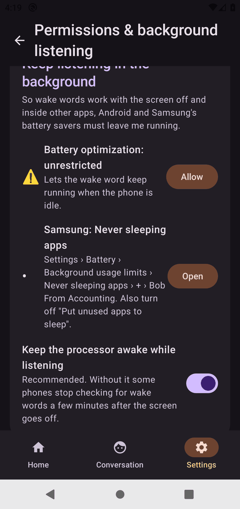
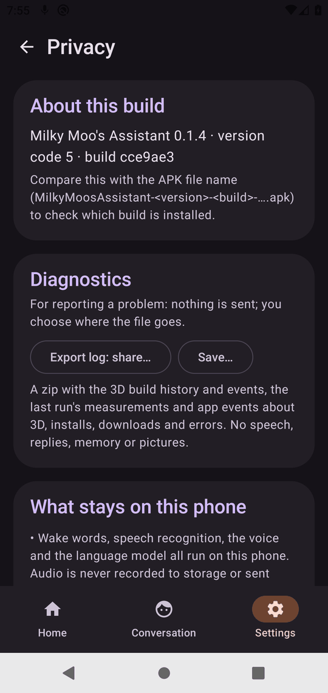

# Privacy, permissions and storage

> *Everything runs on the phone. No accounts, no cloud, no Google services, and every network request is something you started.*

<!-- nav -->
<p align="center"><sub><a href="models-and-downloads.md">← Models and downloads</a> &nbsp;·&nbsp; <a href="../README.md">Docs home</a> &nbsp;·&nbsp; <a href="../settings-reference.md">Settings reference →</a></sub></p>
<!-- /nav -->

<p align="center"><br><sub>Emulator render · Settings › Permissions &amp; background listening</sub></p>

## At a glance

| | |
|---|---|
| **Where your voice goes** | Nowhere. Audio is processed in memory on the phone and never saved |
| **Accounts and keys** | None. No sign-in, no API keys, no analytics, no ads |
| **Google Play services** | Not used. The app works on phones without them (de-Googled ROMs) |
| **Backups** | The app opts out of Android cloud backup and device transfer |
| **Memory** | Encrypted with a key in the phone's secure keystore |

## The only times the app uses the internet

The app never makes a network request on its own. These are the only four kinds, and each one is started by you:

| What | When | Default |
|---|---|---|
| **Model downloads** (speech, voices, thinking models) | You press *Download* | n/a |
| **Install 3D generation** | You press the button and accept the licence | n/a |
| **Web answers and news** | You ask a question with *Allow internet access* switched on | **Off** |
| **Voice samples** for voices not yet installed | You press ▶ *Play* on a voice, with *Allow internet access* on | **Off** (follows the switch) |

The voice sample (a ~90 KB clip from the Piper project's sample page, kept after the first play) is only fetched while *Allow internet access* is on. With it off, the app says the sample needs the internet and downloads nothing. Model downloads and *Install 3D generation* are separate buttons you press yourself, and they work with the switch off.

<details><summary>Technical details</summary>

- **Network code paths:** there are exactly four, and the manifest's `INTERNET` permission comment lists all four.
  - `net/Net.kt` + `net/WebViewFetcher.kt` serve web answers and news. They check the `internet` switch on every call and throw `NetDisabledException` when it is off.
  - `models/Downloads.kt` / `models/Fetcher.kt` serve model downloads, with an HTTPS host allow-list.
  - `threed/Pixal3DInstall.kt` serves the 3D model set (same fetcher and allow-list).
  - `speech/VoicePreview.kt` fetches only `https://rhasspy.github.io/piper-samples/…`, only while the `internet` switch is on, and caches the result (`VoicePreview.plan`, see [Voices](voices.md#hearing-a-voice-before-you-download-it)).
- **Not used:**
  - No Firebase, Play services, crash reporters or analytics libraries.
  - The dependencies are sherpa-onnx 1.13.8 (AAR, which includes ONNX Runtime), Apache Commons Compress, Jetpack Compose / Material 3, AndroidX Activity and PdfBox-Android. llama.cpp is built from source (`third_party/llama.cpp`), and dav1d (BSD-2, the AV1/AVIF decoder) is linked as a prebuilt static library. JNI glue lives in `app/src/main/cpp`.
- **Face detection** for the 2D rig uses `android.media.FaceDetector`, which is part of AOSP and does not need Google ML Kit.
- **Backups:** `android:allowBackup="false"`, and `data_extraction_rules.xml` excludes root, file, database and sharedpref from **cloud backup and device transfer**.
- **Memory store:** `no_backup/memory/*.db`, AES-256-GCM under an Android Keystore key, with a secure wipe (see [Memory](memory.md)).
- **Logs:** diagnostic events (`BelleEvent` tag) go to the on-device logcat ring buffer only. The *Listening status* panel shows live mic level, the silencing flag and what the spotter last heard. Nothing is written to shared storage.

</details>

## Permissions

Only the microphone is needed for the basics. Everything else is optional and asked for when you first use the feature.

| Permission | Why | Needed? |
|---|---|---|
| Microphone (`RECORD_AUDIO`) | Wake word and speech | **Yes** |
| Notifications (`POST_NOTIFICATIONS`) | The "listening" notification, reminders, download and book notifications | Recommended |
| Display over other apps (`SYSTEM_ALERT_WINDOW`) | The floating bubble and edge glow, and opening apps from the background | Optional |
| Contacts (`READ_CONTACTS`) | Calling or texting someone by name | Optional |
| Phone (`CALL_PHONE`) | Placing the call directly (otherwise the dialler opens) | Optional |
| SMS (`SEND_SMS`) | Sending a text directly (otherwise your messaging app opens) | Optional |
| Alarms (`SET_ALARM`, `SCHEDULE_EXACT_ALARM`, `USE_EXACT_ALARM`) | Alarms, timers, reminders on time | Automatic |
| Run at startup (`RECEIVE_BOOT_COMPLETED`) | Offer to resume listening after a restart | Automatic |
| Keep awake (`WAKE_LOCK`) | Keep listening and reading with the screen off | Automatic |
| Audio settings (`MODIFY_AUDIO_SETTINGS`) | Volume commands, ducking music while speaking | Automatic |
| Network state, Internet | See the table above | Automatic |
| Ignore battery optimisation (request) | So Android doesn't kill background listening | Optional |
| Accessibility service | Screen control, and reading the browser tab in *frontend* web mode | Optional; you turn it on in Android settings |
| Default digital assistant (role) | Long-press home / assist gesture opens the assistant | Optional |

The *Permissions & background listening* page has **Open app info**, **Accessibility** and **Notifications** shortcuts, plus *Keep the processor awake while listening*.

<details><summary>Technical details</summary>

- **Foreground service types:**
  - `AssistantService`: `microphone|specialUse` (subtype declared)
  - `BookPlaybackService`: `mediaPlayback`
  - `DownloadService`: `dataSync`
  - This needs `FOREGROUND_SERVICE` plus the per-type permissions `FOREGROUND_SERVICE_MICROPHONE`, `_SPECIAL_USE`, `_MEDIA_PLAYBACK` and `_DATA_SYNC`.
- **System integration:**
  - `BelleVoiceInteractionService` + `BelleSessionService` + `BelleRecognitionService` provide the default-assistant role.
  - `AssistActivity` handles `ACTION_ASSIST` / `VOICE_COMMAND`.
  - `BelleAccessibilityService` is the screen-control service.
  - `ReminderReceiver` and `BootReceiver` (`BOOT_COMPLETED`, `MY_PACKAGE_REPLACED`) handle reminders and restarts.
- **Package visibility:** a `<queries>` block declares the intents the app needs to see: launcher apps, `geo:` / `google.navigation:` maps, `https` browser, `SET_ALARM` / `SET_TIMER`, calendar `INSERT`, and the still/video camera.
- **ABIs:** native code is built for `arm64-v8a` (phones) and `x86_64` (emulators).
- **API levels:** minSdk **29** (Android 10), target/compile SDK **37**.

</details>

## Storage layout

Everything lives in the app's private storage. Other apps can't read it, and uninstalling removes it.

<details><summary>Technical details</summary>

```
/data/data/app.belle.assistant/
├── files/
│   ├── models/
│   │   ├── kws/                     wake-word model (from the APK)
│   │   ├── stt-moonshine-tiny-en/   speech recognition
│   │   ├── silero_vad.onnx          voice activity detector
│   │   ├── voices/<voice>/          Piper / Kokoro voices
│   │   ├── llm/*.gguf               thinking models
│   │   ├── matting/                 cut-out model (copied from the APK)
│   │   └── 3d/                      Pixal3D model set + .sha256 markers + last_run.json,
│   │                                last_generated.glb + last_generated.attached (who got it)
│   ├── avatar3d/<profile>/          avatar.glb, avatar3d.json, preview.png
│   ├── avatar_<time>.<ext>          chosen 2D pictures
│   ├── backgrounds/                 background files (+ .bad / .decoding crash-guard markers)
│   ├── books/<id>/                  book.json, <chapter>.txt/.idx, pos.json
│   ├── sounds/                      imported chime files
│   ├── widget_idle/<key>/           pre-rendered widget idle loops (key includes the profile id)
│   ├── pixal3d_history.{0,1}.ck     3D build history (last 30 runs) + pixal3d_history_events.log
│   ├── pixal3d_job/                 the running/unfinished 3D build and its checkpoints
│   ├── notes.txt                    "save a note"
│   ├── reminders.json               reminders still to come (re-armed after a restart)
│   └── keywords.txt                 current wake-word keyword file
├── no_backup/memory/<profile>.db    encrypted long-term memory
├── shared_prefs/                    per-assistant settings, belle_global, belle_widgets, book_reader, pixal3d_install
└── cache/                           voice samples, import scratch, PDF page cache, exports/ (log zips you shared)
```

</details>

## Diagnostics export

*Settings › Privacy › Diagnostics* has **Export log: share…** and **Save…** (choose a folder). The same buttons are in the 3D build log. The file is only made when you press one, and it goes only where you send it. It holds the app version, phone model, Android version and RAM, the 3D build history (with assistant names), the last 3D run's numbers, and technical app events about 3D, downloads, models, the widget, the avatar and errors. It **leaves out** what you said, replies, contacts, messages, memories and pictures. File paths, `content://` links and email addresses in the remaining lines are replaced with placeholders. Details: [Photo → 3D › Build log and history](photo-to-3d.md#build-log-and-history).

<p align="center"><br><sub>Emulator render (0.1.4 release, build cce9ae3) · Settings › Privacy › About this build and Diagnostics</sub></p>

## Licences

The app's own code is **Apache-2.0**. Models and libraries keep their own licences, which are listed in [THIRD_PARTY_NOTICES](../../THIRD_PARTY_NOTICES.md). Two to know about:

- **eSpeak NG** (used by the Piper voices for pronunciation) is GPL-3.0. Because it is inside the APK, **each APK as a whole is distributed under GPL-3.0**, while the source code stays Apache-2.0.
- **DINOv3** (used by photo → 3D) comes under Meta's DINOv3 License, which you accept in the app before downloading. The app shows *"Built with DINOv3"*.

## Limits and honest notes

- Downloaded model files are not encrypted (only memory is). They are public models and contain nothing about you.
- If you turn on the internet switch, search providers see your search queries and your IP address, like any web visit.
- A rooted phone or a forensic tool with the device unlocked can read app storage. Memory stays encrypted while the keystore key exists.

<!-- nav -->
<p align="center"><sub><a href="models-and-downloads.md">← Models and downloads</a> &nbsp;·&nbsp; <a href="../README.md">Docs home</a> &nbsp;·&nbsp; <a href="../settings-reference.md">Settings reference →</a></sub></p>
<!-- /nav -->
