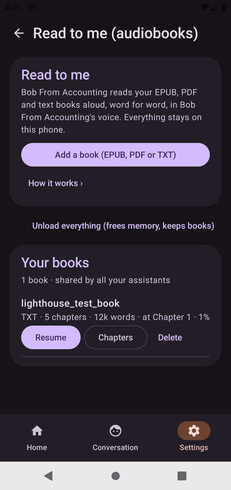
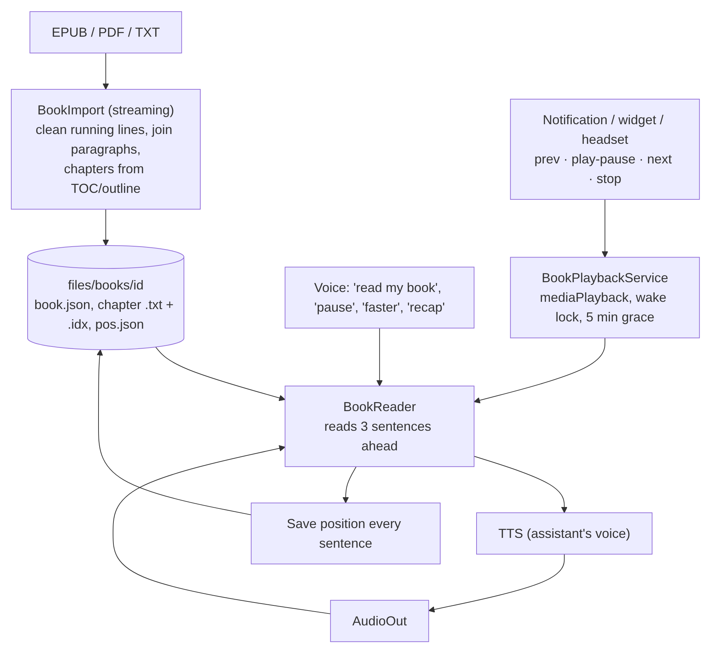

# Read to me (audiobooks)

> *Your own EPUB, PDF and text books read aloud, word for word, in your assistant's voice. Offline, in the background, with your place kept.*

<!-- nav -->
<p align="center"><sub><a href="stories.md">← Stories, songs and poems (long-form)</a> &nbsp;·&nbsp; <a href="../README.md">Docs home</a> &nbsp;·&nbsp; <a href="avatar-studio.md">Avatar Studio →</a></sub></p>
<!-- /nav -->

<p align="center"><br><sub>Emulator render · Settings › Read to me (audiobooks), with a synthetic test book</sub></p>

## At a glance

| | |
|---|---|
| **Books** | EPUB, PDF and TXT that you add from your phone |
| **Voice** | The active assistant's voice, speed and character. Nothing is rewritten by the model |
| **Keeps playing** | With the screen off or another app open (media notification with controls, also on the lock screen) |
| **Bookmarks** | Saved at every sentence |
| **Control** | The page's player, the widget's Book buttons, the notification, or your voice |

## How it works for you

1. **Add a book** (EPUB, PDF or TXT). The app cleans it up: it removes page numbers, running headers and publisher pages, rejoins broken lines and hyphenated words, and finds the chapters from the book's own table of contents.
2. Press **Play**, tap the widget's **▶**, or say *"read me Treasure Island"* or *"continue my book"*.
3. Listen. Your place is saved continuously, so you can stop at any time and pick up mid-sentence later.

| Player button | What it does |
|---|---|
| ⏮ / ⏭ | Previous or next chapter |
| ↺ | Back a few sentences |
| Play / Pause | Pause keeps everything ready; Play resumes at once |
| ■ Stop | Stops and saves your place, frees the audio prepared ahead, and closes the notification |
| Chapters | Jump to any chapter |
| Unload the book | Closes the book and frees its memory (bookmark kept) |
| Unload everything | Also unloads the voice, speech recognition and thinking model (books and bookmarks kept) |
| Delete | Removes a book from the library |

<details><summary>Technical details: import</summary>

- **Streaming import** (`book/BookImport.kt`), fully offline. The whole book is never held in memory:
  - The picked file is stream-copied to app cache.
  - **PDF:** opened with temp-file scratch storage, and each page's text is extracted one at a time to a disk page cache (`PDFTextStripper`, paragraph markers kept).
  - **EPUB:** spine documents in order. The chapters come from the EPUB nav or NCX.
  - **TXT:** UTF-8 if the whole file decodes as UTF-8 (checked as a stream), otherwise Windows-1252.
- **Cleaning** (`book/BookText.kt`, pure Kotlin, unit-tested):
  - `RunningLines` removes page numbers (*"10/359"*, *"Page 3"*, *"xii"*) and first or last lines repeated across pages.
  - `paragraphs()` joins wrapped lines. A trailing `-` is dropped unless the hyphenated word appears elsewhere in the book (`dictionary()`), which tells *blue-black* from *af-ternoon*.
  - `joinAcrossPages()` merges paragraphs split by a page break.
  - `classify()` drops front and back matter.
  - Chapters come from the **TOC / PDF outline**, or failing that, from headings at the top of pages. `niceTitle()` turns *"1"* into *"Chapter 1"*, and `dropHeading()` removes the repeated heading.
- **Library layout** (`book/Library.kt`), shared by all assistants:

  ```
  files/books/<id>/
    book.json        title, author, chapter list
    <chapter>.txt    one sentence (reading unit) per line, empty line = paragraph break
    <chapter>.idx    byte offsets for random access
    pos.json         chapter, sentence, updated, finished
  ```

  Playback reads only the few lines it needs. Nothing appears in the library until the import `finish()`es.
- **Memory:** import peak memory (PSS, Java and native heap) is sampled every 100 ms for diagnostics.

</details>

## Background playback and the notification

Reading carries on with the screen off or in other apps. A media notification shows the book and chapter with **previous chapter, play/pause, next chapter and stop**, and it also works on the lock screen and with headset buttons. After you pause, it stays ready for 5 minutes, so resuming is instant. **Stop** ends it completely.

<details><summary>Technical details</summary>

- **`BookPlaybackService`:** a foreground service of type **`mediaPlayback`**.
  - It holds a CPU wake lock, because the voice is generated on the phone sentence by sentence.
  - It owns a `MediaSession` and a `MediaStyle` notification (channel `book`, compact actions: prev, play/pause, stop).
- **Grace period:** after reading stops it stays in the foreground for `GRACE_MS = 5 min`, so a resume starts at once, then leaves.
- **Starting from the background:** `pending(ctx, cmd)` gives the widget and notification a `PendingIntent` that may start the foreground service from the background. It **never starts the assistant or loads its models**.
- **Stop vs pause:**
  - **Pause** keeps the read-ahead audio.
  - **Stop** (`BookReader.stop()`) saves the bookmark, ends reading, drops the sentences made ahead (memory and their cache file) and dismisses the notification. The book stays open, so Play starts from the bookmark.
  - **Unload** also closes the book.
  - **Unload everything** (`AssistantRuntime.unloadEverything`) also frees TTS, STT and the LLM.

</details>

## Speaking to your book

While a book is open, you can just say what you want after the wake word. A wake word **pauses** the book, and it carries on by itself when you're done.

| Say | Effect |
|---|---|
| "read me *title*" / "read my book" / "continue reading" | Open a book (best title match) or the last one |
| "pause" / "wait" / "hold on" | Pause |
| "stop" / "stop reading" | Stop (bookmark kept) |
| "resume" / "go on" / "keep going" | Resume |
| "next chapter" / "previous chapter" / "start this chapter again" | Chapter moves |
| "chapter twelve" | Jump to a chapter |
| "go back" / "repeat that" / "go back a lot" | Back 3 or 12 sentences |
| "faster" / "slower" | Reading speed ±0.15× (0.6× – 2.0×) |
| "stop reading in 20 minutes" / "sleep timer 30 minutes" / "cancel the sleep timer" | Sleep timer (stops at the next sentence end) |
| "where am I" | Says the chapter and progress |
| "what just happened" / "recap" / "what did I miss" | A 2–4 sentence summary of what you just heard (needs a thinking model) |
| "unload the book" / "unload everything" | Free memory |

<details><summary>Technical details</summary>

- **Parsing** (`book/BookCommands.kt`): the text is normalised first, removing *hey/ok*, *please* and *can you*.
  - Commands that only make sense with a book (pause, faster, next chapter …) apply only while the reader is `active`: playing, barge-paused, or paused within the last 30 minutes.
  - *"Read me a story / the news / my messages"* is **not** treated as a book.
- **Title match** (`bestTitle`): word overlap ignoring little words. 4-letter prefixes count as a match, and at least 50 % of the spoken words must match.
- **Numbers:** spoken numbers up to the sixties ("twenty one").
- **Recap:** the last **6,000 characters** read (about 1,500 tokens) plus a fixed prompt go to the thinking model for 2–4 sentences, using only what the passage says (≤ 220 tokens).
- **Playback engine** (`service/BookReader.kt`):
  - Sentences are read from disk a few at a time and synthesised at most **`AHEAD = 3`** sentences ahead on the shared voice thread.
  - They are written back to back into **one streaming `AudioTrack`**, so there are no gaps.
  - A sentence made ahead is reused only with the same voice key (voice and settings).
  - The position is saved at every sentence.
  - `speed` is on top of the voice's own speed.
  - Audio-focus loss (a call) pauses; regaining focus resumes.

</details>

<p align="center"><picture><source media="(prefers-color-scheme: dark)" srcset="../images/diagrams/book_playback-dark.png"></picture><br><sub>Diagram · import, library and playback</sub></p>

## Limits and honest notes

- Scanned PDFs (pictures of pages, no text layer) can't be read. There is no OCR.
- Footnotes, tables and complex layouts are read as plain text, in reading order where possible.
- DRM-protected EPUBs can't be opened.
- **Verified:** import, cleaning and chapter detection are unit-tested, and also tested against a real user PDF during development. That test is excluded from the public repo for privacy. Background playback, the widget controls and Stop/Unload were exercised on the emulator. **Long background listening on a real phone (hours, screen off) was not separately measured.**

<!-- nav -->
<p align="center"><sub><a href="stories.md">← Stories, songs and poems (long-form)</a> &nbsp;·&nbsp; <a href="../README.md">Docs home</a> &nbsp;·&nbsp; <a href="avatar-studio.md">Avatar Studio →</a></sub></p>
<!-- /nav -->
