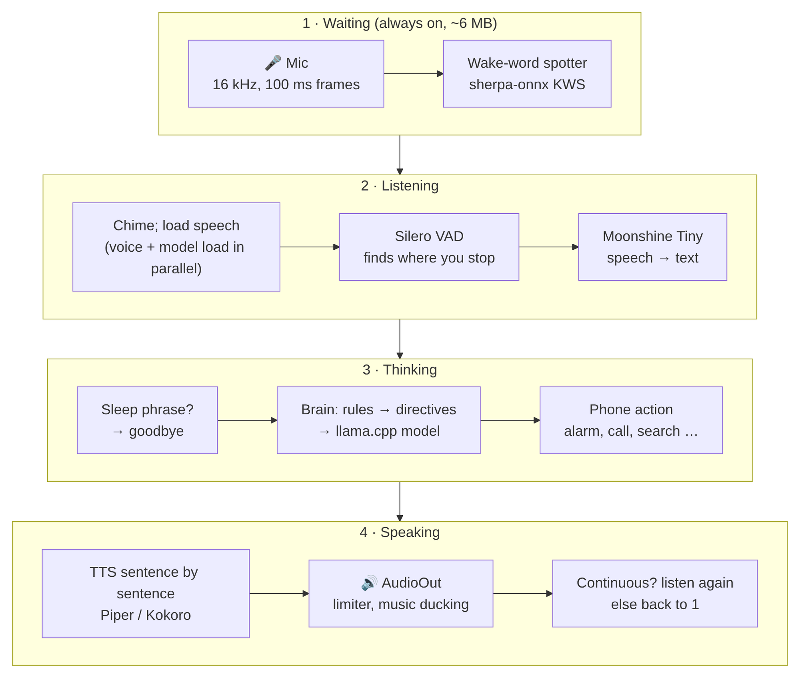

# Speech recognition and conversation

> *Turns what you say into text on the phone, and decides when you've finished talking.*

<!-- nav -->

<a href="wake-word.md">← Wake word</a> &nbsp;·&nbsp; <a href="../README.md">Docs home</a> &nbsp;·&nbsp; <a href="thinking-model.md">The thinking model (chat) →</a>

<!-- /nav -->

<picture><source media="(prefers-color-scheme: dark)" srcset="../images/diagrams/voice_pipeline-dark.png"></picture> Diagram · the voice pipeline from microphone to spoken reply

## At a glance

| | |
|---|---|
| **What it does** | Writes down what you say after the wake word, then hands the text to the assistant |
| **Where** | Settings › *Speech recognition*, *Continuous conversation & timeouts*, *Sleep words* |
| **Works offline** | Yes, after a one-time download of the 30.5 MB speech pack (*Downloads › Speech recognition*), or importing it from a file |
| **Language** | English |

## How it works for you

After the wake chime, the assistant listens. It waits until you stop talking for a moment, writes down what you said, and answers. In **continuous conversation** (the default) it keeps listening after each answer, so you can carry on talking without saying the wake word again. Say a **sleep phrase** like *"that's all"* or *"goodnight bob"* to end the conversation.

You can watch what it heard on the **Conversation** tab.

Technical details

There are two models, both run by sherpa-onnx on the CPU. They are not inside the APK. They arrive as the *speech* download: `sherpa-onnx-moonshine-tiny-en-quantized-2026-02-27.tar.bz2` (29.9 MB, SHA-256 checked) plus `silero_vad.onnx` (0.64 MB), both MIT, from the sherpa-onnx GitHub releases. They are unpacked to `files/models/stt-moonshine-tiny-en/` and `files/models/silero_vad.onnx`.

| Stage | Model | Settings used |
|---|---|---|
| Voice activity detection (VAD) | **Silero VAD** (ONNX) | threshold 0.5, min speech 0.2 s, min silence **0.7 s**, window 512 samples, max speech 20 s, 1 thread |
| Speech to text (STT) | **Moonshine Tiny (English) int8**, MIT licence | 2 threads, offline (non-streaming) decoder |

**Flow:**

1. 16 kHz float audio goes into the VAD.
2. When the VAD closes a speech segment (0.7 s of silence), the segment is decoded by Moonshine.
3. The text goes to `Brain`.

Audio heard while the recogniser was still loading is buffered and replayed. You may see events like *"fed 2200 ms of audio captured while waking"*.

## Long sentences are cut safely

Moonshine is a small model, and it produces garbage if given more than about 9 seconds at once. So long speech is cut into pieces of 8 seconds or less, at the quietest moment (a breath between words), and the pieces are joined back together.

Technical details

`speech/SpeechChunks.kt`:

- `MAX_DECODE_S = 8.0` s. Moonshine Tiny was measured to break down above roughly 9.3 s.
- `split(x, rate, maxS = 8, minS = 0.55·maxS)` finds the **quietest 20 ms window** (lowest RMS, window = rate/50 samples) between 4.4 s and 8 s into the remaining audio, cuts there, and repeats.
- Texts are decoded per chunk and joined with spaces.
- `MAX_UTTERANCE_S = 30` s: one utterance is capped at 30 s of audio, so a stuck VAD cannot build an endless buffer.

## Listening timeouts

If you wake the assistant and then say nothing, it goes back to waiting for its wake word after the **listening timeout** (default **8 seconds**). You can turn the timeout off, or set it from 2 seconds up to an hour.

**Continuous conversation** (default **on**) means "keep the conversation open until I say a sleep word". While it is on, the timeout does not apply.

Technical details

`core/ListenPolicy.kt`:

- **Unlimited listening:** `unlimited = !listen_timeout_on || continuous`.
- **Expiry:** `listenExpired` counts **audio fed to the recogniser**, not wall-clock time, so a slow phone cannot time out while it is still catching up.
  - If no speech has been heard, it expires after `timeoutSec × 1000` ms.
  - If speech has been heard, it allows a further 30 s.
- **After a reply** (`afterReply`): it listens again if listening is unlimited, the reply asked a question, or continuous conversation is on. Otherwise it goes back to wake words.
- **Watchdog:**
  - A busy think step with no progress for 180 s (`STUCK_MS`) is reset.
  - With unlimited listening, a recogniser with no progress for 10 minutes is restarted.
  - Speaking is never cut while it still makes progress.

Prefs: `listen_timeout_on` (true), `listen_timeout` (8), `listen_timeout_unit` ("s" or "min"), `continuous` (true).

## Sleep phrases

Sleep phrases end a conversation. The defaults are:

*goodnight bob · good night bob · thanks bob that's all · goodnight bob from accounting · go to sleep · that's all · that is all · goodbye · stop listening · never mind*

The settings page also suggests extras such as *"bye bob"*, *"we're done"* and *"go away"*. A sleep phrase also works at the **end** of a sentence, as in *"thanks, that's all"*.

You choose how it confirms: a spoken goodbye, a chime, or both.

Technical details

- **Prefs:** `sleep_phrases` (defaults from `Prefs.defaultSleepPhrases(name)`) and `sleep_confirm` (`"voice"`, `"chime"` or `"both"`, default `voice`).
- **Matching:** `Brain.isSleep(text)` normalises the text (lower case, punctuation removed). It matches if the text equals a phrase, ends with it, or starts with it and has at most two more words.
- **Stop chime:** the *stop chime* (`stop_chime`, default on) plays when a conversation ends, except when it was ended by a sleep phrase that already confirms.
- **Tap to end:** tapping the avatar while it listens also ends the conversation (`avatar_tap_ends`, default on).

## Interrupting

- **While a book is being read to you**, say the wake word. The book pauses, you talk to the assistant, and the book carries on by itself when the conversation ends.
- **While the assistant itself is talking**, tap the avatar (in the app, the floating bubble or the widget) to stop it. The microphone is not listening for words while the assistant speaks its own reply, so it cannot hear itself and get confused.

Technical details

- **Wake detection only runs in `Mode.WAKE`.** While a book plays, the runtime is in WAKE mode, so a match calls `BookReader.bargePause()`, and `resumeAfterBarge()` restarts the book when the session returns to waiting.
- **During a normal reply** the runtime is BUSY, and audio is not decoded.
  - A tap calls `AudioOut.stop()`, which increments `AudioOut.stops`.
  - The speaking pipeline sees the counter change, cancels sentences that were synthesised ahead, and returns `false` to the LLM stream so generation stops too.
- **Fresh context after a pause:** a new session that starts more than **5 minutes** after the last turn begins with a fresh short-term context (`brain.resetContext()`). Long-term memory is kept.

## Limits and honest notes

- English only (Moonshine Tiny English).
- Noisy rooms reduce accuracy. The VAD may also wait for a gap in background noise.
- Names and rare words are often misheard. The assistant's own rules accept common mis-hearings for commands.
- **Measured:** on the test emulator (software CPU emulation), the speech recogniser loaded in **26 s**, and a command answered by the fast rules took **4.5 s** from end of speech to reply. Real phones are many times faster. Exact phone timings were not recorded for this release.

<!-- nav -->

<a href="wake-word.md">← Wake word</a> &nbsp;·&nbsp; <a href="../README.md">Docs home</a> &nbsp;·&nbsp; <a href="thinking-model.md">The thinking model (chat) →</a>

<!-- /nav -->
