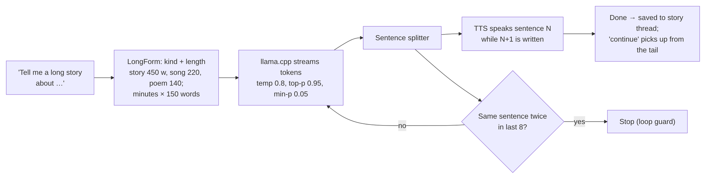

# Stories, songs and poems (long-form)

> *Ask for a five-minute bedtime story and hear it start within seconds, told sentence by sentence as it is written.*

<!-- nav -->

<a href="assistants-and-personalities.md">← Assistants, personalities and standing instructions</a> &nbsp;·&nbsp; <a href="../README.md">Docs home</a> &nbsp;·&nbsp; <a href="read-to-me.md">Read to me (audiobooks) →</a>

<!-- /nav -->

<picture><source media="(prefers-color-scheme: dark)" srcset="../images/diagrams/longform-dark.png"></picture> Diagram · how a long story is written and spoken at the same time

## At a glance

| | |
|---|---|
| **What it does** | Writes and tells stories, songs, poems, long descriptions and roleplay scenes |
| **How long** | You choose: *"a 10 minute story"*, *"a long poem"*. There is no practical cap |
| **Starts speaking** | After the first sentence is written, not after the whole thing |
| **Remembers** | The plot so far, in a separate story memory, so *"keep going"* continues it |

## How it works for you

Say things like:

- *"Tell me a bedtime story about a lighthouse keeper."*
- *"Sing me a song about Mondays."*
- *"Write a long poem about the sea."*
- *"Tell me a 5 minute story about a dragon who loves tea."*

The assistant starts talking after its first sentence is ready and keeps writing while it speaks. Say *"keep going"* or *"what happens next?"* afterwards to continue the same story. Tap the avatar to stop. What was told up to that point is remembered, ending on a whole sentence.

| You ask for | Length it aims for |
|---|---|
| a story | about 450 words (~3 min) |
| a song | about 220 words |
| a poem | about 140 words |
| a long answer, letter or speech | about 300 words |
| "long", "epic", "detailed" … | double the above |
| "an N-minute …" | N × 150 words (150 to 6,000) |

Technical details

- **Detection** (`core/LongForm.request`): a *make* verb (tell, write, sing, compose, narrate, recite …) within 40 characters of a story, song, poem or long-text noun. Examples are *"story about…"* and *"once upon a time"*.
  - Kinds: `STORY`, `SONG`, `POEM`, `LONG`.
  - *"Play a song / some music"* is excluded, because it is a media command.
- **Continue:** `isContinue()` matches *continue / keep going / what happens next*, but only while a long-form piece is active.
- **Target words** (`targetWords`): explicit minutes × 150 wpm, clamped to 150–6,000. Otherwise a per-kind base, ×2 for "long/epic/…".
- **Prompt:** the system prompt is unchanged, so its KV cache is reused. An `instruction(kind, words, name)` is appended to the user turn, with the story memory (`STORY` thread) at `LONG_MEMORY_TOKENS = 400`.
- **Generation:** `LlamaEngine.stream()` produces free text (no grammar) at **temperature 0.8** (top-k 40, top-p 0.95, min-p 0.05, repetition penalty 1.1 over 256 tokens).
- **Cleaning on the fly** (`StreamCleaner`) drops a tool-call JSON wrapper the model might emit anyway, `<think>` blocks, chat-template tokens, markdown and `[Verse]` labels.
- **Splitting** (`SentenceSplitter`) releases each sentence (or lyric line) as soon as it is complete, joining very short pieces.
- **Speaking:** `LongForm.speakable()` drops echoed prompt text, speaker labels and sign-off lines. Each sentence goes into the [TTS pipeline](voices.md), which synthesises ahead.

## Long stories don't run out of room

A small model can only hold about 4,000 tokens (roughly 3,000 words) of text at once. When a story fills that space, the assistant starts a fresh "page": it keeps the last part of the story plus your standing instructions and carries on from there. You hear one continuous story.

Technical details

- **Context shift:** when a stream stops because it **hit the context limit** (`hitLimit`), a new segment starts with `continueInstruction(kind, remainingWords, tail(full), name)`. The previous KV is replaced. Pinned directives are always re-added.
- **Runaway-only caps** (a looping model hits these, never a real story):

  | Constant | Value |
  |---|---|
  | `LONG_SEGMENTS` | 8 segments |
  | `LONG_MAX_WORDS` | 12,000 words |
  | `LONG_CAP_MS` | 30 minutes |
  | per-segment tokens | `LONG_REPLY_TOKENS × 4` (6,400) or what the context has left |

- **Guards:**
  - **Refusals:** the first sentence is checked for a refusal; if it is one, there is one in-character retry.
  - **Parroting:** a parroted opening is skipped.
  - **Loops:** the same sentence twice within the last 8 ends the reply.
- **Watchdog:** the `TimedCall` think limit (100 s) counts time *without progress*. Every streamed piece is progress, so a 20-minute story is never cut.
- **Storage:**
  - The whole text goes to the `STORY` thread, and a 300-character note goes to the chat thread.
  - The last 1,500 characters are kept as the active piece (`LONGFORM`) for *"keep going"*.
  - A story stopped by you is stored ending on its last whole sentence (`closeTurn`).

## Limits and honest notes

- Quality depends on the model. 0.5B models wander; 3B+ and the roleplay fine-tunes tell much better stories.
- With Kokoro (slow voice), long stories may pause between sentences on mid-range phones.
- Phone timings for long stories were not measured for this release. Long-form logic is unit-tested (`LongFormTest`, `LongRequestTest`, `NoSilentReplyTest`).

<!-- nav -->

<a href="assistants-and-personalities.md">← Assistants, personalities and standing instructions</a> &nbsp;·&nbsp; <a href="../README.md">Docs home</a> &nbsp;·&nbsp; <a href="read-to-me.md">Read to me (audiobooks) →</a>

<!-- /nav -->
