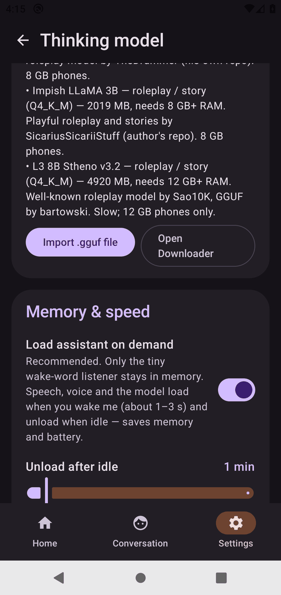

# The thinking model (chat)

> *A real language model running on your phone's processor, deciding what you meant and how to answer.*

<!-- nav -->

<a href="speech-recognition.md">← Speech recognition and conversation</a> &nbsp;·&nbsp; <a href="../README.md">Docs home</a> &nbsp;·&nbsp; <a href="phone-actions.md">Phone actions →</a>

<!-- /nav -->

 Emulator render · Settings › Thinking model

## At a glance

| | |
|---|---|
| **What it does** | Understands free-form requests, chats, answers questions, picks phone actions, writes stories |
| **Where** | Settings › *Thinking model*; models come from *Downloads (one tap)* or a `.gguf` file you import |
| **Works offline** | Yes. The model runs on the phone's CPU with llama.cpp |
| **Sizes offered** | From 0.4 GB (any phone) to 4.9 GB (12 GB+ RAM phones) |

## How it works for you

When you say something, the assistant tries two things in order:

1. **Instant rules.** Common commands like *"set a timer for 5 minutes"*, *"turn on the flashlight"* or *"what time is it"* are recognised straight away by built-in patterns, with no model needed. That takes well under a millisecond.
2. **The thinking model.** Anything else goes to the language model. It reads your words, the assistant's personality and what it remembers about you, then either **answers** or **chooses one phone action** (call, text, alarm, open an app, and so on).

Without a model, the assistant still does the rule-based commands and tells you it needs a model for the rest.

Technical details

`Brain.handle(utterance)`:

1. **Sleep phrase?** Then end the session.
2. **Pending confirmation** (for example *"Send 'on my way' to Sam?"*): *yes* runs it, *no* drops it, anything else is treated as new input.
3. **Missing slot** (for example *"set an alarm"* → *"For what time?"*): your answer fills the slot using `NumberWords` (clock times, durations, days).
4. **Directive update:** standing instructions are parsed out of the text (see [Assistants & personalities](assistants-and-personalities.md)).
5. **Long-form request?** Stories, poems and songs go to the streaming path (see [Stories](stories.md)).
6. **`RuleParser.parse(text)`:** about 70 regular-expression rules. Wake-name prefixes ("hey bob, …") and politeness ("could you", "I want you to") are stripped first.
7. **`askLlm(text)`:** grammar-constrained tool call, described below.
8. **`ActionRouter.execute(action)`:** runs the action, then the turn is stored in memory.

## One answer, always a valid action

The model is not allowed to ramble or invent commands. Its answer is forced into a strict shape: *one* tool from a fixed list, with the right kind of values. Even a tiny model therefore always produces something the app can act on.

Technical details

- **Grammar:** `Tools.grammar()` builds a **GBNF grammar** (llama.cpp's grammar format) from `Tools.ALL`. Generation is constrained so the output is exactly one JSON-like tool call: `{"tool":"set_timer","seconds":300}`. Integer parameters accept only digits, and choice parameters accept only the listed words.
- **The 23 tools:**

  | Group | Tools |
  |---|---|
  | Talk | `reply`, `cancel` |
  | Contacts | `call`, `sms` |
  | Apps and device | `open_app`, `open_settings` (15 panels), `camera`, `flashlight`, `volume`, `media` |
  | Time | `set_alarm`, `set_timer`, `reminder`, `calendar_event` |
  | Notes and info | `note`, `read_notes`, `device_info` |
  | Maps | `navigate` |
  | Screen | `screen` (13 operations) |
  | Web | `web_answer`, `news`, `web_search` |

- **Parsing:** `LlmOutputParser` reads the call, tolerating stray whitespace.
- **Safety nets after the call** (`Brain.askLlm`):
  - **Plausibility:** if the model chose a phone action that does not fit your words (`Intent.plausible`), for example flirting turned into "call", it is asked again with a **reply-only grammar**.
  - **Parroting:** if a reply repeats an earlier answer's opening (60 characters, 12 recent replies), it is regenerated with a nudge.
  - **Refusals:** an *"as an AI I can't…"* answer gets one in-character retry.
  - **Context overflow:** if the prompt did not fit, memory is shrunk to ⅓ of its budget and the call is retried. Failing that, only the pinned directives are kept.
- **Limits:** `MAX_REPLY_TOKENS = 200` per normal reply, and `MAX_MEMORY_TOKENS = 600` of memory per turn.

## Choosing a model

Bigger models are smarter but need more memory and are slower. The app recommends one for your phone automatically:

| Your phone's RAM | Recommended (default) |
|---|---|
| under 5 GB | Dolphin 3 Qwen2.5 **0.5B** (0.40 GB) |
| 5–10 GB | Dolphin 3 Qwen2.5 **1.5B** (0.99 GB) |
| 10.5 GB or more | Dolphin 3 Llama 3.2 **3B** (2.02 GB) |

Each assistant can use its own model ("Use … for Bob"), or follow the one you picked last.

Technical details

All models are **GGUF, Q4_K_M** quantisation (4-bit), from Hugging Face. They are downloaded on request from *Downloads* or imported from a file. "Min RAM" is the app's guidance, not a hard block.

| Family | Model id | Size | Min RAM | Licence note |
|---|---|---|---|---|
| Standard | qwen2.5-0.5b | 0.49 GB | 3 GB | Apache-2.0 |
| | qwen2.5-1.5b | 1.12 GB | 6 GB | Apache-2.0 |
| | llama3.2-1b | 0.81 GB | 4 GB | Llama 3.2 Community |
| | qwen2.5-3b | 2.10 GB | 8 GB | Qwen Research (non-commercial) |
| | llama3.2-3b | 2.02 GB | 8 GB | Llama 3.2 Community |
| | qwen3-4b-2507 | 2.50 GB | 12 GB | Apache-2.0 |
| Uncensored (Dolphin) | dolphin3-qwen2.5-0.5b | 0.40 GB | | |
| | dolphin3-qwen2.5-1.5b | 0.99 GB | | default for 5–10 GB |
| | dolphin3-qwen2.5-3b | 1.93 GB | | |
| | dolphin2.9.4-gemma2-2b | 1.71 GB | | Gemma terms |
| | dolphin3-llama3.2-3b | 2.02 GB | | default for ≥10.5 GB |
| | dolphin3-llama3.1-8b | 4.92 GB | | |
| Abliterated | qwen3-4b-2507-abl, gemma3-4b-abl, qwen2.5-1.5b-abl | | | |
| Roleplay | gemmasutra-mini-2b, impish-llama-3b, stheno-8b | | | |

- **Which model runs:** `ModelChoice` resolves it. The profile's own `llm_file` wins if the file exists. Otherwise the last model chosen anywhere (global) is used. Otherwise the recommended one.
- **"Selected" vs "loaded":** these are kept separate (`LlmOnDemand`), so unloading a model never clears your choice.
- **Chat template:** the GGUF's embedded chat template is applied. If it is missing or unknown, the architecture's known format is used as a fallback.

## Memory use: load on demand

A loaded model uses memory roughly the size of its file, plus working space. To keep your phone fast, the model is **loaded only when needed** and **unloaded after 60 seconds idle** by default. The first answer after an unload takes a few seconds longer while it loads.

| Setting | Default | Range |
|---|---|---|
| Load assistant on demand | On | |
| Unload after idle | 60 s | 10 s – 1 h |
| Processor threads | Auto | 1 – number of cores |

The *Unload the book* and *Unload everything* buttons free memory at once.

Technical details

- **Engine:** `llm/LlamaEngine.kt` → JNI → `cpp/llm_core.cpp` (llama.cpp, CPU, `n_batch = 512`). The context is `DEFAULT_CTX = 4096` tokens, sized for a full persona, memory and a long reply.
- **Threads:** `llm_threads = 0` means auto: `ModelCatalog.recommendedThreads(cores)` gives 4 for 8+ cores, 2 for 4+ and 1 otherwise. Only big cores are targeted, because using the little cores is slower on phones.
- **KV-cache reuse:** the long system prompt (tools, clauses, persona) is identical between requests. `llm_core` keeps the cached tokens, finds the longest common prefix and only evaluates the new user turn. `Brain.warm()` pre-fills the system prompt after loading, so the first real reply is quick.
- **Sampling:**
  - **Tool calls:** greedy, with a repetition penalty of 1.1 over the last 64 tokens, constrained by the grammar.
  - **Long free text:** temperature 0.8, top-k 40, top-p 0.95, min-p 0.05, and a repetition penalty of 1.1 over 256 tokens.
- **Priorities:** one llama context serves both replies and background work (memory summaries, warm-up). Background calls run through `background {}`, and a reply calls `preempt()` so background work aborts at once and its output is discarded.
- **Watchdogs:**
  - `TimedCall` limits a reply to **100 s without progress** (`THINK_LIMIT_MS`). Streaming progress resets the clock, so long stories are not cut.
  - Waiting for a model to load is capped at **150 s** (`LOAD_WAIT_S`).
  - The conversation watchdog resets a step stuck for **180 s** (`STUCK_MS`).
- **Prefs:** `llm_file`, `llm_threads` (0), `on_demand` (true), `unload_after` (60).

## The rules (fast path)

The built-in rules cover the most common commands in natural phrasing. Examples:

| You say | It does |
|---|---|
| "set a timer for an hour and a half" | 90-minute timer |
| "wake me up at seven thirty" | alarm at 07:30 |
| "remind me in 10 minutes to check the oven" | reminder notification |
| "turn the flashlight on" / "torch" | flashlight |
| "what time is it" / "battery" | spoken device info |
| "never mind" / "cancel that" | cancels |

Technical details

- **Where:** `core/RuleParser.kt` (about 70 regexes) and `core/NumberWords.kt`.
- **NumberWords** handles spoken numbers ("twenty five"), durations ("half an hour", "1 hour 30 minutes") and clock times ("quarter past 6", "noon", "seven thirty in the morning"). Without am/pm, 1–6 o'clock is read as pm, except when answering an alarm follow-up.
- **Speed:** the rules run in under 1 ms. Anything they do not match falls through to the model.

## Limits and honest notes

- Small models (0.5B–1.5B) are chatty but make mistakes, and their knowledge is frozen at training time. Turn on [Internet answers](web-and-news.md) for current facts.
- Speed depends heavily on the phone. Reply times on a real phone were **not benchmarked** for this release. On the software-emulated test device, only rule replies were timed (4.5 s end to end).
- The "uncensored", "abliterated" and "roleplay" models have had safety tuning reduced. They are offered because this is a private, adults-only assistant. Pick a standard model if you prefer.
- Some model licences restrict commercial use (Qwen2.5-3B, Gemma, Llama). See the model card before relying on one.

<!-- nav -->

<a href="speech-recognition.md">← Speech recognition and conversation</a> &nbsp;·&nbsp; <a href="../README.md">Docs home</a> &nbsp;·&nbsp; <a href="phone-actions.md">Phone actions →</a>

<!-- /nav -->
