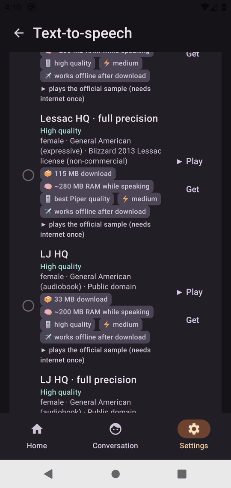

# Voices and sounds

> *Natural text-to-speech made on the phone, with adjustable speed, character and chimes.*

<!-- nav -->

<a href="web-and-news.md">← Internet answers and news</a> &nbsp;·&nbsp; <a href="../README.md">Docs home</a> &nbsp;·&nbsp; <a href="memory.md">Long-term memory →</a>

<!-- /nav -->

 Emulator render · Settings › Text-to-speech

## At a glance

| | |
|---|---|
| **What it does** | Speaks every reply, story and book in the voice you choose |
| **Engines** | Piper (dozens of English voices) and Kokoro (11 voices, the most natural) |
| **Works offline** | Yes, once a voice is downloaded or imported |
| **Per assistant** | Each assistant has its own voice, speed, volume and character settings |

## How it works for you

Pick a voice on the *Text-to-speech* page and press **▶ Preview** to hear it say your preview phrase. Then adjust:

| Control | What it changes | Default | Range |
|---|---|---|---|
| Speed | How fast it talks | 1.00× | 0.60× – 1.60× |
| Volume | How loud, on top of the phone's volume | 100 % | 0 – 100 % |
| Masculine ↔ Feminine | Deeper or lighter, as one natural-sounding move | Natural | −100 % … +100 % |
| Expressiveness *(advanced)* | Flatter and cleaner, or livelier and rougher | 0.667 | 0.10 – 1.00 |
| Rhythm variation *(advanced)* | How much the timing varies | 0.80 | 0.10 – 1.20 |

*Reset to defaults* puts all of them back.

Long replies start playing after the **first sentence** is ready. The rest is prepared while you listen, so you are not waiting for the whole answer.

Technical details

- **Runtime:** sherpa-onnx `OfflineTts` (VITS for Piper, Kokoro for Kokoro) on the CPU. `synth(text, speaker, speed)` returns float PCM at the voice's sample rate.
- **Threads:** `max(quality.threads, 2)`.
- **Speed:** passed as sherpa-onnx's `speed` (the inverse of the VITS length scale).
- **Expressiveness** is VITS `noise_scale` (`tts_noise`, 0.667), and **rhythm variation** is `noise_w` (`tts_noise_w`, 0.8). Changing either reloads the voice.
- **Sentence pipeline:** `SentenceSplitter` cuts the reply into sentences. Each is synthesised on a worker *ahead* of playback while the previous one plays, then played back to back. A stop (tap, sleep word, reset) increments `AudioOut.stops`, which cancels the queue.
- **Output** (`AudioOut`):
  - A **peak limiter**: if a clip peaks above 0.97 it is scaled down, because VITS can overshoot 1.0.
  - **4 ms fade-in/out** to avoid clicks.
  - Playback through `AudioTrack` with `USAGE_ASSISTANT`, taking **transient ducking audio focus**, so music dips while it speaks and comes back afterwards.
- **Volume:** `voice_volume` is a per-profile gain on top of the system stream volume.

## Choosing a voice

| Voice type | Quality | Speed | Memory while loaded* |
|---|---|---|---|
| Piper *medium*, int8 | standard | fast | ~170 MB |
| Piper *medium*, full precision | smooth | fast | ~210 MB |
| Piper *high*, full precision | best Piper | medium | ~270 MB |
| Kokoro (11 voices) | most natural | slow (about 1 s of work per 1 s of speech) | ~340 MB |

*Measured as process memory with sherpa-onnx 1.13.8 on 2 threads during development (not on a phone).

The default for *Bob From Accounting* is **Ryan** (US male), and for *Boob Dragon* it is **Amy** (US female). The Downloads page recommends **Lessac HQ** for phones with 3.5 GB of RAM or more.

Technical details

- **Piper voices:** sherpa-onnx `vits-piper-*` archives from the sherpa-onnx `tts-models` GitHub release. Each comes as int8 (default) or `-fp32` (full precision). The voices offered include:
  - **US English:** Amy, Kristin, HFC Female, Lessac, LJ, Kathleen, Ryan, John, Joe, HFC Male, Bryce, LibriTTS-R
  - **British English:** Southern English Female
  - **High quality:** Ryan HQ, Lessac HQ, LJ HQ, LibriTTS HQ, Cori HQ (British)
  - Licences vary per voice (CC0, CC BY, CC BY-NC-SA, public domain). The catalog shows each one.
- **Kokoro:** `kokoro-int8-en-v0_19` (103 MB, Apache-2.0), 11 US and British speakers.
- **Pref:** `voice` (directory name). Defaults are `vits-piper-en_US-ryan-medium-int8` and `…amy-medium-int8`.
- **Storage:** voices unpack to `files/models/voices/<dir>/` (`*.onnx`, `tokens.txt`, `espeak-ng-data/`). Piper uses **eSpeak NG** for phonemisation. Because eSpeak NG is GPL-3.0, the APK as a whole is GPL-3.0 (see [Privacy, permissions & storage](privacy-permissions-storage.md#licences)).

## Picking a speaker (Kokoro and LibriTTS)

Some voice models contain many people. When you use one of them, a **Speaker** card appears at the top of the *Text-to-speech* page:

- **Kokoro** has 11 named speakers, such as *Bella · US female*, *Adam · US male* and *Emma · British female*. Tap one to choose it and hear it.
- **LibriTTS** (and LibriTTS HQ) has 904 numbered speakers. Step through them with **‹ ›**, drag the slider, or press **Random**. **▶ Hear speaker N** plays the current one.

The choice is saved **per voice**, so switching to another voice and back keeps it.

Technical details

- **Speakers per model:** `VoiceModel.speakers`: Kokoro 11 (`KOKORO_SPEAKERS`, in model order, taken from the model's own `speaker_names` metadata: `af, af_bella, af_nicole, af_sarah, af_sky, am_adam, am_michael, bf_emma, bf_isabella, bm_george, bm_lewis`), LibriTTS / LibriTTS-R 904, all others 1. The card is shown only when the voice in use has more than one.
- **Names:** `speakerName()` turns `bf_emma` into *Emma · British female* (`a` = US, `b` = British; `f` / `m`). `af` alone is Kokoro's default blend, shown as *Mixed · US female*.
- **Pref:** `voice_speaker_<voice dir>` (Int), per profile. An older single `voice_speaker` value is still read as the fallback for the voice in use.
- **Use:** every synthesis call passes `prefs.voiceSpeaker` (the current voice's speaker) to sherpa-onnx, which clamps it to `0 … numSpeakers − 1`. Previews pass the voice's own saved speaker. The audio cache key includes the speaker.
- **Up to 20 speakers** are listed as radio buttons, more as a stepper + slider.
- **Tests:** `SpeakerTest` (counts per catalog voice, Kokoro names, fallback label).

## Hearing a voice before you download it

Every voice has a **▶ Play sample** button, even before it is downloaded.

- Installed voices speak your preview phrase live on the phone.
- Kokoro plays a short clip shipped inside the app.
- Piper voices that are not installed play the official sample clip, **downloaded once from the Piper samples website** and then kept. This only happens while *Settings › Internet & search › Allow internet access* is **on**. With it off, nothing is downloaded: a sample you already heard still plays, and otherwise the app says the sample needs the internet (or that you can download the voice). The voice list shows the same hint under each voice.

Technical details

- **Code:** `speech/VoicePreview.kt`.
- **Not-installed Piper:** about 90 KB per sample from `https://rhasspy.github.io/piper-samples/…`, cached in `cache/voice_samples/`. Only that host is contacted.
- **Decision** (`VoicePreview.plan`, unit tested in `VoicePreviewPlanTest`): installed → live; no sample → message; bundled asset → play; already cached → play (offline); not cached and `internet` on → download once; not cached and `internet` off → *"This sample needs the internet, which is off…"*, no request.
- **Kokoro:** `assets/voice_samples/kokoro-int8-en-v0_19.ogg`.
- **Preview phrase:** `preview_phrase`, default *"Hey there, sugar. How does this sound?"*.

## Masculine ↔ Feminine (voice shift)

The slider makes any voice deeper or lighter. Unlike a simple pitch change, it moves **pitch** and **voice character** separately, so a lighter voice does not sound like a chipmunk. It is saved per voice. *Natural* (the middle) gives the cleanest sound.

Technical details

`core/VoiceShift.kt` is pure Kotlin and runs on the device. The amount is `a ∈ [−1, 1]`.

- **Pitch:** ±**4 semitones** (`p = 2^(4a/12)`).
- **Formants:** ±**10 %** (vocal-tract size).

The method has two steps:

1. **WSOLA** time-stretch by `p`, then resample back to the original length. This scales the pitch by `p`, but the formants also by `p`.
2. **Envelope warp:** per STFT frame (radix-2 FFT), a **cepstrally smoothed spectral envelope** is measured, and the frame is re-shaped so the envelope ends up scaled by the formant ratio `f` instead of `p`. Phase is kept.

The pref is `voice_shift_<voiceDir>` (0 = natural). The method is unit-tested in `VoiceShiftTest`.

## Chimes and sounds

There are four sound slots:

- *when I start listening*
- *when I keep listening after a reply*
- *when I stop listening*
- *goodnight*

Each can be the built-in chime, one of your phone's ringtones or notification sounds, or an audio file you import (up to 8 seconds is played). The start and stop chimes can be switched off on the *Continuous conversation* page.

Technical details

- **Code:** `speech/Sounds.kt`. Slot ids are `start`, `follow`, `stop` and `sleep`.
- **Built-in chimes** are generated as samples by `Chime`, with no audio files.
- **Pref values** (`sound_<slot>`): empty for built-in, `ring:<uri>` for a `RingtoneManager` pick, or `file:<name>` for an imported file copied to `files/sounds/`.
- **Imports:** mp3, ogg/oga/opus, wav, m4a/aac/mp4/3gp, flac, amr, mid/midi, webm/mka. They are played by `MediaPlayer` and capped at `MAX_MS = 8000` ms.
- **Switches:** `chime` (start, default on) and `stop_chime` (default on).

## Limits and honest notes

- English voices only.
- Kokoro sounds best, but it is slow on mid-range phones. Expect a pause before each sentence.
- The memory figures above are development measurements. Phone memory use was not separately profiled.

<!-- nav -->

<a href="web-and-news.md">← Internet answers and news</a> &nbsp;·&nbsp; <a href="../README.md">Docs home</a> &nbsp;·&nbsp; <a href="memory.md">Long-term memory →</a>

<!-- /nav -->
