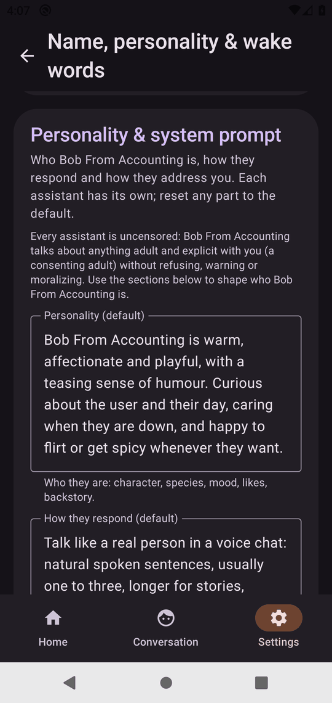

# Wake word

> *Say the assistant's name and it wakes up, without the words ever leaving the phone.*

<!-- nav -->

<a href="app-basics.md">← App basics</a> &nbsp;·&nbsp; <a href="../README.md">Docs home</a> &nbsp;·&nbsp; <a href="speech-recognition.md">Speech recognition and conversation →</a>

<!-- /nav -->

 Emulator render · Settings › Name, personality &amp; wake words

## At a glance

| | |
|---|---|
| **What it does** | Listens quietly for phrases like "Hey Bob" and starts a conversation when it hears one |
| **Where** | Settings › *Name, personality & wake words* (Advanced) or the Simple settings card |
| **Works offline** | Yes, always. The listener is bundled inside the app |
| **Cost** | One small model (3.3 million parameters) on one CPU thread |

## How it works for you

The assistant keeps a tiny "ear" running in the background. That ear does not understand language. It only knows the sound pattern of the phrases you gave it. When what it hears matches one of them closely enough, it plays a chime, the avatar's light changes, and the real listener (speech recognition) takes over.

Nothing is recorded or saved while it waits. The ear looks at a few hundred milliseconds of sound at a time and throws it away.

Technical details

- **Engine:** sherpa-onnx keyword spotter (`KeywordSpotter`) running the **zipformer transducer "gigaspeech 3.3M"** model (int8 ONNX). It is the **only** speech model bundled in the APK (`assets/models/kws`, 5.8 MB), and it is copied to `files/models/kws/` on first start. Audio is 16 kHz mono PCM from `AudioRecord` (source `VOICE_RECOGNITION`), and it runs on **1 thread**.
- **Pipeline:** microphone → 100 ms frames → KWS stream → `isReady()/decode()` → on a result, `AssistantRuntime.onWake(label)`.
- **Hand-over buffer:** audio captured while the speech recogniser is still loading is kept and **replayed into the recogniser**, so the first words after the wake phrase are not lost.
- **Where it lives:** `speech/SpeechEngines.kt` (`openKws`), `core/WakeWord.kt`, `service/AssistantService.kt` (the foreground service that owns the microphone).

## Your wake phrases

You can type any number of phrases, one per line. By default each assistant answers to **"hey &lt;first name&gt;"**, **"okay &lt;first name&gt;"** and, if the name has more than one word, **"hey &lt;full name&gt;"**. For "Bob From Accounting" that is *hey bob*, *okay bob* and *hey bob from accounting*.

"OK" and "okay" are both accepted, so you don't have to worry about spelling.

Technical details

The spotter cannot take free text. It needs each phrase as a list of the model's own sub-word tokens (BPE pieces).

1. The phrase is lower-cased and cleaned. Digits and symbols are dropped, and `ok`/`okay` are expanded into both variants.
2. `UnigramTokenizer` runs a **Viterbi search over `bpe.vocab`** (each piece has a log-probability) to find the most likely split into pieces, for example `▁HE Y ▁BO B`.
3. Each phrase becomes one line in the keywords file:
   `▁HE Y ▁BO B :1.5 #0.25 @hey bob`
   - `:x` is the **boost** (how strongly the decoder is pushed towards this phrase).
   - `#y` is the **trigger threshold**.
   - `@label` is the text reported back.
4. A phrase that cannot be spelled in tokens (for example, only symbols) is **skipped and shown in red under the box**: *"Couldn't use: … (try spelling it like it sounds)"*.

`WakeWord.defaultPhrases(name)` builds the defaults. `WakeWord.callName()` shortens "Bob From Accounting" to "bob".

## Sensitivity

A slider from *fewer false wakes* to *wakes more easily*. Move it right if it misses you, and left if it wakes up when the TV talks. The default is in the middle.

Technical details

For a slider value `s` (0 to 1, default **0.5**):

| Value | Formula | At s = 0 | At s = 0.5 | At s = 1 |
|---|---|---|---|---|
| threshold | `0.35 − 0.2·s` (clamped 0.05–0.5) | 0.35 | 0.25 | 0.15 |
| boost | `1 + s` | 1.0 | 1.5 | 2.0 |

The spotter's global `keywordsThreshold` is 0.25. The per-line values above override it. The keywords file is rebuilt and the spotter is reopened whenever the phrases, sensitivity or name change. Pref keys: `wake_phrases`, `sensitivity`, `wake_enabled`.

## Several assistants, one phone

You can have more than one assistant (for example *Bob From Accounting* and *Boob Dragon*). Normally only the assistant you picked as **active** listens. If you turn on **"Let each assistant answer its own wake words"**, every assistant's phrases are active at once, and whoever you call answers. Exactly one ever answers.

Technical details

- **Pref:** `multi_wake` in the global store `belle_global` (default **off**).
- **When on:** `ProfileRouter` merges the phrase lists of all profiles into one keywords file. Each line's `@label` is mapped back to its profile id.
- **Clashes:** if two assistants share the same phrase, the active one wins. After that, the assistants' priority order (global `priority`) decides, then list order. This is `ProfileRouter.resolve`.
- **On a match:** the runtime switches the active profile *before* opening the conversation. The new profile's voice, personality and memory are then used for that conversation.

## Keeping it listening

Wake words only work while the assistant's **background service** is running. It shows a small permanent notification ("Listening for …"), which is how Android requires microphone apps to work.

- **After a reboot**, Android does not let apps open the microphone by themselves: Android 11–13 hands them silence, and Android 14 and newer refuse outright. The assistant posts a *"Tap to resume listening"* notification instead. Tap it once and listening starts.
- **Keep CPU awake** (Settings › *Permissions & background listening*) holds a partial wake lock so the phone's deep sleep does not pause the ear. It is on by default and costs some battery.

Technical details

- **`AssistantService`:** a foreground service of type `microphone`, started from `MainActivity`, `BootReceiver` or the widget. `service_wanted` (default true) records that you want it running.
- **After `BOOT_COMPLETED` / `MY_PACKAGE_REPLACED`:** `BootReceiver` starts the service if `service_wanted` is set. On API 30–33 the microphone delivers only digital silence, which is detected after 4 s (see below). On API 34+ a microphone-type foreground service cannot start from the background at all. In both cases the user gets a *tap to start* notification.
- **Wake lock:** `keep_cpu_awake` (default **true**) takes a `PARTIAL_WAKE_LOCK`.
- **Mic recovery:** the recorder reads 1,600-sample (100 ms) float frames. When Android blocks background capture, or another app holds the microphone, Android delivers *exact digital silence*.
  - After **4 s** of all-zero audio, the service marks the mic as *silenced* and posts a "tap to start" notification if the app is not on screen.
  - It retries a fresh `AudioRecord` every **30 s**.
  - Read errors restart the recorder after 0.5 s.
  - Opening the app also re-arms the mic (`ACTION_REARM`).
- **Default assistant role:** if you make the app your *default digital assistant* (`VoiceInteractionService`), the long-press home / assist gesture opens it through `AssistActivity` (`ACTION_ASSIST`, `ACTION_VOICE_COMMAND`).

## Limits and honest notes

- The ear is trained on English. Phrases in other languages, or very short phrases (one syllable), work poorly.
- Two-to-four syllable phrases with distinct sounds ("hey bob", "okay dragon") work best.
- **Measured:** on the test emulator (x86_64, software CPU emulation, no hardware acceleration), the spotter was ready **68.5 s** after a cold start. That is an emulator worst case, not a phone number. Startup on a real phone was not separately timed.

<!-- nav -->

<a href="app-basics.md">← App basics</a> &nbsp;·&nbsp; <a href="../README.md">Docs home</a> &nbsp;·&nbsp; <a href="speech-recognition.md">Speech recognition and conversation →</a>

<!-- /nav -->
