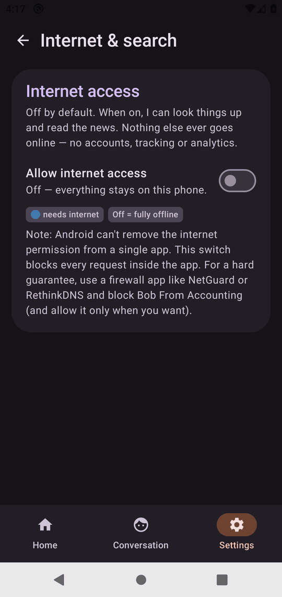

# Internet answers and news

> *Optional and off by default. When you allow it, the assistant can look things up and read the headlines, with sources.*

<!-- nav -->

<a href="phone-actions.md">← Phone actions</a> &nbsp;·&nbsp; <a href="../README.md">Docs home</a> &nbsp;·&nbsp; <a href="voices.md">Voices and sounds →</a>

<!-- /nav -->

 Emulator render · Settings › Internet &amp; search

## At a glance

| | |
|---|---|
| **What it does** | Searches the web, reads a few result pages, and has the local model write a short spoken answer that names its sources. It also reads the news from RSS feeds |
| **Default** | **Off.** No web request is made until you turn on *Allow internet access* |
| **Accounts or API keys** | None needed |
| **Where** | Settings › *Internet & search* and *News feeds* |

## How it works for you

Ask something current, like *"who won the match last night?"*. If the internet switch is on, the assistant:

1. searches the web
2. opens the best few pages
3. reads them
4. summarises the answer in a couple of sentences

It speaks the answer without the citation numbers. The Conversation tab shows the answer with numbered links to the pages it used.

Say *"what's the news?"* or *"news about science"* for headlines from your feeds.

If the switch is off, the assistant tells you so. It answers from its own knowledge only when you ask it to chat.

Technical details

**Pipeline** (`core/Web.kt`, class `WebKnowledge`):

1. **Search:** try providers in your order, skipping disabled or rate-limited ones.
2. **Fetch:** read the top N result pages in parallel (`pages_to_read`, default **3**, range 1–5), spread across different sites.
3. **Extract:** `HtmlText` strips scripts, styles, navigation and footers. Wikipedia pages use the clean summary API instead of HTML.
4. **Answer:** the local LLM writes a short answer with `[n]` citations.
5. **Speak:** `forSpeech()` removes the `[n]` markers. The sources go to the transcript.

If the first-choice provider failed and another answered, a small note (*"switched to DuckDuckGo"*) is shown but not spoken.

## Search providers

| Provider | How | Default order |
|---|---|---|
| Brave Search | Loads search.brave.com like a normal visitor | 1 |
| DuckDuckGo | Loads DuckDuckGo's results page | 2 |
| SearXNG | Your own server (enter its address) | 3 (only if set) |
| Wikipedia | Encyclopedia articles only | 4 |

You can reorder them, or switch individual providers off.

Technical details

- **Parsers:** `SearchParsers.braveHtml` and `duckDuckGoHtml` parse results pages (html. and lite.duckduckgo.com) and tolerate class-name changes. SearXNG uses its JSON API (`format=json`). Wikipedia uses its REST API.
- **Prefs:** `search_order` and `search_disabled` (comma lists), `searx_url`.
- **Local servers:** a SearXNG server on your home network may use plain `http`. Everything else must be HTTPS.
- **Rate limits** (`core/RateLimiter.kt`):
  - Per-provider token buckets, about **one search every 2.5 s with bursts of 2**.
  - On a 429 or a captcha, that provider backs off, honouring `Retry-After`, otherwise exponential with jitter. Callers never wait; they skip to the next provider.
  - Identical concurrent requests are de-duplicated.
  - TTL caches: search results **10 min**, news **30 min**.

## Browsing mode

- **Headless (default):** the search page loads in an invisible built-in browser on your phone, just like a normal visit from your connection.
- **Frontend:** the search is also opened in your browser so you can see it. Optionally (*"Also read the browser tab"*) the assistant reads the page text from the screen using Accessibility.
- **Clear browsing data** removes the hidden browser's cookies and cache.

Technical details

- **Headless:** `net/WebViewFetcher.kt` uses an off-screen `WebView` (real Chromium engine, JavaScript on, that site's cookies), waits for load and extracts `document.documentElement.outerHTML`. This copes with providers that block plain HTTP clients.
- **Frontend:** `showInBrowser(url)` launches an `ACTION_VIEW`. If `frontend_a11y` is on, `screenReader()` asks the Accessibility service for the visible text after load.
- **Plain reads** (JSON APIs, RSS, result pages): `net/Net.kt` is the **only** class that opens HTTP connections for web answers.
  - It checks the switch first and throws `NetDisabledException` when it is off.
  - HTTPS only (except a local SearXNG), no cookies kept, a common desktop User-Agent with nothing device-specific, and a **1.5 MB cap** per response.
- **Prefs:** `internet` (false), `browsing_mode` (`headless` / `frontend`), `frontend_a11y` (false).

## News feeds

Five world-news feeds are set up by default: BBC World, NPR, PBS NewsHour, The Guardian World and Al Jazeera. You can add any RSS or Atom feed address, remove feeds, or reset to the defaults. *"News about X"* filters the headlines by topic.

Technical details

- **Parser:** `Rss` is a tolerant RSS 2.0 / Atom parser with no Android dependencies, and it is unit-tested.
- **Headlines:** gathered from all feeds, de-duplicated, filtered by topic words, newest first, then summarised by the LLM with `[n]` citations.
- **Pref:** `news_feeds` (newline list, default `Rss.DEFAULT_FEEDS`).

## Limits and honest notes

- Answers are only as good as the pages found and the small local model's reading. Check the sources for anything important.
- Search sites can change their pages or block automated visits. The fallback order exists for this reason.
- The live web tests (`LiveWebTest`) were run from the development machine. Web answers on a real phone were **not separately verified** for this release.

<!-- nav -->

<a href="phone-actions.md">← Phone actions</a> &nbsp;·&nbsp; <a href="../README.md">Docs home</a> &nbsp;·&nbsp; <a href="voices.md">Voices and sounds →</a>

<!-- /nav -->
