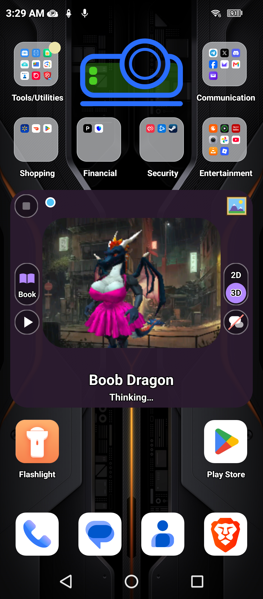
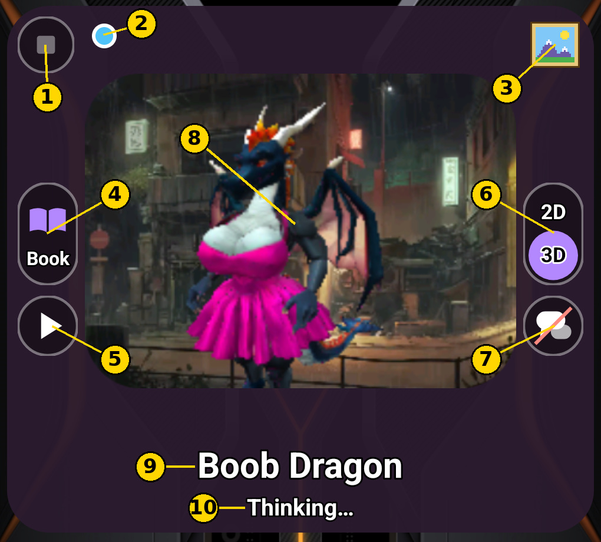
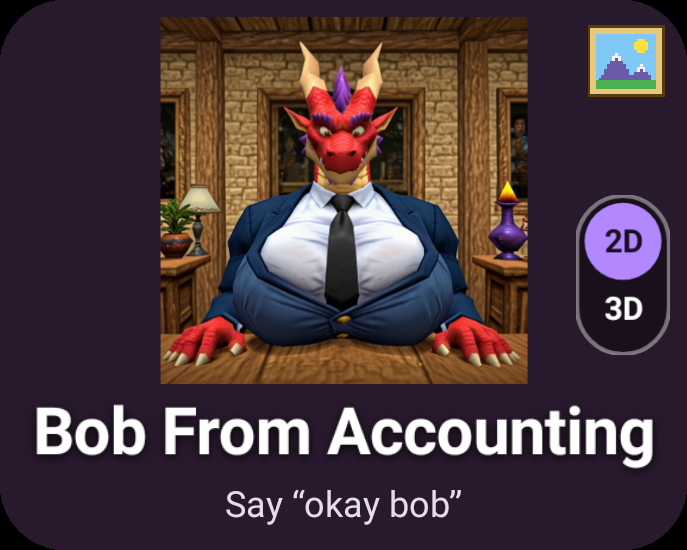
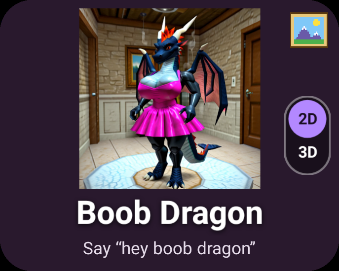
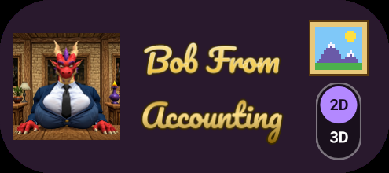

# Home-screen widget

> *Your assistant on the home screen: animated, tappable, with one-touch talk, 2D/3D, conversation mode, backgrounds and audiobook controls.*

<!-- nav -->

<a href="autorig3d.md">← AutoRig3D (automatic skeleton)</a> &nbsp;·&nbsp; <a href="../README.md">Docs home</a> &nbsp;·&nbsp; <a href="photo-to-3d.md">Photo → 3D (Pixal3D on the phone) →</a>

<!-- /nav -->

 <b>Real device</b> · the widget on a phone's home screen (3D avatar, custom background, mid-conversation)

## At a glance

| | |
|---|---|
| **What it is** | One widget type that always shows the **active** assistant and follows when you switch |
| **Sizes** | Any size the launcher allows. Tall layouts put the avatar above the name; short ones put it beside the name |
| **Animation** | Idle breathing, blinking and sway keep playing even while the app sleeps; livelier during a conversation |
| **Add it** | Long-press the home screen › Widgets › *Milky Moo's Assistant*, or the **Add widget** button on the app's Home tab |

## Every button

 <b>Real device</b> (annotated) · the numbered controls below

| # | Control | Tap does |
|---|---|---|
| 1 | **Book Stop** ■ (top left) | Stops the book. Your place is kept, and the playback notification goes away. Dim when no book is open |
| 2 | **Live dot** | Not a button. It shows a conversation is in progress |
| 3 | **Background** (picture frame, top right) | Opens the background picker for this assistant |
| 4 | **Book** (left pill) | Opens the *Read to me* library to choose a book |
| 5 | **Book Play / Pause** ▶ ❚❚ | Starts or pauses reading straight away, without starting the assistant or loading the thinking model |
| 6 | **2D / 3D** (right pill) | Switches this widget between the picture and the 3D avatar. If the active assistant has no 3D model, the 3D half is greyed out, the widget shows the 2D picture, and tapping it shows a hint |
| 7 | **Conversation** (speech bubble) | Turns *continuous conversation* on (lit) or off (crossed out) |
| 8 | **Avatar** | **Talk.** Tap again during a conversation to **end** it |
| 9 | **Name** | Opens the app on its Home tab |
| 10 | **Status line** | Shows *Say "hey bob"* (rotating through your wake words every 10 s) or what the assistant is doing. While a book is open it reads *Reading …* / *Paused …*, and tapping it plays or pauses |

**The widget always shows the active assistant**, their own picture or their own 3D model, never another assistant's. If you switch to an assistant without a 3D model, the widget shows that assistant in 2D, even if it was on 3D for the previous one. When the assistant gets a 3D model, the widget's 3D choice works again. The widget refreshes when you change the active assistant, add an assistant, or import, make or remove a picture or 3D model.

Empty space, the background and the wake-word hint do nothing when tapped, so a stray touch never starts anything.

Technical details

- **Provider:** `ui/AssistantWidget.kt` (an `AppWidgetProvider`). Each widget is a single `RemoteViews` built by `build()`.
- **Click wiring** (all `PendingIntent.FLAG_IMMUTABLE`):

  | View id | Target |
  |---|---|
  | `w_tap`, `w_avatar_box`, `w_avatar`, `w_idle` | `getForegroundService(AssistantService, ACTION_LISTEN or ACTION_END)`. A widget tap is a *user-visible start*, so the microphone works afterwards even with the app closed |
  | `w_name` | `MainActivity` with `tab=home` |
  | `w_toggle` | broadcast `ACTION_TOGGLE` (per widget id) |
  | `w_conv` | broadcast `ACTION_CONV`, which flips `continuous` and shows a short confirmation in the hint line |
  | `w_bg` | `MainActivity` with `page=background` |
  | `w_book` | `MainActivity` with `page=books` |
  | `w_bookplay`, `w_state` | `BookPlaybackService.pending("toggle")` |
  | `w_bookstop` | `BookPlaybackService.pending("stop")` |

- **Per-widget mode:** stored in prefs `belle_widgets`. `core/WidgetPlan.decide(activeId, chosen, has3d)` returns which profile to draw, the mode (2D when that profile has no mesh), and whether the 3D toggle is enabled. Every view on the widget (the idle loop, the talking avatar, the name, the background) is built from `Prefs(ctx, activeId)`, pinned to the active profile, not the profile of a running conversation.
- **Per-profile caches:** each pre-rendered idle loop records the profile id and mode it was drawn for. `WidgetPlan.canReuse()` only shows a cached loop if both match, so another assistant's loop is never shown while a new one renders. Refreshes go through `AssistantWidget.avatarChanged()` (from `ProfileStore.setActive`, `Avatar3DFiles.import/remove`, `assign2DPicture`). New profiles go through `updateAll`. Regression test: `core/WidgetPlanTest`.
- **Wake hint:** `wakeHint(phrases, fallback, now)` rotates every `WAKE_ROTATE_MS = 10 s`.
- **Bitmaps:** all controls are drawn as bitmaps (pills, icons, name art) so they look the same on every launcher. The name art is trimmed to its drawn pixels, so only the name itself is a tap target.
- **Accessibility:** every control has a content description (for example *"3D avatar on. Tap for 2D"*).

## Animation and battery

The idle animation is a short loop made in advance and played by the home screen itself, so it keeps moving while the assistant's app sleeps and costs nothing when the screen is off. During a conversation the widget switches to live frames so the mouth can move.

To save battery, turn off **Settings › Avatar › Home-screen widget › Moving picture**. The widget then shows one still picture, also while you talk. The name, the status line and the buttons still update.

Technical details

- **Idle loop** (`ui/WidgetIdleLoop.kt`):
  - **24 frames (8 fps × 3 s)** are pre-rendered off-thread into `files/widget_idle/<key>/` and handed to a `ViewFlipper` with `autoStart`.
  - `n + BLEND` frames are rendered at a fixed clock, and the tail is crossfaded into the head so the loop is seamless.
  - The memory budget is half the platform's `RemoteViews` limit (1.5 × screen × 4 B), at most 8 MB. `plan()` picks the frame count and size that fit.
  - The launcher stops a `ViewFlipper` when it is not visible.
- **Live frames** (`Animator`): pushed with `partiallyUpdateAppWidget`, frames ≤ **360 px**.
  - About **2 fps idle** and **4–12 fps in a conversation**, following the widget's 3D detail level.
  - The text part is re-rendered when the wake hint rotates or a hint expires, and the RGB name style is animated.
  - With *Moving picture* off, it only wakes for text changes.
- **Moving picture switch:** `belle_widgets › animate` (Boolean, default on, shared by all widgets), set by `AssistantWidget.setAnimated()`, which redraws every widget. `AssistantWidget.motion(animate, inConversation)` decides: on = idle loop when idle, live frames in a conversation; off = neither (a still picture, also with an animated background). Tested in `WidgetMotionTest`.
- **3D on the widget** uses the same off-screen GL renderer as the app (render scale ≤ 0.75, widget detail tier).
- **Measured** (`proof/api29/widget_idle/README.md`, api29 software emulator): the idle frames advance without the app running. Only about 0.6 distinct frames/s were captured, which is the emulator compositor's limit; the configured flip interval is 125 ms (8 fps). **The real-device frame rate was not measured.**
- **Tap test** on the emulator: corners, gaps, the margin and the wake-word line do nothing. The name opens Home, and the avatar starts talking.

## Looks

  Rendered with the app's widget renderer (<code>AssistantWidget.renderAt</code>, emulator) · 250 × 200 dp · from an earlier build, before the Book buttons were added

The widget uses the assistant's avatar, background, framing (*widget* surface) and [name art](avatar-2d.md#name-art) style and font.

  Emulator render · metallic gold and RGB-piping name styles (Pacifico font, imported)

## Limits and honest notes

- Launchers decide the widget's size and how often it may update. Some throttle updates more than others.
- **Real device:** the widget, its 3D avatar, background and buttons were seen working on a real phone (the screenshot above). Frame rate and battery use on that phone were **not measured**.

<!-- nav -->

<a href="autorig3d.md">← AutoRig3D (automatic skeleton)</a> &nbsp;·&nbsp; <a href="../README.md">Docs home</a> &nbsp;·&nbsp; <a href="photo-to-3d.md">Photo → 3D (Pixal3D on the phone) →</a>

<!-- /nav -->
