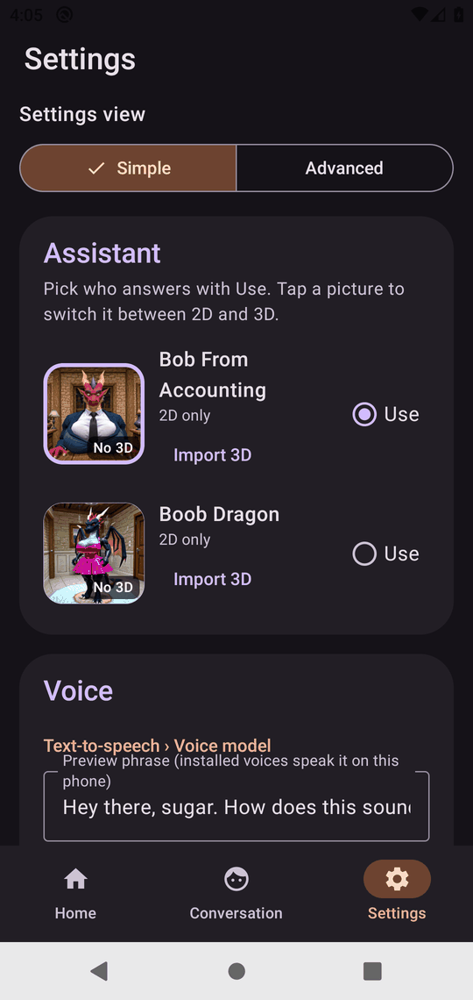
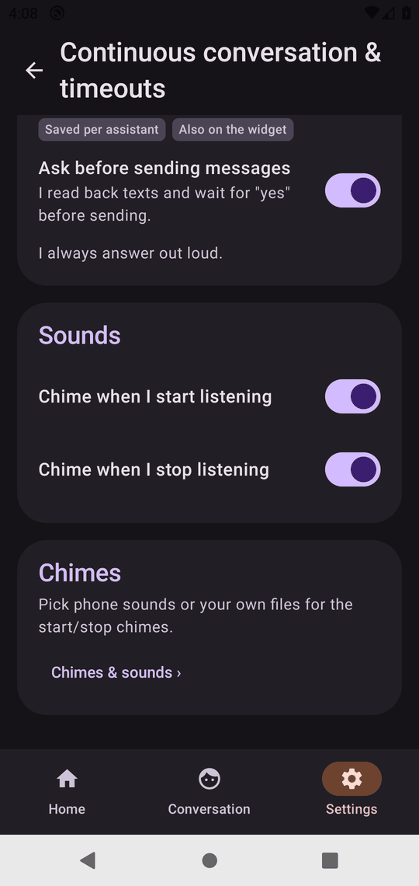

# Settings reference

> *Every setting, what it does, its default, and where it is stored.*

<!-- nav -->

<a href="features/privacy-permissions-storage.md">← Privacy, permissions and storage</a> &nbsp;·&nbsp; <a href="README.md">Docs home</a> &nbsp;·&nbsp; <a href="architecture.md">Architecture →</a>

<!-- /nav -->

 &nbsp;  Emulator renders · Simple view (left) and an Advanced page (right)

## How settings work

- **Each assistant has its own settings.** Name, voice, wake words, avatar, model and so on belong to the assistant you are editing; switch at the top of Settings. A few settings are shared by all assistants; they are listed under [App-wide](#app-wide).
- **Simple or Advanced.** *Simple* shows the handful you'll actually change. *Advanced* shows every page below.
- **Changes apply straight away.** The two exceptions are *Apply sensitivity* and the bubble *Apply* button.
- **Export / import an assistant** (Assistants page) copies all of that assistant's settings as a small JSON file. It does not include memory, pictures or model files.

Technical details

- **Storage:** each assistant is an Android `SharedPreferences` file named after its id, wrapped by `Prefs.kt`. Global keys live in `belle_global` (`ProfileStore`). Other files: `book_reader`, `belle_widgets`, `pixal3d_install`.
- **Live updates:** `Prefs` getters read `SharedPreferences` on every access, so most keys take effect on the next use. Wake-phrase and sensitivity changes call `AssistantRuntime.reloadWakeWords`. A new speech pack sends `ACTION_RELOAD` to `AssistantService`. Voice and model choices are read when those engines load, which happens at the next wake when *load on demand* is on (the default).
- **Export format:** `{"belle_profile":1,"settings":{…}}`. Import gives the assistant a new 8-character id.
- **Clamping:** setters clamp values, so a hand-edited export can't set out-of-range values. The *Range* column shows the slider range, and the stored range where it is wider.

## Contents

- [Name, personality & wake words](#name-personality--wake-words)
- [Continuous conversation & timeouts](#continuous-conversation--timeouts)
- [Sleep words](#sleep-words)
- [Text-to-speech (Voice)](#text-to-speech-voice)
- [2D avatar](#2d-avatar)
- [Bubble & widget](#bubble--widget)
- [3D avatar & photo → 3D](#3d-avatar--photo--3d)
- [Background](#background)
- [Widget name](#widget-name)
- [Chimes & sounds](#chimes--sounds)
- [Thinking model](#thinking-model)
- [Memory](#memory)
- [Internet & search](#internet--search)
- [News feeds](#news-feeds)
- [Permissions & background listening](#permissions--background-listening)
- [Appearance](#appearance)
- [App-wide](#app-wide)

## Name, personality & wake words

| Setting | Default | What it does |
|---|---|---|
| **Name** | Bob From Accounting | What the assistant is called; also used in default wake and sleep phrases. |
| **Wake words** | the name-based defaults | The phrases that wake this assistant. All are active at once. |
| **Wake words on** | on | Turn hands-free waking off; you can still tap *Talk now*. |
| **Sensitivity** | 0.5 | Higher wakes more easily but also by mistake. |
| **Personality / How you respond / How you address the user / Extra instructions** | built-in text | The character's system prompt, split into four editable parts. |
| **Listening switch (Home)** | on | Whether background listening should run, including after a restart. |

Technical details

| Key | Type | Range | Notes |
|---|---|---|---|
| `name` | String | free text | Used by `PersonaPrompt` and the widget name art. |
| `wake_phrases` | List | any number | Compiled to sherpa-onnx KWS keywords (`keywords.txt`); phrases with unknown tokens are listed as *Couldn't use*. |
| `wake_enabled` | Boolean | — | Off → no KWS stream; the service keeps running for taps/widget. |
| `sensitivity` | Float | 0.05–0.95 | threshold = 0.35 − 0.2·s, boost = 1 + s. Applied with *Apply sensitivity* (rebuilds the spotter). |
| `p_personality, p_style, p_address, p_extra` | String | — | `null` = default text; *Reset … to default* removes the key. Legacy key `personality` is read once for migration. |
| `service_wanted` | Boolean | — | Read by `BootReceiver` on `BOOT_COMPLETED` / `MY_PACKAGE_REPLACED`. |

## Continuous conversation & timeouts

| Setting | Default | What it does |
|---|---|---|
| **Unlimited listening** | timeout on | Once awake, never stop listening on its own. |
| **Wait for** | 8 | How long to wait for you to start talking before going back to the wake word. |
| **seconds / minutes** | s | Only how the timeout is shown. |
| **Continuous conversation** | on | Keep listening after every answer until a sleep word or *End*. |
| **Ask before sending messages** | on | Read a text back and wait for *yes* before sending it. |
| **Chime when I start listening** | on | Play a sound when it starts listening. |
| **Chime when I stop listening** | on | Play a sound when it stops. |

Technical details

| Key | Type | Range | Notes |
|---|---|---|---|
| `listen_timeout_on (inverted)` | Boolean | — | `unlimited = !listen_timeout_on || continuous` (`ListenPolicy`). |
| `listen_timeout` | Int seconds | 2–3600 | Measured as audio fed to the recognizer; +30 s once speech was heard. **Not used while Continuous conversation is on (the default).** |
| `listen_timeout_unit` | String | s, m | Display only. |
| `continuous` | Boolean | — | Counts as unlimited; watchdog restarts the recognizer after 10 min with no progress. |
| `confirm_sms` | Boolean | — | Brain pending-confirmation state. |
| `chime` | Boolean | — | Sound slot `start`/`follow`. |
| `stop_chime` | Boolean | — | Sound slot `stop`. |

## Sleep words

| Setting | Default | What it does |
|---|---|---|
| **Sleep words** | goodnight <name>, that's all, goodbye, stop listening, never mind … | Phrases that end the conversation right away. |
| **Confirm with** | voice | How it acknowledges going to sleep. |
| **Tap the avatar to end** | on | Tapping the bubble during a conversation ends it. |

Technical details

| Key | Type | Range | Notes |
|---|---|---|---|
| `sleep_phrases` | List | any number | Matched as equal, suffix, or prefix + ≤ 2 extra words. |
| `sleep_confirm` | String | voice, chime, both | — |
| `avatar_tap_ends` | Boolean | — | Long-press menu always has *End conversation*. |

## Text-to-speech (Voice)

| Setting | Default | What it does |
|---|---|---|
| **Voice** | vits-piper-en_US-ryan-medium-int8 | Which voice speaks. |
| **Speed** | 1.0 | Speaking speed. |
| **Volume** | 1.0 | Loudness of the voice and chimes, separate from the phone volume. |
| **Masculine ↔ Feminine** | 0 | Shifts the voice lower or higher, saved per voice. |
| **Expressiveness** | 0.667 | How lively the intonation is. |
| **Rhythm variation** | 0.8 | How much timing varies. |
| **Preview phrase** | "Hey there, sugar. How does this sound?" | What *▶ Preview* says. |
| **Speaker** | 0 | Who talks, for voices with several speakers (Kokoro: 11 named, LibriTTS: 904 numbered). *Speaker* card at the top of the page; saved per voice. |

Technical details

| Key | Type | Range | Notes |
|---|---|---|---|
| `voice` | String | installed voices | Directory name under `files/models/voices`. |
| `voice_speed` | Float | 0.6–1.6 | Piper `length_scale = 1/speed`. |
| `voice_volume` | Float | 0–1 | `AudioOut.volumeProvider`: gain before the 0.97 peak limiter; also used for chimes (`Sounds.play`). |
| `voice_shift_<voice>` | Float | −1…1 | `VoiceShift`: pitch ±4 semitones (WSOLA + resample) and formants ∓/±10 % (cepstral envelope), applied separately so it does not sound chipmunk-like. |
| `tts_noise` | Float | 0.1–1.0 (stored 0–1.2) | Piper/VITS `noise_scale`. |
| `tts_noise_w` | Float | 0.1–1.2 | VITS `noise_scale_w`. |
| `preview_phrase` | String | — | — |
| `voice_speaker_<voice>` | Int | Kokoro 0–10, LibriTTS 0–903 | Clamped by sherpa-onnx to the model's speaker count. Falls back to the older single `voice_speaker` for the voice in use. |

## 2D avatar

| Setting | Default | What it does |
|---|---|---|
| **Choose image** | "" (built-in) | Your own avatar picture (PNG/JPG/WebP/GIF). |
| **Talking mouth** | on | Mouth moves with speech. |
| **Body animation** | on | Breathing, sway and head motion. |
| **Animated GIF** | play | Play the GIF, or use its first frame fully rigged. |
| **Mouth & joints** | auto | Where the mouth and joints are. |
| **Framing** | same for all | Zoom and position of the picture per place. |

Technical details

| Key | Type | Range | Notes |
|---|---|---|---|
| `avatar_file` | String | file in filesDir | — |
| `avatar_mouth` | Boolean | — | Driven by TTS amplitude. |
| `avatar_animate` | Boolean | — | Skin2D 20×20 mesh warp. |
| `avatar_gif_mode` | String | play, still | — |
| `rig_<avatarKey>` | String (JSON) | — | Set by *Place mouth & joints* / *Auto-place again*. |
| `framing_same, framing_<avatar>_<surface|all>` | Boolean / String | home, bubble, widget | Set in the framing editor. |

## Bubble & widget

| Setting | Default | What it does |
|---|---|---|
| **Show avatar bubble** | on | Floating bubble over other apps. |
| **Show** | always | Always, or only while listening/thinking/speaking. |
| **Size** | 72 | Bubble size. |
| **Opacity** | 0.95 | Bubble transparency. |
| **Tuck away after** | 8 | Idle bubble slides half off the edge. |
| **Bubble position** | −1 (right edge), 400 | Where you dragged it. *Reset position* clears it. |
| **Glow around the screen edges** | on | Coloured light at the screen edge while active. |
| **Glow colour** | #4FC3F7 | Colour of that light. |

Technical details

| Key | Type | Range | Notes |
|---|---|---|---|
| `avatar_on` | Boolean | — | Needs *Display over other apps*. |
| `avatar_mode` | String | always, active | — |
| `avatar_size` | Int dp | 40–160 (stored ≤ 200) | — |
| `avatar_opacity` | Float | 0.2–1 | — |
| `avatar_autohide` | Int seconds | 0–120 (0 = never) | — |
| `avatar_x, avatar_y` | Int px | — | — |
| `edge_glow` | Boolean | — | — |
| `glow_color` | Int ARGB | palette | — |

## 3D avatar & photo → 3D

| Setting | Default | What it does |
|---|---|---|
| **Workflow & run settings (ComfyUI .json)** | phone defaults (official TRELLIS.2 workflow, fitted) | Import a ComfyUI workflow; its values are fitted to this phone (step counts, seed, crop, triangles). The table shows workflow value → value used → why. |
| **Your changes to the workflow values** | none | Per-value overrides with a reset each, and *Reset all my changes*. |
| **Show 3D on Home and the bubble** | on | Use the 3D model when this assistant has one. |
| **Rig** | skinned | Smooth bending, or N64-style rigid parts, for models without a skeleton. |
| **Motion** | 1 | How much the body stretches when it moves. |
| **Look (shader)** | none | Modern, PS1-style or N64-style look. One at a time. |
| **Intensity** | 0.8 | Strength of the retro effect. |
| **No depth buffer** | off | Retrostation: authentic PS1 polygon pop. |
| **Fog** | on | Retro64 distance fog. |
| **Automatic for this phone / Detail** | −1 (automatic) | Fewer triangles and pixels for speed. |
| **<Surface> own setting / detail** | −1 (same as global) | Different detail for Home, bubble or widget. |

Technical details

| Key | Type | Range | Notes |
|---|---|---|---|
| `files/workflow3d.json, workflow3d_source.txt` | File | — | `Workflow3DSettings.parse` → `Run3DPlan.plan(wf, overrides, Device)`; unknown nodes are listed, not guessed. |
| `files/workflow3d_overrides.json` | JSON | steps, cfg, scheduler, random seed, seed, crop, triangles, background | `Workflow3DOverrides`; *your value* wins over the fitted value, clamped to safe ranges. |
| `show3d` | Boolean | — | — |
| `rig_style3d` | String | skinned, rigid | AutoRig3D v6. |
| `anim_strength` | Float | Full 1, Balanced 0.5, No stretching 0 | — |
| `shader3d` | String | none, retrostation, retro64 | — |
| `shader3d_intensity` | Float | 0–1 | — |
| `psx_no_depth` | Boolean | — | Painter's-order CPU sort. |
| `n64_fog` | Boolean | — | — |
| `detail3d` | Float | 0–1 | Detail3D tiers by RAM/cores. |
| `detail3d_home, detail3d_bubble, detail3d_widget` | Float | 0–1 | — |

## Background

| Setting | Default | What it does |
|---|---|---|
| **Background** | own | The picture's own background, or one you choose. |
| **Background file** | "" | Still image, GIF/animated WebP/AVIF, or a video clip. |
| **Background sound** | off | Play a video background's sound. |
| **Background volume** | 0.5 | Its loudness. |

Technical details

| Key | Type | Range | Notes |
|---|---|---|---|
| `bg_mode` | String | own, custom | — |
| `bg_file` | String | files/backgrounds | Video: 12 s window, ≤ 96 frames at ≤ 320 px. |
| `bg_sound` | Boolean | — | — |
| `bg_volume` | Float | 0–1 | — |

## Widget name

| Setting | Default | What it does |
|---|---|---|
| **Name style** | plain | How the name is drawn on the widget. |
| **Name font** | sans | Font of the name; you can import .ttf/.otf. |

Technical details

| Key | Type | Range | Notes |
|---|---|---|---|
| `name_style` | String | plain, gold, silver, rgb | Per assistant. |
| `name_font` | String | sans, serif, mono, casual, cursive, condensed, black, file: | — |

## Chimes & sounds

| Setting | Default | What it does |
|---|---|---|
| **Start / Follow-up / Stop / Sleep sound** | "" (built-in) | Replace a chime with a phone sound or your own file. |

Technical details

| Key | Type | Range | Notes |
|---|---|---|---|
| `sound_start, sound_follow, sound_stop, sound_sleep` | String | "", ring:<uri>, file:<name> | Clips over 8 s are cut. |

## Thinking model

| Setting | Default | What it does |
|---|---|---|
| **Model for this assistant** | "" (none) | Which brain this assistant uses. |
| **Load assistant on demand** | on | Load the big parts only when woken, to save memory and battery. |
| **Unload after idle** | 60 | How soon to free memory after a conversation. |
| **Processor threads** | 0 (auto) | CPU cores used for thinking. |

Technical details

| Key | Type | Range | Notes |
|---|---|---|---|
| `llm_file` | String | installed .gguf | Empty → rule commands only. |
| `on_demand` | Boolean | — | — |
| `unload_after` | Int seconds | 10–600 (stored ≤ 3600) | — |
| `llm_threads` | Int | 0–8 | Auto: 4 if ≥ 8 cores, 2 if ≥ 4, else 1. |

## Memory

| Setting | Default | What it does |
|---|---|---|
| **Remember our conversations** | on | Long-term memory for this assistant, kept on the phone only. |

Technical details

| Key | Type | Range | Notes |
|---|---|---|---|
| `memory_on` | Boolean | — | See [Memory](features/memory.md). |

## Internet & search

| Setting | Default | What it does |
|---|---|---|
| **Allow internet access** | **off** | Lets it look things up on the web. |
| **Mode** | headless | Read results invisibly, or also open them in your browser. |
| **Also read the browser tab** | off | Frontend mode: read the open tab with Accessibility. |
| **Search providers order** | Brave, DuckDuckGo, SearXNG, Wikipedia | Which search engine is tried first. |
| **Provider switched off** | none | Skip a provider. |
| **SearXNG address** | "" | Your own SearXNG server. |
| **Pages to read per question** | 3 | How many result pages are read before answering. |

Technical details

| Key | Type | Range | Notes |
|---|---|---|---|
| `internet` | Boolean | — | `Net` refuses every call while off. |
| `browsing_mode` | String | headless, frontend | — |
| `frontend_a11y` | Boolean | — | — |
| `search_order` | List | drag order | — |
| `search_disabled` | Set | — | — |
| `searx_url` | String | URL | http allowed for local addresses. |
| `pages_to_read` | Int | 1–5 | — |

## News feeds

| Setting | Default | What it does |
|---|---|---|
| **Feeds** | BBC World, NPR, PBS NewsHour, Guardian World, Al Jazeera | Where *what's the news* reads from. |

Technical details

| Key | Type | Range | Notes |
|---|---|---|---|
| `news_feeds` | List "Name|url" | any RSS/Atom | — |

## Permissions & background listening

| Setting | Default | What it does |
|---|---|---|
| **Keep the processor awake while listening** | on | Keeps the wake word working with the screen off. |

Technical details

| Key | Type | Range | Notes |
|---|---|---|---|
| `keep_cpu_awake` | Boolean | — | Partial wake lock. |

## Appearance

| Setting | Default | What it does |
|---|---|---|
| **Theme** | dark | App colours. |
| **Wallpaper colours** | off | Android 12+: colours from your wallpaper. |
| **Large text** | off | Bigger text in the app. |
| **Widget hint** | off | Hides the *Add widget* hint after *Got it*. |

Technical details

| Key | Type | Range | Notes |
|---|---|---|---|
| `theme` | String | system, light, dark | — |
| `wallpaper_colors` | Boolean | — | — |
| `large_text` | Boolean | — | — |
| `widget_hint_done` | Boolean | — | — |

## App-wide

These are shared by every assistant.

| Setting | Default | What it does |
|---|---|---|
| **Settings view** | Simple | Simple shows a short page of the most-used settings; Advanced shows every page. |
| **Assistant list** | default | All assistants (profiles). |
| **Active assistant** | default | The one Home and the widget show. |
| **Wake priority** | list order | Which assistant answers when phrases overlap. |
| **Let each assistant answer its own wake words** | off | All assistants listen at once. |
| **Last model** | "" | Suggested for new assistants. |
| **Book speed** | 1.0 | Reading speed 0.6–2.0 (± 0.15 per *faster/slower*). |
| **Last book** | none | Resumes *continue the book*. |
| **Widget look** | 2d | 2D or 3D per widget, toggled on the widget. |
| **Widget moving picture** | on | Avatar › Home-screen widget › *Moving picture*. Off = a still picture, also while talking (saves battery). |
| **Reminders to come** | empty | Reminders (and the app's own alarm/timer fallback) not yet fired; re-armed after a restart, an update or a force stop. |
| **Avatar Studio progress** | not started | Which assistant, picture and 2D/3D you chose and how far you got; the Studio reopens there. |
| **Photo → 3D job** | none | An unfinished photo → 3D run (settings with fixed seeds, the photo, and stage checkpoints). It continues after a kill or restart; up to 3 tries. |
| **3D speed on this phone** | first guess: the plan's desktop times × 10 | Measured seconds per step and per stage on this phone, saved after every timed step (so an interrupted build counts too); used for the time-left countdown. Ignored if restored on another phone. |
| **Asked about battery limits** | off | Set after the one-time *run without battery limits* request before the first 3D build, so it is never asked again. |
| **3D build history** | empty | The last 30 photo → 3D runs (who for, start/end, stage, result or error, duration, peak memory) and their redacted event lines; shown in the 3D build log and in *Export log*. |
| **Last generated model** | none | The newest photo → 3D result and which assistant got it (hash + profile). A model with no matching marker is offered under *Attach last generated model to…*. |
| **Download speed** | none | Last smoothed download speed, so a resumed queue starts with a sensible time left. |
| **3D licence accepted** | off | DINOv3 licence accepted. |
| **Unfinished downloads** | none | Downloads you started that resume after an app kill or restart. |

Technical details

| File › key | Type |
|---|---|
| `belle_global › simple_settings` | Boolean |
| `belle_global › ids` | String |
| `belle_global › active` | String |
| `belle_global › priority` | String |
| `belle_global › multi_wake` | Boolean |
| `belle_global › last_llm` | String |
| `book_reader › speed` | Float |
| `book_reader › last` | String |
| `belle_widgets › mode_<widgetId>` | String |
| `belle_widgets › animate` | Boolean |
| `files/reminders.json` | JSON list |
| `files/avatar_studio/studio.{0,1}.ck, picture.png` | Checkpoint (sealed JSON) |
| `files/pixal3d_job/job.json + ck/` | Sealed JSON + checkpoints |
| `files/pixal3d_times.json` | JSON |
| `belle_global › battery_prompted` | Boolean |
| `files/pixal3d_history.{0,1}.ck + pixal3d_history_events.log` | Sealed JSON + text |
| `files/models/3d/last_generated.glb + last_generated.attached` | glTF + JSON |
| `downloads_eta › bytes_per_sec` | Float |
| `pixal3d_install › accepted_<licence>` | Boolean |
| `downloads_wanted › ids; files/models/3d/.install_wanted` | Set / marker |

## Settings that don't do anything

None, as of 0.1.3. Earlier versions had three: `mem_budget_mb` (stored but never read) was **removed**; the speaker (`voice_speaker`) and the widget's `animate` flag now have controls (*Speaker* card, *Moving picture*).

<!-- nav -->

<a href="features/privacy-permissions-storage.md">← Privacy, permissions and storage</a> &nbsp;·&nbsp; <a href="README.md">Docs home</a> &nbsp;·&nbsp; <a href="architecture.md">Architecture →</a>

<!-- /nav -->
