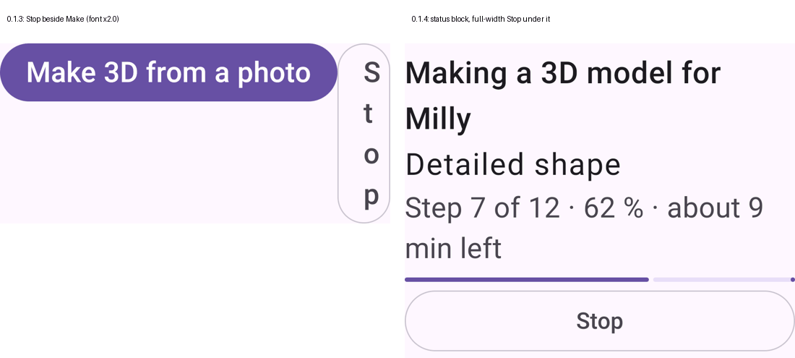

# Troubleshooting

> *Common problems and what to do, starting with the quickest fix.*

<!-- nav -->

<a href="status.md">← Verification status</a> &nbsp;·&nbsp; <a href="README.md">Docs home</a> &nbsp;·&nbsp; <a href="glossary.md">Glossary →</a>

<!-- /nav -->

| Area | Problem |
|---|---|
| Listening | [It doesn't hear its wake word](#it-doesnt-hear-its-wake-word) |
| Listening | [It wakes up when nobody said the wake word](#it-wakes-up-when-nobody-said-the-wake-word) |
| Listening | [A notification says *Tap to start listening* / the mic was paused](#a-notification-says-tap-to-start-listening--the-mic-was-paused) |
| Listening | [After restarting the phone it isn't listening](#after-restarting-the-phone-it-isnt-listening) |
| Listening | [It stops listening too soon, or never stops](#it-stops-listening-too-soon-or-never-stops) |
| Understanding | [It only does simple commands, or says it needs a model](#it-only-does-simple-commands-or-says-it-needs-a-model) |
| Understanding | [The first reply after waking takes a while](#the-first-reply-after-waking-takes-a-while) |
| Understanding | [It cut off or ignored a long sentence](#it-cut-off-or-ignored-a-long-sentence) |
| Actions | [It can't open apps or call while the screen is off](#it-cant-open-apps-or-call-while-the-screen-is-off) |
| Actions | [*Restricted setting* when turning on Accessibility](#restricted-setting-when-turning-on-accessibility) |
| Actions | [A reminder came late after I restarted the phone](#a-reminder-came-late-after-i-restarted-the-phone) |
| Web | [It says the internet is off](#it-says-the-internet-is-off) |
| Downloads | [A download failed or keeps failing](#a-download-failed-or-keeps-failing) |
| Voice | [The voice sounds robotic or too flat](#the-voice-sounds-robotic-or-too-flat) |
| Books | [Reading stops when the screen turns off](#reading-stops-when-the-screen-turns-off) |
| Avatar | [The floating bubble doesn't appear](#the-floating-bubble-doesnt-appear) |
| Avatar | [The 3D avatar is slow, or the phone gets warm](#the-3d-avatar-is-slow-or-the-phone-gets-warm) |
| Photo → 3D | [Making a 3D model fails or stops](#making-a-3d-model-fails-or-stops) |
| Memory | [It remembers something wrong](#it-remembers-something-wrong) |

## It doesn't hear its wake word

- Check Home says *Waiting for…* / *Ready*, not *Off*.
- Settings › *Name, personality & wake words*: raise **Sensitivity** a little and press **Apply sensitivity**.
- If a phrase shows under *Couldn't use*, spell it the way it sounds ("bel" instead of "Belle").
- Allow *Run in the background (battery unrestricted)* on the Permissions page, and leave *Keep the processor awake while listening* on.

Technical details

The spotter fires when the KWS score passes `0.35 − 0.2·sensitivity`. The *Listening status* panel (wake-word page and Simple settings) shows the live mic level and what the spotter last heard; use it to tell a quiet mic from a strict threshold.

## It wakes up when nobody said the wake word

- Lower **Sensitivity**.
- Use a longer, more unusual phrase (three syllables or more). Remove short ones like "hey".

Technical details

Short keyword token sequences have more false paths. Boost = 1 + s also rises with sensitivity.

## A notification says *Tap to start listening* / the mic was paused

- Another app (calls, video chat, a recorder) is using the microphone, or Android blocked background mic access. Tap the notification, or open the app.

Technical details

After **4 s of all-zero audio** the service sets `micSilenced`, posts the tap-to-start notification, and retries a fresh `AudioRecord` every **30 s**. When real audio returns, it clears the flag itself.

## After restarting the phone it isn't listening

- Open the app or tap its notification once. Android 11 and later don't let a microphone service start by itself at boot.

Technical details

`BootReceiver` starts the service on `BOOT_COMPLETED` when `service_wanted` is on. Android 11–13 give a boot-started mic service only silence, and 14+ refuse it, so the service posts *Tap to resume listening* instead.

## It stops listening too soon, or never stops

- *Continuous conversation* (on by default) keeps listening until a sleep word or **End**.
- Turn it off to use the **Wait for** timeout (default 8 s).

Technical details

See `ListenPolicy`: `unlimited = !listen_timeout_on || continuous`.

## It only does simple commands, or says it needs a model

- Install a **thinking model** (Downloads › Thinking model). Without one, only built-in commands work: timers, alarms, calls, the flashlight and similar.

Technical details

With no `llm_file` set, `Brain.handle` stops after `RuleParser` (~70 patterns).

## The first reply after waking takes a while

- That is the model loading. Use a smaller model, or turn off *Load assistant on demand* (uses more memory and battery).

Technical details

With `on_demand` on, speech recognition loads first, then the voice and model in parallel. The KV-cache warm-up runs while you speak.

## It cut off or ignored a long sentence

- Pause briefly between long sentences. Very long requests are split automatically.

Technical details

Moonshine returns empty text for audio over ~9.3 s, so speech is decoded in ≤ 8 s pieces cut at the quietest point. If speech produced no text, you hear *didn't catch that*.

## It can't open apps or call while the screen is off

- Allow **Display over other apps**: Android only lets apps start other apps from the background with it.

Technical details

Without `SYSTEM_ALERT_WINDOW`, background activity starts are blocked; the action falls back to a notification you tap.

## *Restricted setting* when turning on Accessibility

- Android 13+: App info › ⋮ › **Allow restricted settings**, then turn it on again. The Simple settings page has a button for this.

Technical details

A sideloaded APK's Accessibility service is restricted until the user allows it in App info.

## A reminder came late after I restarted the phone

- Reminders are kept through a restart. One that came due while the phone was off goes off as soon as the phone has started, and says the time it was for.
- If it didn't go off at all: check *Permissions › Exact reminders* (Android 12+). Without it Android may deliver reminders a few minutes late.
- Reminders more than 7 days overdue are dropped.

Technical details

Reminders are saved in `files/reminders.json` and re-armed by `BootReceiver` and on every app start (`Reminders.rescheduleAll`). Overdue ones fire 5 s apart, marked late when over a minute overdue.

## It says the internet is off

- Settings › *Internet & search* › **Allow internet access** (off by default).

Technical details

`Net` throws `NetDisabledException` while `internet` is false.

## A download failed or keeps failing

- Dropped connections are retried automatically a few times. If it still shows *failed*, check free space and the connection, then tap **Retry**. Partial files resume.
- After a phone restart on Android 15+, tap the *Tap to finish your downloads* notification, or just open the app.
- A *checksum* error means the server sent a different file. It is deleted rather than used; try again later.

Technical details

`Fetcher`: HTTPS with an allow-listed host, `Range` resume of `.part`, then a size + SHA-256 check before the rename. Automatic retries: 4 for one-tap downloads and 5 per 3D file, with back-off capped at 60 s. Unfinished downloads you started are remembered (`downloads_wanted`, `.install_wanted`) and resumed on app start, on a sticky service restart, or at boot.

## The voice sounds robotic or too flat

- Try a **High-quality** voice (★ marks the best fit for your phone), or raise **Expressiveness**.

Technical details

int8 voices round the weights; *full precision* / HQ are larger. `tts_noise` controls VITS noise_scale.

## Reading stops when the screen turns off

- Allow battery unrestricted. Some phone brands also need the app locked in *recent apps*.

Technical details

`BookPlaybackService` is a `mediaPlayback` foreground service with a partial wake lock, but OEM task killers can still stop it.

## The floating bubble doesn't appear

- Turn on **Show avatar bubble** and allow *Display over other apps*.
- With *Show: only while active*, it appears only during a conversation.

Technical details

`avatar_on`, `avatar_mode`; overlay window type `TYPE_APPLICATION_OVERLAY`.

## The 3D avatar is slow, or the phone gets warm

- Lower **Detail** on the 3D avatar page, or set it per place (widget, bubble, Home).

Technical details

Detail scales triangles, texture mip bias, render scale and frame rate together (see [3D avatar](features/avatar-3d.md)).

## Making a 3D model fails or stops

- It keeps running with the screen off and in the background; a notification shows the progress and the time left.
- **The phone died or restarted in the middle?** Open the app (or wait for the phone to start): it continues from the last finished step on its own. *Avatar Studio* and the 3D page show **Continue building** if it is waiting.
- After **3 failed tries** it stops and shows what went wrong. Pick the picture again to start fresh.
- **"Ran out of memory at Building the surface"** (0.1.3): update the app, open the 3D page and press **Resume**. The update resets the tries and the build continues from its saved checkpoint, without redoing the shape steps. Out-of-memory failures are not retried automatically, because the same version would fail the same way.
- Make sure the phone has 8 GB+ RAM. The app asks once to run without battery limits. If you said no, allow it under *Android Settings › Apps › Milky Moo's Assistant › Battery › Unrestricted*.
- The **3D build log** on the 3D page shows each run, how far it got and why it stopped. **Export log: share…** shares it.
- If it ran out of space during install, free space and tap **Retry all**.

Technical details

`Pixal3DService` (foreground, `specialUse`, partial wake lock) runs `Pixal3DJob`. Checkpoints are in `files/pixal3d_job/ck/` (two checksummed slots per stage; a damaged one is skipped). Resume is triggered by `MainActivity.onResume` and `BootReceiver`; `MAX_ATTEMPTS = 3`; an update resets them (`BuildJobRules.afterUpdate`) and an OOM on the same version blocks automatic retries (`BuildJobRules.blocked`). Large buffers after the shape stage are native (`threed/Big.kt`), so the 512 MB Java heap limit isn't reached; `scripts/heap_gate.sh` checks this on every release. Peak memory was 3.27 GB RSS on a desktop.

## My assistant has no 3D model after a build, or the widget shows another assistant

This is what happened on 0.1.0: a build made for *Milly* wasn't attached to her, and the widget kept showing *Bob's* 3D model.

- Since 0.1.3 the widget **always shows the active assistant**, in 2D if they have no 3D model. Update the app and the widget corrects itself.
- Open *Settings › 3D avatar* (or Avatar Studio). If you see **Attach last generated model to…**, pick the assistant and press **Attach**. That's the finished model from the lost build; it doesn't need to be made again.
- **Unfinished build** with **Resume** means the build was cut off. Resume continues from where it stopped.
- New builds ask **Build it for** first and remember the answer, so the model always lands on that assistant.

Technical details

0.1.0 wrote `models/3d/last_generated.glb` before importing it and kept no record of where it went. 0.1.3 writes `last_generated.attached` (hash and profile) after a successful import, so a model without a matching marker counts as an orphan. The widget bug came from the idle loop reading the *current* profile instead of the widget's profile, and from reusing the last loop for any profile. See [Widget](features/widget.md#every-button).

## Sending a log when something went wrong

- *Settings › 3D avatar › 3D build log › Export log: share…* (or *Settings › Privacy › Diagnostics*) shares a zip. **Save…** saves it wherever you choose.
- It holds the build history and technical events, not your conversations or photos. See [what the export contains](features/photo-to-3d.md#build-log-and-history).

## Buttons or text look squeezed with large text

- Since 0.1.4, every button label stays on **one line**. Button labels grow with your font size up to 1.5× (body text keeps growing); if a label still doesn't fit, it ends in "…". Explanations that used to sit inside long labels are now a line of help text under the button. Buttons that don't fit side by side move to the next line. A running job's **Stop** or **Cancel** is full width **under** its progress bar.
- With *Font size* or *Display size* turned up in Android settings, step cards put their status under the title and use the full width, text fields put their button underneath, and side-by-side choices (like the bubble size) become a list of round radio buttons.

 Compose UI test render (ProgressLayoutTest, 360 dp wide, font size × 2.0): 0.1.3 on the left, 0.1.4 on the right

Technical details

`BtnText` (one line, font capped at `MAX_LABEL_SCALE` = 1.5× the normal size, then ellipsis; no auto-size passes, which cost layout time on slow phones), `FieldRow`, `ChoiceRow` (radio list above font scale 1.15), `ButtonRow` (a `FlowRow`) and `ProgressBlock` in `ui/ProgressUi.kt`. Checked by `ProgressLayoutTest` (Compose, on a device) at 280/360/411 dp and font scales 1.0/1.3/2.0. It also includes a control test that reproduces the old one-letter-per-line *Stop*.

## The time left jumps around

- Before your phone has timed a step, the first estimate is a deliberately long guess. After one or two steps it uses this build's real step times. It only counts down, and goes up only if the build is clearly slower than shown (more than 15 % and 3 min), never by a minute or two.
- Long estimates are rounded to 5 or 10 minutes, so *"about 1 h 55 min"* can stay the same for a few minutes.
- Your phone's speed is saved after every step, so the next build's first estimate is already close.

Technical details

Live per-step times weighted 0.75 / 0.9 / 0.95 after 1 / 2 / 3+ steps, later stages scaled by the measured speed factor, a 10 % margin, and a countdown display that re-anchors only on big changes (`Pixal3DEta`, replayed against a real WP100 trace in `EtaTest`). Saved per device in `files/pixal3d_times.json` after every step. Downloads use the smoothed speed over all files (`downloads_eta`). See [Photo → 3D](features/photo-to-3d.md#how-it-works-for-you).

## Avatar Studio opened at a later step

- That's on purpose: it reopens **where you left off**. Each step says *done*, *next* or *waiting* and why. To start over, finish or press **Make another**, or pick a different assistant in step 1.

Technical details

State in `files/avatar_studio/studio.{0,1}.ck` (sealed JSON, two slots). Steps are recomputed from what is on the phone (`StudioFlow.steps`), so a deleted picture or assistant reopens its step instead of showing it as done.

## It remembers something wrong

- Settings › *Memory* › delete that entry, or **Clear memory**. You can also say *"forget that …"* for standing instructions.

Technical details

Each entry is a separate row (a chat line, a fact or a summary), and deleting it removes just that row. *Clear memory* wipes this assistant's whole encrypted database, and *Clear all assistants* wipes all of them.

## Still stuck?

The **Listening status** panel (on the wake-word page and in Simple settings) shows what the assistant hears and why it is or isn't listening. A developer can also read the diagnostic log with `adb logcat -s BelleEvent`.

<!-- nav -->

<a href="status.md">← Verification status</a> &nbsp;·&nbsp; <a href="README.md">Docs home</a> &nbsp;·&nbsp; <a href="glossary.md">Glossary →</a>

<!-- /nav -->
